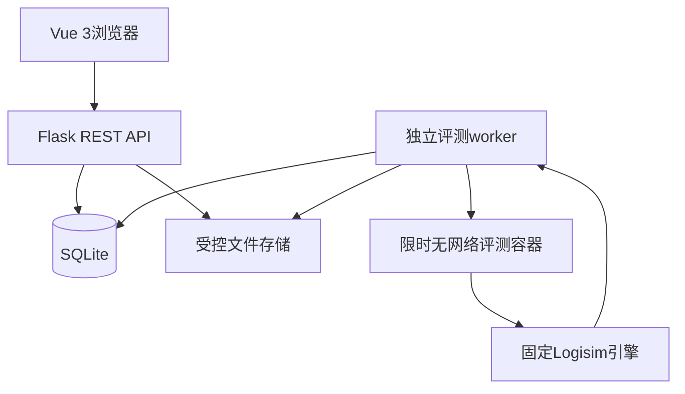

# 中央处理器课程学习系统架构决策记录

版本0.6。需求设计已完成团队评审。以下为设计决策，非已落地事实。课程指定项作为约束；团队选择项经本次设计确定，技术可行性验证在编码前完成。

## ADR-001 采用指定技术栈和模块化单体

采用Vue 3前端、Flask REST API、SQLite数据库，业务按模块划分，前端统一课程和角色导航。Flask处理身份、教学、接线记录和评测提交，独立worker执行耗时电路仿真。理由是遵守任务书且四人可维护，避免把每个课程模块拆为微服务。

数据流为浏览器→同源API→SQLite/文件存储；worker→SQLite领取任务→隔离引擎→结果写回；浏览器轮询状态。演示同步采用1秒轮询，评测采用2秒轮询，终态停止；本期不引入WebSocket、Redis、Celery。代价是初始评测并发1，明确有队列上限和超时；实测超出课程规模再评审扩容，不能在API线程直接执行无限时仿真。

## ADR-002 SQLite作为唯一业务数据库

开发和部署统一SQLite，短事务+唯一约束处理并发签到、幂等和任务领取。运行时数据库不进Git，迁移和匿名演示数据可进Git。资源、电路、图片存文件系统，库内保留键和哈希。理由为任务书硬性要求和易迁移；代价是写并发受限，需要单worker、有限忙等待和备份恢复演练。未采用MySQL/PostgreSQL，也不以缓存充当第二套成绩数据库。

## ADR-003 采用CPU-EDU-8虚拟教学实验箱

实验箱采用自定义数字教学面板，精确模型见PRD第5节。Vue负责端子交互与信号可视化，电气连接使用端子ID和显式网表，坐标仅影响显示。基础元件逻辑按有限的数字语义实现；最终提交由服务端校验结构、过程和实验规则。

未提供实体实验箱型号，故不宣称复刻某品牌板卡。本期保证“可接线、可断线、可运行、可观察、可保存”的实验过程；不做模拟电压或硬件远控。选择8位CPU足以讲清累加器、程序计数器、指令寄存器、ALU和控制步骤，又可以列出完整验收样例。

连线状态JSON与Logisim .circ为两种独立产物。本期不开发任意格式互转，避免丢失位宽/时序语义；界面明确各自提交用途。CPU教学实验集合覆盖两种提交，各版本仅启用PRD列出的模式，教师报告展示关联实验版本。

## ADR-004 GitHub开发与Gitea课堂归档

用户已明确：日常开发使用GitHub，上课提交到Gitea。GitHub是唯一开发合并来源，执行PR、评审、分支保护和Actions。Gitea保存课程所需完整Git历史、六份文档、分工、测试、检查报告及阶段tag，不在两平台独立开发同名main。

课堂归档将GitHub已通过检查的提交原样传输到Gitea专用归档分支和不可变checkpoint tag，并核对对象SHA相同；不在Gitea重新squash或重新合并生成不同提交。Gitea的main保持禁止人为直推，不为归档而临时关闭GitHub/Gitea主分支保护。默认归档分支名为submission/checkpoint-N，教师从该分支/tag查看。若教师要求特定默认分支，先调整提交展示方式并记录，不偷偷形成第二条开发主线。

Gitea检查报告保存GitHub PR链接、base/head/tested SHA、最终merge SHA、CI报告、实际评审记录及阶段提交映射，确保不用只看GitHub也能审查贡献。GitHub PR评论不是Git对象，不会随push自动复制，必须专门整理到检查报告。任务书要求Gitea托管和PR评审，并未明确PR必须在Gitea平台内；按用户确认采用GitHub评审，证据随Gitea归档，若课堂另有要求再登记调整。取消GitHub强制批准人数不代表课程要求的实际评审已完成。

## ADR-005 采用精简Git Flow及强制CI

保留main/develop/feature/release/hotfix。main只接release/hotfix的PR；develop接feature及发布修复回灌。选择merge commit保留个人原始提交与合并节点。组员教程的直接push共享分支示例不采用；共享主线通过PR合入。

Actions对main PR运行测试、构建、lint及真实评测冒烟，配合required checks和必经PR真正阻断失败合并；仅写工作流不足以保护main。develop同样执行基础门禁以降低发布集中失败风险。文档阶段不谎称空仓库构建通过，软件发布前必须执行真实完整门禁。完整规则见README附录A。

## ADR-006 固定Logisim-evolution并调用真实引擎

选用官方Logisim-evolution 5.0.0发布版，采用Java21基线并锁定具体补丁版本/JAR哈希；不在运行时下载“最新版”。采用官方测试向量/命令行能力，平台适配固定版本的输出及退出状态。官方[发布记录](https://github.com/logisim-evolution/logisim-evolution/releases)可确认版本存在，[测试向量文档](https://github.com/logisim-evolution/logisim-evolution/blob/main/docs/test_vector.md)说明自动执行机制；主分支文档不能替代安装版本的验证。

技术验证必须覆盖：ALU组合电路、REG时序、CPU连续序列、项目内子电路、加载失败、零测试、超时和缺少图形环境。某些模式可能仍依赖虚拟显示，Linux worker是否需要Xvfb在验证中确定并写入环境清单。不能简单假设“命令行即纯headless”。如固定版本时序能力不满足，先变更ADR与适配方案，不删除时序验收。

平台不自写一个不完整的.circ解释器冒充Logisim。结果同时检查执行数量、有效输出及错误类别；单凭进程退出0不能判对。题目测试台控制输入和时钟，学生只提供符合端口契约的电路。严格白名单和隔离同时使用，任何一项不能替代另一项。

## ADR-007 隔离执行与失败语义

Web进程和评测worker分离，worker在无网络、非root、限时/限内存/限进程数的沙箱执行用户电路。Web整体Docker部署可选，Linux评测容器为本项目选定隔离方式。worker不能把数据库、主机密钥或全部上传目录挂入容器，只挂当前电路和受控测试输入，输出限定大小。

客户端错误分4xx预检拒绝和评测终态invalid_circuit；引擎/基础设施故障为system_error且不计学生分数。系统错误允许有限重试并保留旧run。隐藏测试属于受控数据，即便公开仓库也不可写入公开CI日志或产物；CI只用合成公开测试集，生产测试在受限环境管理。

## ADR-008 轻量算法与可解释统计

统计使用Pandas/NumPy；问答采用scikit-learn TF-IDF检索，问答字符切分/别名/阈值及推荐薄弱度公式均固定于PRD§4.3，推荐按薄弱知识点加权，组卷使用配额约束与固定随机种子，预警使用KMeans聚类及可审计阈值，图谱计算先修关系，识别使用OpenCV模板匹配。均有真实输入、输出、版本及验证样本，不只画图。

不引入大型深度学习框架。暂不接大模型API，避免配额和网络影响课堂验收。阈值初始设掌握度低于60%且至少5次作答、近两次考勤缺勤或迟到触发预警；教师可查看原因，不自动惩罚。识别适用范围公开说明，低置信度必须人工确认；识别阈值和固定样例见PRD§4.5。

## ADR-009 版本化与不可变成绩证据

题目、实验定义、测试集、引擎分别记录版本；提交固定文件SHA和版本引用。重评新增run，教师必须填写原因，不更新旧run的分数。这样规则变更不使历史报告无法解释。发布备份必须同时包含数据库和其引用文件，回退代码与恢复数据分别处理，见CHG-RB。

## ADR-010 可运行性和文档阶段的界限

当前只有文档，无法给出实测部署命令和通过率。README规定运行入口、配置和验收要求，实现阶段补全真实命令并复现。CP-1生成文档基线tag；只有集成测试、实际构建、lint和发布冒烟均通过才生成软件版本tag。main“稳定可发布”是由门禁执行的工程目标，不是零缺陷的数学保证。

## ADR-011 单一事实来源与低耦合边界

沿用模块化单体，不引入微服务、消息总线或只有一个实现的接口工厂。模块通过普通应用函数和稳定ID协作，不在Flask内HTTP调用自身API。

| 数据所有者 | 唯一写入责任 | 允许的依赖 |
|---|---|---|
| 身份/课程 | 用户、成员与授权 | 其他模块调用同一权限检查，不各自以teacher_id授权 |
| 资源/备课/知识 | 各自内容及版本 | 备课引用固定版本；文件存储不决定业务权限 |
| 题目/试卷 | paper、attempt、判分 | quiz为paper视图，复用发布/提交/评分，不另存答卷或状态 |
| 实验定义 | panel、CPU语义、端口及版本 | 连线与评测仅引用experiment_version，不互改成绩 |
| 连线 | actions、重放状态、功能结果 | 演示复用相同数字逻辑规则；不调用Logisim，不要求格式互转 |
| 电路评测 | profile、suite、run、case_result | worker执行固化任务，不在运行时查最新版或持锁运行Java |
| 分析/智能 | 只读投影、算法快照、预警 | 读事实表与冻结名单，不回写成绩；推荐失败不阻断提交 |
| 存储/通知 | 文件键、业务通知 | 所属模块先判权；通知与业务事件同事务，不加消息队列 |

依赖方向为身份课程/文件基础→教学及实验事实→分析智能。统计不参与提交事务，预警不参与评分。前端与Python重放共用schema及验收向量，分别验证结果一致，不要求跨语言共享一份实现。

2026-10-20知识图文增量仍待复核/实施：005仅维护固定资源版本关系和知识上下文授权，003负责图片上传/文件/内容事件服务；二者用同一调用方短事务组合，不在Flask内HTTP调用自身，不复制事件表或下载业务。HTML白名单保持，图片只经结构化引用和当前双重授权的同源内容入口，见[APIC§3.2](APIC.md#32-spec-005图文增量提案2026-10-20待复核实施)、[DBD§3.1](DBD.md#31-知识图片关系增量提案2026-10-20待复核实施)及[依赖/真实探针](SPEC-005_IMAGE_CONTRACT.md)。

低耦合验收：关闭智能计算仍可签到、做题、保存连线及提交电路；停worker时历史报告可读，新电路提交明确503；新统计维度不修改原始评分字段；发布新实验不改旧记录。鉴权或数据库故障不得绕过。

## ADR-012 固定执行身份与统计口径

judge_profile唯一保存引擎、端口、白名单和限额；suite只保存测试及固定评分模板。circuit草稿先创建后配置，judge_profile_id由本版本配置关联派生，草稿允许null，发布时才强制完整配置及已验证测试集；不接受客户端跨版本绑定。验证绑定完整哈希集合，实验发布后profile冻结；切换suite只更新experiment_grading绑定，受理时run立即固定身份。更换引擎/端口创建新实验版本。

教学统计按冻结名单和effective_run复算，最新活动run单独展示。六种统计查询保存不可变analysis_run，页面和CSV以analysis_run_id读取同一结果，后续事实更正只影响新查询；读取/导出重新检查当前课程授权与创建者。终态判定以PRD第7.1节为准；已确认timeout/resource_limit不因缺少结果改成system_error。分析不另设可写成绩总表。

Java21基线依据[Logisim-evolution v5.0.0 README](https://raw.githubusercontent.com/logisim-evolution/logisim-evolution/v5.0.0/README.md)，具体补丁/JAR哈希及真实时序执行仍须实测；验证失败先修订方案，不能删去必做验收。

## ADR-013 本轮契约收口（v0.3）

保密资格不是版本号或当前可见性的同义词，题目公开历史不可撤销，解析保护持续到review_at实际开放（null时持续保护），不随测验截止解除；系统阻止可追踪的公开题进入保密卷，教师确认实质改编，系统不宣称自动判断所有内容泄露。备课使用撤回状态保留历史引用，资源权限只由当前业务授权决定。章节排序复用课程revision和SQLite事务，统计及推荐补全响应而不引入新服务。

租约有效性在续租/结果事务中直接检查，扫描器不是拒绝迟到结果的唯一防线；Web与worker复用同一回收逻辑。维护模式的部署验收仅在独立验收课程与指定账号开放，正常课程在冒烟通过前保持禁止写入。上述规则的验收见修订核对R25—R35。

## ADR-014 v0.4关联与统计口径

备课通过preparation_quiz引用现有paper(kind=quiz)，测验继续由原模块控制时间、参与权限和讲评；备课不能复制一份测验状态。学习进度只聚合同一当前已发布知识点集合，历史下架记录保留。资源content的intent决定view/download事件，event_id标记一次逻辑访问及其分片/重试；统计只承诺成功提供内容次数，不推断读完或保存成功。

## ADR-015 考勤配对与受限识别的可验收基线

已完成团队评审，选择attendance-performance-v1，按同一区间已关闭任务的个人考勤率与homework/exam/quiz已评分卷百分比均值计算Pearson；采用每卷等权避免不同满分支配结果，排除缺交/partial避免人为补0，至少3人且双方有变异才输出。PRD§4.4及APIC§5.4规定筛选、快照、单位和C01—C04；数据只读事实表，保存的快照不是新的成绩来源。教师自行选择试卷时需解释选择范围；相关性不推断因果或自动扣分。

识别选择recognition-template-v1的有限字典与模板掩膜交并比，初始阈值0.55/0.85是设计目标，非效果结论；所有识别均人工确认，确认不生成运行电路。PRD§4.5及固定图片SHA控制验收边界；候选分割/模板版本必须技术验证冻结。采用此范围便于四人实现和逐图验收，不扩为任意OCR或通用电路解析。

## ADR-016 核心技术验证先于实现

TV-01验证固定引擎能执行连续时序而非逐行复位；TV-02验证浏览器与后端按共同schema重放同一序列逐步一致；TV-03验证受限识别样例。负责人、节点、预算、失败步骤见PRD第10.4.3节，当前均未执行。固定引擎/Java补丁/JAR SHA和模板SHA在验证后登记，不凭文档写成已锁定。失败时提交具体分歧与备选适配方案，更新PRD/APIC/DBD/ADR和受影响验收，留下实际评审记录再进入核心实现；必做连线与真实评测范围保留。

v0.5归并将接口补充放回APIC所属模块，新增字段放回DBD实体；现行验收位置由PRD第12节明确，公共幂等与跨模块事务仍集中维护。两地副本同步与本地备份只用于文档管理，不能充当Git历史或课堂提交。
