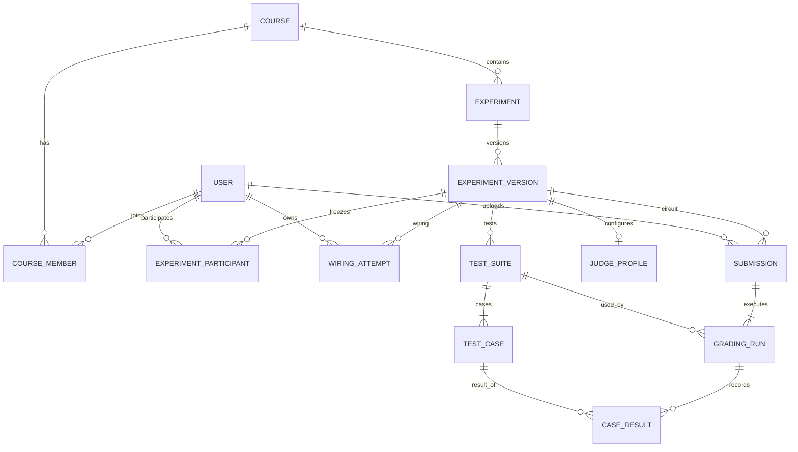

# 中央处理器课程学习系统数据库设计

版本0.6，需求设计已完成团队评审，数据库SQLite；本文为逻辑与约束设计，无建表代码。所有实体按PRD规格及APIC字段实现。每张未特别声明的业务表含id INTEGER主键、created_at TEXT UTC时间；可变表另含updated_at。FK表示外键，NN表示非空，UQ表示唯一，JSON为经应用验证结构后保存的TEXT，不用JSON代替核心外键关系。

## 1 数据关系

用户通过课程成员关联课程；课程关联章节、知识点、资源、题目、备课、考勤、实验。题目版本被试卷条目引用，作答引用试卷和题目版本。实验有不可变实验版本；学生的连线attempt与电路submission均引用具体实验版本。submission保存上传文件身份，grading_run保存每次执行，case_result保存测试结果，避免重评覆盖原成绩。

关键基数：course 1:N chapter；chapter 1:N knowledge_point；experiment 1:N experiment_version；experiment_version 1:N wiring_attempt和submission；submission 1:N grading_run；grading_run 1:N case_result；test_suite 1:N test_case。跨课程引用除外键存在性之外，还必须验证双方course_id一致。

### 1.1 核心实体概念关系

测试集至少一例，circuit提交受理与首个run同事务；queued运行可尚无case_result。wiring-only实验无judge_profile，已发布circuit版本必须有配置。参与名单与当前课程成员独立保存，退课不改历史分母；跨课程/名单内提交的复合约束仍按实体定义验证。此图为概念关系，完整字段和可空性见各表。

## 2 身份课程与审计 SPEC-001/019

| 表 | 核心字段及类型 | 约束与用途 |
|---|---|---|
| user | student_no TEXT NN UQ；name TEXT NN；password_hash TEXT NN；role TEXT NN；active INTEGER NN；session_version INTEGER NN默认0 | role限定student/teacher/admin；active为0/1；仅保存带盐密码哈希；停用/改密增加session_version |
| session | token_hash TEXT NN UQ；user_id INTEGER FK；csrf_hash TEXT NN；session_version INTEGER NN；expires_at/last_seen_at TEXT NN | Cookie随机令牌只存哈希；过期索引；会话角色从user读取 |
| course | title TEXT NN；description TEXT；chapters_revision INTEGER NN默认0；teacher_id INTEGER FK user | 一个学期的一个教学班；teacher_id仅负责人属性，授权只认合法active member |
| course_member | course_id INTEGER FK；user_id INTEGER FK；member_role TEXT；active INTEGER | UQ(course_id,user_id)；role限定student/teacher；访问由active决定；退课不删历史 |
| notification | user_id INTEGER FK；course_id INTEGER FK；title TEXT；target_type TEXT；target_id INTEGER；read_at TEXT可空；event_key TEXT NN | 目标类型白名单；按(user_id,read_at)检索；UQ(user_id,event_key)；event_key从业务事件身份生成，通知创建与事件同事务 |
| audit_event | actor_id INTEGER FK可空；action TEXT NN；object_type TEXT；object_id INTEGER；request_id TEXT；before_summary/after_summary TEXT | 追加不可修改；不记录密码、完整隐藏答案；系统行为actor可空 |
| schema_migration | version TEXT主键；applied_at TEXT NN；checksum TEXT NN | 记录数据库结构版本，不把代码版本等同于schema版本 |

## 3 教学与资源 SPEC-002—005

| 表 | 核心字段 | 约束与关系 |
|---|---|---|
| chapter | course_id FK；title TEXT；position INTEGER | position≥0；UQ(course_id,position)；重排在事务内先移到不冲突的临时非负位置，再写0至n−1，完成后无间隙；新增与重排递增course.chapters_revision |
| knowledge_point | chapter_id FK；title/content/example TEXT；published INTEGER；content_revision INTEGER；is_foundational INTEGER NN默认0 | content_revision递增驱动问答索引更新；归档替代删除被引用项 |
| bookmark | user_id FK；knowledge_id FK | UQ(user_id,knowledge_id) |
| learning_progress | user_id FK；knowledge_id FK；completed INTEGER；completed_at TEXT可空 | UQ(user_id,knowledge_id)；完成状态0/1；进度聚合仅联结同快照本课published知识点；下架不删除记录但不计分子或分母 |
| file_object | owner_id FK；storage_key TEXT NN UQ；original_name TEXT；media_type TEXT；size_bytes INTEGER；sha256 TEXT；purpose TEXT | size≥0；服务端生成不含路径分隔符的key；不存可执行上传路径；purpose白名单 |
| resource | course_id FK；chapter_id FK可空；title TEXT；kind TEXT；visibility TEXT NN；archived INTEGER | kind限定slides/video/guide/question_bank；visibility=students/teacher_only；question_bank必须teacher_only |
| resource_version | resource_id FK；version INTEGER；file_id FK file_object；change_note TEXT | UQ(resource_id,version)；发布后不可覆盖 |
| resource_event | user_id FK；resource_version_id FK；event_type TEXT；event_id TEXT NN；request_id TEXT；UNIQUE(user_id,event_id) | event_type=view/download由content.intent映射；event_id为逻辑访问UUID，request_id为首个请求追踪；成功提供非空内容的200/206才计数；按资源/日期索引；同用户逻辑打开/下载及其Range分片去重；同event_id不同版本/type拒绝409；不把预览再计download |
| preparation | course_id FK；title TEXT；scheduled_at TEXT可空；status TEXT；source_id FK本表可空；published_at TEXT可空 | status为draft/published/withdrawn；source_id保留模板来源；replaces_id FK本表可空、withdrawn_at TEXT可空、withdraw_reason TEXT；UQ(replaces_id)约束一个旧项只能被替代一次，撤回不删关联 |
| preparation_knowledge | preparation_id FK；knowledge_id FK | 复合主键两字段 |
| preparation_resource | preparation_id FK；resource_version_id FK | 复合主键两字段，引用固定版本 |
| preparation_question | preparation_id FK；question_version_id FK | 复合主键两字段 |
| preparation_quiz | preparation_id FK；paper_id FK paper | 复合主键两字段；paper.kind=quiz且同课程；发布时paper.status=published；关联不复制试卷状态/时间/答案 |
| attendance_task | course_id FK；title TEXT；start_at/late_at/end_at TEXT；code_hash TEXT；code_expires_at TEXT；status TEXT | start≤late≤end且start<end；status=open/closed；数字码只存哈希；创建/轮换一次返回，所有查询无明文；轮换原码失效 |
| attendance_record | task_id FK；student_id FK；status TEXT；checked_at TEXT可空；source TEXT | UQ(task_id,student_id)；status=present/late/leave/absent；source=checkin/approval/close/correction |
| leave_request | task_id FK；student_id FK；reason TEXT；status TEXT；reviewer_id FK可空；review_note TEXT；reviewed_at TEXT可空 | UQ(task_id,student_id)；status=pending/approved/rejected；更正审计 |
| attendance_participant | task_id FK,student_id FK | 复合PK；创建任务事务复制active学生名单；record和leave使用(task_id,student_id)复合FK |
| question_import | resource_version_id FK,actor_id FK,count INTEGER | 一次导入批次；创建question/version与幂等记录同事务 |
| leave_review_event | leave_id FK,actor_id FK,old_status,new_status,note,reason_snapshot | 追加，不覆盖历次申请/审批 |

考勤窗口采用start≤当前时间<end；当前时间<late为present，否则late。任务关闭按创建时attendance_participant冻结名单补齐absent，已批准请假标leave，不再额外计absent。签到与批准请假冲突时由教师纠正并记录前后值；学生重复签到不覆盖审批状态。数据库UQ为并发最终防线，禁止只靠插入前查询去重。

attendance_task.code_expires_at不得晚于end_at，初次生成有效到end_at；轮换原子替换code_hash，新码不能与现码相同，旧码立即失效。明文仅创建/轮换响应一次返回，任何查询都不返回，忘记须轮换。

## 4 测评与演示 SPEC-006—008

| 表 | 核心字段 | 约束与用途 |
|---|---|---|
| question | course_id FK；archived INTEGER；ever_public INTEGER NN默认0 | 题目身份稳定，内容进版本表；ever_public只可0→1，创建公开练习或修改为公开的事务中置1；保密发布还检查是否进入已到start_at的published卷，不能依赖异步标记及时运行 |
| question_version | question_id FK；version INTEGER；type/stem/options_json/answer_json/explanation TEXT；difficulty TEXT；tolerance REAL；UNIQUE(id,question_id) | UQ(question_id,version)；type/difficulty枚举见APIC；tolerance≥0；答案不可出现在学生未讲评响应中；支持paper_item复合FK；每次内容更新新version |
| question_knowledge | question_version_id FK；knowledge_id FK | 复合主键；题目可对应多个知识点 |
| paper | course_id FK；title/kind/status TEXT；confidential INTEGER NN；confidentiality_note TEXT可空；start_at/end_at/review_at TEXT；seed INTEGER可空；algorithm_version TEXT可空；generation_snapshot_id FK可空 | kind见APIC，status=draft/published；window_state按时间派生，不存closed；发布后冻结 |
| paper_item | paper_id FK；question_version_id FK；question_id FK；position INTEGER；points_hundredths INTEGER | UQ(paper_id,question_id)，UQ(paper_id,position)；(question_version_id,question_id)复合FK保证版本属于题目；分值以百分之一分整数存储避免浮点累计 |
| attempt | paper_id FK；student_id FK；status TEXT；score_hundredths INTEGER可空；partial_score_hundredths INTEGER NN；revision INTEGER NN；submitted_at TEXT | 单次测验/作业/考试UQ(paper_id,student_id)；练习另表；待人工评分时记录partial |
| answer | attempt_id FK；question_version_id FK；value_json TEXT；score_hundredths INTEGER可空；answered INTEGER NN；graded_by FK可空；comment TEXT | UQ(attempt_id,question_version_id)；分数不超过paper_item配分，引用须属于该试卷 |
| practice_attempt | student_id FK；question_version_id FK；answer_json TEXT；answered/correct INTEGER；score_hundredths INTEGER；created_at TEXT | 多次练习保留全部记录；关联幂等表防网络重复 |
| wrong_question | student_id FK；question_id FK；last_attempt_type TEXT；last_attempt_id INTEGER；resolved INTEGER | UQ(student_id,question_id)；重练成功可标已掌握，不删除历史作答 |
| quiz（API视图，不建表） | id=paper.id；kind=quiz | status由paper时间计算；review_published_at别名paper.review_at；复用同一提交服务 |
| demo_session | course_id FK；experiment_version_id FK可空；preset TEXT；scene_version TEXT；teacher_id FK；revision INTEGER；state_json TEXT；active INTEGER | revision条件更新防旧帧覆盖；状态只允许教师写 |
| paper_participant | paper_id FK,student_id FK | 复合PK；发布时冻结；attempt复合FK |
| generation_snapshot | course_id FK,seed INTEGER,algorithm_version,parameters_json,candidates_json,history_json,source_until,input_sha256,selected_ids_json | 记录有序候选版本及历史实际指标，引用版本保留；不可变；paper增加generation_snapshot_id FK可空 |

试卷提交在一个事务中写attempt及answers并计算可自动判分部分；保存答案/分数二者不得部分成功。简答评分变更同时更新attempt汇总并写审计。多知识点题的统计按每个标签各记一次，但总答题数按作答ID去重；图表注明口径，不能将各知识点样本数相加当总题数。

question_version另含practice_available INTEGER NN默认0，公开练习必须教师显式开放，考试专用题不能经练习API获取答案。paper.review_at对quiz允许null，表示教师尚未讲评；其他类型发布时须为合法时间。

attempt.status只取partial/graded，score_hundredths在partial时NULL，partial_score_hundredths为已定分总和；漏答存0，待批简答存NULL。answer.score更新、attempt汇总、revision和审计同事务完成。题目/试卷/备课的跨课程关联事务校验。preparation发布后冻结关联，修改用copy生成draft；撤回/替代仅更新可见状态，保留不可变内容和关联。

generation_snapshot中的版本ID由事务校验并禁止删除引用版本，JSON仅为不可变算法证据，不替代paper_item外键。跨试卷题目配分按整数百分之一分校验。

演示状态追加last_tick_at TEXT可空及running INTEGER；单Web进程按服务端时钟推进，pause/close/重启后不补发停机期间时钟，重启一律暂停。revision与state/last_tick_at条件更新原子完成，防止轮询请求造成重复推进。输入动作和元件语义与PRD一致。

## 5 智能与分析 SPEC-010—016

统计优先对现有事实表查询后由Pandas/NumPy计算，不建立重复“成绩真相表”。数据范围由course_member及课程外键限定，历史退出成员保留快照分母；系统错误结果的处理按PRD。需要保留版本的算法输出如下。

| 表 | 核心字段 | 约束与用途 |
|---|---|---|
| analysis_run | course_id INTEGER FK NN；creator_id INTEGER FK user NN；scope TEXT NN；subject_student_id INTEGER FK user可空；kind TEXT NN；algorithm_version TEXT NN；parameters_json TEXT NN；source_until TEXT NN；generated_at TEXT NN；sample_size INTEGER NN；result_json TEXT NN；input_snapshot_json TEXT NN；model_status TEXT可空；model_parameters_json TEXT可空 | id为API的analysis_run_id；kind覆盖attendance/knowledge/wiring/grading/resources/scores及warning；scope=self/student/class，个人范围须指定subject_student_id，class时为NULL；统计输入、筛选与结果同事务完整保存，发布给调用方后不可更新；sample_size≥0；warning批次保留每人特征、分母、样本数、聚类中心、标签及截止，model_status=clustered/insufficient_data，其余维度可空 |
| warning | analysis_run_id FK；student_id FK；reasons_json TEXT；status TEXT；handled_by FK可空；note TEXT | UQ(analysis_run_id,student_id)；status=open/handled |
| knowledge_edge | source_id FK knowledge_point；target_id FK；type TEXT | UQ(source_id,target_id,type)；source≠target；先修无环由事务内图检查保证 |
| qa_index | course_id FK UQ；corpus_revision TEXT；algorithm_version TEXT；built_at TEXT；status TEXT；error_code TEXT可空 | 向量索引可重建，索引缓存不作为唯一数据源 |
| qa_query | user_id FK；course_id FK；question TEXT；matched_ids_json TEXT；similarities_json TEXT；index_revision TEXT | 学生只能看本人记录；最小化保留敏感原文 |
| recognition | course_id FK；user_id FK；image_file_id FK；status TEXT；items_json TEXT；confirmed_items_json TEXT可空；algorithm_version TEXT；template_set_sha256 TEXT NN | status=recognized/unrecognized/confirmed；确认不意味着电路正确 |

推荐可在线计算，组卷结果直接固化paper_item及seed，不为了“智能”再造缓存数据库。资源访问、作答、连线与评测的日期索引支撑按周统计。

统计查询返回前必须保存analysis_run，不能将快照保留作为可选行为。parameters_json包含已解析的from/to、筛选项及实际对象集合；input_snapshot_json保留同一读快照提取的必要输入，result_json保存完整metrics/series、口径、单位和提示，generated_at为该结果生成时间。学生scope=self且subject_student_id=creator_id；教师指定学生时scope=student，否则class；warning批次为教师创建的class范围。计算在读事务结束后进行，输入和结果在一次短写事务保存，当前权限失效或计算/保存失败不得交付快照ID。

C06 knowledge复用001的analysis_run，不新增表或修改旧SQL。parameters_json冻结已解析from/to、subject student及实际knowledge_ids；input_snapshot_json保存当前已发布知识点的ID/title/content_revision、该学生同集合进度，以及限定课程/个人范围的实际客观作答source/sample_id/student_id/question_version_id/event_at/correct和固定标签，不保存答案原文或其他学生的个人输入。原始事实以(practice,id)/(answer,id)区分，同一读取事务获取K、进度与作答；计算在事务外执行，短写事务复核权限，插入与补入结果ID的UPDATE共同提交。发布结果后应用只读旧快照，新作答/上下架/批分不更新旧记录；快照不参与成绩写入。class没有个人进度输入，其完成数/进度为null；详情、周序列、口径和警告均随result_json冻结。真实API/备份恢复及并发证据见[SPEC-010B实施记录](SPEC-010B_IMPLEMENTATION.md)。

C07 scores继续复用此表，无新迁移。parameters_json保存from/to、kind、paper_id、subject及实际selected_paper_ids；input_snapshot_json保存所选发布卷id/title/kind/start_at/total_hundredths及按paper_id/student_id排序的冻结名单左连接attempt（attempt_id/status/score_hundredths/submitted_at）。个人范围在SQL中限制student_id，不保存其他学生输入；全班保留退出成员的冻结记录。读取同一事务后用Pandas/NumPy计算，短写事务复核当前会话/课程/目标学生后整体保存；缺表/计算/INSERT/UPDATE失败无可用ID。result_json冻结filters、全部metrics、周序列、分箱及单位/警告；CSV仅序列化该结果，读取/导出重新鉴权。C06旧快照未记录filters时不回填或改写。备份副本原ID JSON/CSV恢复、WAL读取期间真实批阅和保存前撤权/停用用例见同一实施记录；不代表完整生产备份恢复已执行。

考勤关联分析不建新的可写成绩表。事实来源为attendance_task/participant/record与paper/participant/attempt，按PRD第4.4节及APIC第5.4节配对。analysis_run.parameters_json另保存实际selected_paper_ids，input_snapshot_json保存有序student_id、考勤分子/分母、有效attempt_id及score/total_points；结果与algorithm_version=attendance-performance-v1同事务保存。后续人工评分、考勤更正、知识上下架或新提交不修改旧分析快照。页面按analysis_run_id读取已保存结果，CSV也只序列化该结果，不从当前事实表重算；读取和导出均重新校验当前课程授权、creator_id、scope及kind。六种统计快照保留至课程验收后90天，清理后按不可用处理，不能回退为最新结果。快照仅是历史查询证据，不参与评分写入。

recognition.items_json保存symbol/bbox/confidence/confidence_band/label/label_status；算法版本及模板SHA在受理时固定。确认只允许recognized/unrecognized→confirmed，同事务保存confirmed_items_json，不允许写成绩或网表实体；低置信度不另存状态。图片继续由file_object管理并先按recognition归属鉴权。

## 6 实验及接线过程 SPEC-009/017

| 表 | 核心字段 | 约束与用途 |
|---|---|---|
| experiment | course_id FK；code TEXT；title/description TEXT；archived INTEGER | UQ(course_id,code)，如EXP-01 |
| experiment_version | experiment_id FK；version INTEGER；objectives/instructions TEXT；panel_json/rules_json TEXT；submission_modes_json TEXT NN；status TEXT；published_at TEXT；start_at/end_at TEXT；definition_sha256 TEXT | UQ(experiment_id,version)；status=draft/published；已发布版本不可变；发布时非空且start<end；内容与时间冻结 |
| experiment_knowledge | experiment_version_id FK；knowledge_id FK | 复合主键 |
| wiring_attempt | experiment_version_id FK；student_id FK；revision INTEGER默认0；latest_seq INTEGER默认0；state_json TEXT；status TEXT；completed INTEGER NN默认0；functional_results_json TEXT可空；saved_at/submitted_at TEXT可空；snapshot_hash TEXT可空 | status=draft/submitted；submitted后禁止写；索引(student_id,experiment_version_id,created_at) |
| wiring_action | attempt_id FK；seq INTEGER；type TEXT；payload_json TEXT；client_at TEXT可空；received_at TEXT | UQ(attempt_id,seq)；服务端确认seq连续及动作合法 |
| wiring_validation | attempt_id FK；revision INTEGER；valid INTEGER；errors_json TEXT；validator_version TEXT | 每次验证追加；提交只使用当前revision的服务端重新验证结果 |
| experiment_participant | experiment_version_id FK,student_id FK | 复合PK；发布时冻结；wiring_attempt/submission复合FK |

panel_json保存元件、端子和布局，不包含数据库用户信息；端子ID在版本内唯一。state_json保存当前连线与全部SWITCH/RESET/ENABLE输入（不含CLOCK），reset结束必须记录RESET=0，actions用于过程回放；二者在同事务按revision条件更新。复合更新失败返回409，不能先写actions再无条件覆盖state。

submission_modes_json限定wiring/circuit非空子集；只启用wiring的EXP-03无需judge_profile或test_suite，只启用circuit的EXP-04无需连线panel。不存在的提交模式必须在API入口拒绝。

circuit版本在draft阶段允许尚无judge_profile行；版本表不保存客户端提供的judge_profile_id，该读字段由judge_profile.experiment_version_id的唯一关联派生，无配置为NULL。配置只能创建/更新于本版本仍为draft且含circuit模式时；wiring-only版本不得有配置。缺配置时不能启动测试集验证或发布circuit实验。发布事务复核配置完整、同版本published测试集及验证身份一致，再原子设置published、冻结配置和建立experiment_grading绑定；任一条件不满足保持draft，不产生半份发布状态。

“完成实验人数”使用submitted且completed=1（结构及功能断言全过）的去重学生数；接线错误统计使用验证事件，不把同一未修改revision的重复刷新当成新的错误尝试。

## 7 电路评测 SPEC-018

| 表 | 核心字段 | 约束与用途 |
|---|---|---|
| judge_profile | experiment_version_id FK UQ；top_circuit TEXT；port_schema_json TEXT；allowed_components_json TEXT；engine_version TEXT；jar_sha256 TEXT；limits_json TEXT | 平台配置不可由学生覆盖；发布前固定引擎及端口 |
| test_suite | experiment_version_id FK；version INTEGER；status TEXT；content_sha256 TEXT NN；scoring_groups_json TEXT NN；published_at TEXT；published_validation_id FK可空 | UQ(experiment_version_id,version)；draft/published；published不可修改；发布必需；证书所有哈希匹配；发布事务阻止同时修改profile |
| test_case | suite_id FK；label TEXT；visibility TEXT；group_code TEXT NN；steps_json TEXT | visibility=public/hidden；每组至少一例；UQ(suite_id,label)；顺序及位宽验证 |
| submission | experiment_version_id FK；student_id FK；file_id FK；file_sha256 TEXT；size_bytes INTEGER；filename TEXT | 上传原件不可覆盖；大小≤2097152；索引(student_id,experiment_version_id,created_at) |
| grading_run | submission_id FK；suite_id FK；engine_version/jar_sha256 TEXT；status TEXT；score_hundredths INTEGER可空；passed_count/executed_count/total_count INTEGER；started_at/finished_at TEXT可空；error_code TEXT可空；retry_of FK本表可空；reason TEXT可空；worker_token TEXT可空；lease_until TEXT可空；sandbox_id TEXT可空；profile_snapshot_json,profile_sha256,suite_sha256,reference_validation_id FK | status八态见PRD；score在0—10000；count非负且passed≤executed≤total；终态只写一次；受理时固化，suite/profile/JAR身份一致；effective_run为查询派生，不另存可漂移指针 |
| case_result | run_id FK；case_id FK；passed INTEGER；actual_json TEXT；elapsed_ms INTEGER；error_code TEXT可空 | UQ(run_id,case_id)；读取时按visibility脱敏；不将隐藏expected写入公共日志 |
| idempotency_record | user_id FK；operation TEXT；key TEXT；request_hash TEXT；resource_type TEXT；resource_id INTEGER；response_status INTEGER；response_json TEXT；expires_at TEXT | UQ(user_id,operation,key)；同键异内容409；24小时保留 |
| experiment_grading | experiment_version_id FK主键,active_suite_id FK,revision INTEGER | 仅circuit模式；suite必须同实验版本published且证书有效；切换原子更新revision |
| test_suite_validation | suite_id FK,profile_sha256,suite_sha256,jar_sha256,reference_file_id FK,reference_sha256,negative_file_id FK,negative_sha256,status,result_json,worker_token,lease_until,sandbox_id,started_at,finished_at | status=queued/running/passed/failed/system_error；passed需要正确全过、反例至少功能失败，不接受反例system_error/超时作验证成功 |
| reference_file | experiment_version_id FK,file_id FK,kind | kind=correct/known_wrong；UQ(experiment_version_id,file_id)；验证文件均属同实验 |

test_case不保存weight或sequence_id，一例即一独立序列，组内等权。test_suite.scoring_groups_json由PRD固定模板生成，不允许客户端覆盖。每份draft内容不可变，更新创建新版本。judge_profile是engine/limits的唯一配置源，另存canonical_sha256（包含端口、白名单、限制、引擎身份）；实验发布后profile冻结。验证证书字段见本节test_suite_validation，旧证书不能授权变更后的配置。
初始worker并发1，利用SQLite短事务原子领取最早queued任务，将其条件更新为running并生成worker_token和lease_until。仿真在事务之外执行。续租和写结果时在同一事务同时检查status=running、worker_token一致及数据库UTC当前时间<lease_until；失联worker的迟到结果不能覆盖已结束任务。now≥lease_until时禁止续租/提交，即使尚未回收；Web每5秒及worker启动/领任务前执行条件回收，同规则处理test_suite_validation。回收将旧run终结为system_error，重试另建run，不能把旧行重新置queued并覆盖历史。

运行结果明细与终态汇总在一个事务中提交。校验用例数量、分组权重、总分和suite版本一致；仅引擎宣称正常完成时，缺少用例或total_count=0为system_error；已确认的超时/内存/输出限额及电路加载错误优先按PRD第7.1节终结，保留实际执行数。若文件安全落盘而事务失败，孤儿文件由清理任务依据无引用且超过24小时处理。若数据库已有文件引用但文件丢失，任务为system_error并告警，不静默删除submission。

grading_run增加部分唯一索引：同submission_id在status IN ('queued','running')时唯一。学生活动上限、队列容量、幂等和run插入同短事务处理，校验失败不占用容量。run终态不可覆盖，重试另建行；retry_of形成有界链，根任务算0次重试，最多2次。完整性检查仅作用于正常完成输出，不能吞掉已确认的resource_limit/timeout结果。

## 8 索引、事务与数据治理

除UQ索引外建立grading_run(status,created_at)、grading_run(status,lease_until)、submission(experiment_version_id,created_at)、attempt(paper_id,student_id)、wiring_validation(attempt_id,revision)、resource_event(resource_version_id,created_at)等索引。索引按实际查询核验，不为每列建索引。

每连接启用foreign_keys，busy_timeout初始5秒；WAL模式需在目标部署存储上验证，不能把数据库置于不支持其锁语义的共享盘。写冲突有限重试后503，不无限重试。成绩写入、提交入队、幂等键和个人任务限额检查需具有原子性。读报告不能长期占写锁。

被成绩/实验版本引用的用户、课程、题目、文件、测试集禁止级联删除，采用active/archived字段。个人收藏等从属临时记录可按政策清理。运行工作目录完成即清理，调试日志最长7天且脱敏；成绩/原始电路/过程至少保留至验收后90天。公开演示数据不含真实学号之外的无关个人信息；导出默认只有教学所需字段。

备份使用SQLite一致性备份机制，或维护模式停写并正确处理WAL后备份，不能仅复制正在写入的.db主文件。数据库、上传资源与电路原件组成同一备份集，清单含schema版本、文件SHA和时间。恢复后运行完整性/外键检查，并验证至少一份资源、一份电路报告及一段连线记录可读。

迁移带版本和校验和，先备份和副本演练。增加字段先兼容旧数据，删除/重命名不得未经数据迁移直接上线。恢复数据库前保留当前状态，明确恢复点之后新增提交的处置；只回退代码不能自动撤销数据库变更，具体见CHG-RB。

SPEC-005模块迁移的单一定义为`backend/migrations/005_knowledge.sql`：版本取文件stem `005_knowledge`，校验和取SQL文件read_text(encoding="utf-8")的UTF-8 SHA-256，与001候选runner一致（文本读取统一CRLF/LF）。公共runner负责顺序、版本/校验和、重复执行跳过、BEGIN/COMMIT/ROLLBACK及同事务写schema_migration；005 SQL只创建chapter/knowledge_point/bookmark/learning_progress及查询索引，不初始化公共身份或课程。knowledge_migration.py只提供SQL身份及隔离测试的apply辅助，不另建runner。公共runner已随develop f242d2b同步并对接，实际命令为`python -m flask --app backend.app db-upgrade`，受控库重复迁移/校验和拒绝/一致性备份恢复已通过CI；生产迁移和完整备份集尚未验收。005请求只打开现存库、校验已登记迁移，不自动建库或迁移。

本次模块约束：chapter的course_id/title/position非空；知识字段非空，example默认空，published及is_foundational限定0/1，content_revision初始1；收藏和进度用(user_id,knowledge_id)唯一约束。completed=true时completed_at非空，false时为null；重复设true保留第一次完成时间，取消再完成产生新时间。四表外键不级联删除，下架只改published及revision。当前发布知识及其本人进度由同一读事务获取，作为010B输入；005不新增聚合成绩表。

SPEC-006/C02a迁移单一定义为`backend/migrations/006_question_versions.sql`，由既有公共runner按文件stem及UTF-8文本SHA-256登记；只创建question/question_version/question_knowledge、查询索引和保留约束，不建立知识、试卷、作答或成绩替身。question_version及已有知识关联禁止UPDATE/DELETE；新增版本和标签同事务写入，ever_public禁止1→0。SQLite允许先声明到knowledge_point的外键，但缺少005迁移或知识表时知识写入仍返回503，不关闭foreign_keys或允许无标签写入。005已进入develop，需对真实知识标签、题目和作答执行联合回归；不能仅凭空表迁移成功宣布知识依赖已完成。具体测试性质及恢复点见[SPEC-006实施记录](SPEC-006_IMPLEMENTATION.md)。

## 9 跨模块事务不变量

SPEC-006/C02b迁移为`backend/migrations/006b_papers.sql`，排序在006_question_versions之后且不修改已应用的C02a文件。新增真实paper/paper_item/paper_participant、查询索引、同课条目检查、复合版本外键和发布冻结触发器；分值存正整数百分之一分。名单只在draft发布事务插入有效同课学生，发布后不能增删改；成员退出仅收紧当前访问，不变更原名单。published的内容/时间不可修改，quiz仅预留review_at从null到不早于截止的一次讲评更新，C05a专用发布已接入，C05b显式讲评入口已接入，复核截止后一次写入并同事务审计；试卷不能删除。generation_snapshot_id外键及表留待013迁移接入，当前没有算法快照或替身表。普通发布、身份公开历史检查、名单和审计同一短写事务，失败回滚全部；带数据备份测试仅知识使用明确夹具，生产演练未执行。

SPEC-006/C03a新增`backend/migrations/006c_attempts.sql`，不修改既有迁移。接入attempt/answer和第7节公共idempotency_record；attempt复合外键指向原paper_participant，每人每卷唯一，revision默认0；answer有稳定id供事实去重。所有分值为整数百分之一分；partial总分NULL、graded总分等于partial_score，漏答value_json='null'/answered=0/score=0。触发器限定版本属本卷、分数≤原配分、客观分数仅0/满分、待批NULL仅已作答简答，并禁止更改提交身份/原作答或删除历史。C03b复用已作答简答评分字段，不新增或修改迁移：整批先校验，在同一写事务更新score_hundredths/comment/graded_by，重算全卷partial/graded汇总，按原revision条件递增并追加attempt.manual_scores审计（前后每题整数分、评语、评分人及revision）；失败回滚全部评分/汇总/审计。用户+operation+UUID唯一的成功快照保留24小时；paper/quiz共用paper_attempt，原响应JSON和状态码原子保存，批阅/更正不改原快照。C04消费本次完整answer评分事实接入练习及wrong_question，详见下一段；漏答和简答仍不得当作实际客观错答。实际带数据备份副本的迁移重放、完整性/外键和HTTP最新人工分数/原提交重放用例通过，仅知识为明确夹具；生产恢复未执行。

字段未写类型的哈希/状态/时间为TEXT，快照为经验证JSON TEXT，*_id为INTEGER FK。冻结名单及结果不随成员active变化更新；所有历史实体禁止级联删除。course_member创建/恢复必须与全局角色匹配；course负责人需active teacher成员。角色/active变更在同一短写事务检查“至少一位active admin”、移交负责课程并失效不兼容成员与会话；SQLite串行写锁覆盖计数和更新，不能事务外先计数。

文件先落受控临时区、校验SHA、原子改名，再写引用事务；失败留下的无引用文件超过24小时才清理。内容端点必须从业务资源/提交/识别对象鉴权，不提供按file_object.id任意下载接口。所有查询投影（quiz、effective_run、统计汇总）复用事实表，不另设可写成绩镜像。

通知target_type/target_id只用于导航，不授权；目标读取仍回所属模块鉴权。

SPEC-006/C04新增`backend/migrations/006d_practice_wrong.sql`，不修改已应用迁移。practice_attempt保存固定公开客观版本、原answer_json、answered/correct、整数百分之一分（0/10000）及created_at，与既有预警事实适配器时间字段兼容；不可UPDATE/DELETE。wrong_question只保存UQ(student_id,question_id)状态和最近错误来源（paper=attempt.id，practice=practice_attempt.id），触发器确保来源是同学生/同question的实际客观错误，身份不变、不能删除。wrong_count和来源版本/标签从原answer及practice事实派生，不存易漂移的重复计数。迁移按submitted_at/id倒序回填已有客观错答，漏答/简答排除；迁移重放不重复导入。业务后续交卷/练习与状态投影、审计及公共幂等快照同事务，正确练习只设resolved=1，新错误再置0。

C04独立迁移和带数据备份副本的完整性/外键、HTTP错题/原键重放恢复验证见[SPEC-006实施记录](SPEC-006_IMPLEMENTATION.md)。当前SPEC-014适配器按practice_attempt.correct计样本但尚未筛answered=1：本包保留未作答事实并在错题/以后010B口径排除，014的漏答样本筛选需姜苏豪在其分支对接，未改队友统计业务。该依赖不能被既有全部为已作答的适配器测试通过替代。生产恢复、003/004和005真实联测仍须按原边界完成。

SPEC-008/C05a不新增quiz、答卷、成绩或通知表，不修改已应用迁移。专用发布复用006b的quiz空review_at约束；原paper、冻结名单、保密检查、paper.publish审计及冻结学生的quiz提醒共用BEGIN IMMEDIATE事务。通知复用notification的UQ(user_id,event_key)，target_type固定quiz，target_id为原paper.id，event_key为quiz.published:{paper_id}；普通paper发布quiz也用同一事件身份。失败全部回滚，转入/退出不改历史名单或通知身份。paper/quiz仍共用006c的paper_attempt成功快照和同一attempt/answer事实。实施及验证边界见[SPEC-008实施记录](SPEC-008_IMPLEMENTATION.md)。

SPEC-008/C05b复用既有表和冻结触发器，不增加迁移。逐题统计对paper_participant、唯一attempt、固定paper_item及answer在一个BEGIN读事务内聚合，不随当前成员变化漂移分母，不写入成绩或analysis_run。均分用已定分AVG，避免多个合法大分值的整数SUM溢出；漏答0分参与，pending NULL排除。选项分布仅投影原选择题value_json，按原选项顺序返回。显式review在BEGIN IMMEDIATE中复核会话/教师、published quiz及now≥end_at，原review_at从null更新为now且追加quiz.review审计；并发重试保留原时刻，只记一次，审计失败回滚review_at。普通定时quiz已有非null review_at不改动；其余内容/时间仍冻结。答案及解析释放仍经006全版本身份保护，不以截止替代讲评；原提交成功快照不被批分或review改写。
