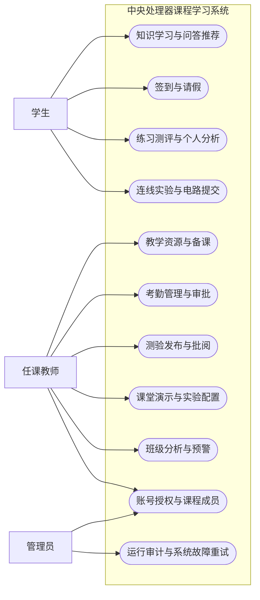
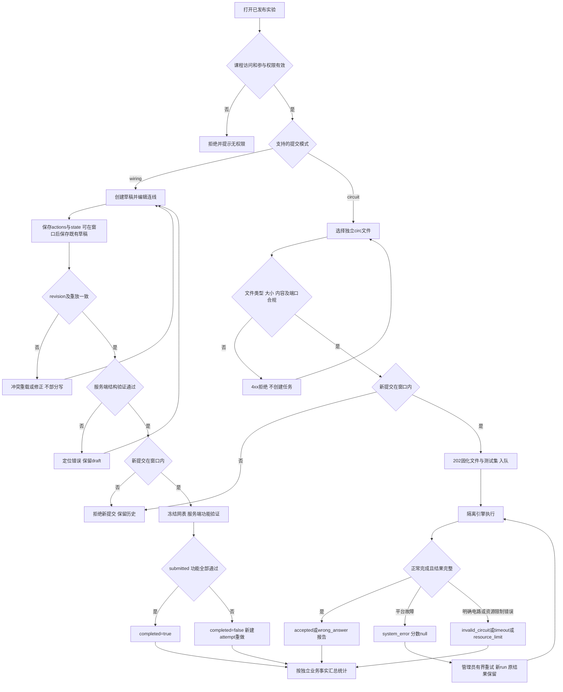

# 计算机组成原理课程学习系统需求规格

版本：0.6。组号：g24201710。组长：姜苏豪。班级：242017。项目主题：中央处理器。本文规定课程学习系统的功能边界及可测试验收条件，配合 APIC、DBD 构成开发依据。需求设计已完成团队评审；SPEC-005主体实现及001真实接入已通过本地与CI验证，整体功能验收尚未完成，真实接入及证据见[SPEC-005实施记录](SPEC-005_IMPLEMENTATION.md)。

## 1 目标与范围

系统以任务书“学海通”平台为基础，围绕 CPU 的寄存器、ALU、数据通路、控制器和指令执行，连接“知识学习—练习测评—课堂演示—实验连线—电路评测—学习分析”。数字逻辑内容作为 CPU 的前置知识，不扩展为另一套独立课程系统。CPU专题由教师指定（用户已确认），不作为待选题。

学生能够实际操作虚拟实验箱端子、拆接导线、输入信号、单步运行并查看结果；能够在线提交 Logisim 的 .circ 文件，由服务端运行真实仿真引擎并返回判分。两项为项目必做，不降级为文档、动画播放或静态真值表。

课程列出的十个基础模块与六个智能模块均纳入本次设计，内容限定为 CPU 教学场景。优先完成身份与课程权限、实验与评测闭环，再完成课堂及分析功能；优先级不等于删去课程模块。大模型接入、商用实体实验箱远程控制、模拟电压/器件烧毁、完整 x86/ARM、流水线/乱序/缓存一致性、多校区 SaaS 不在本期范围。图像识别仅支持本系统标准符号与清晰输入，不能宣称可识别任意手绘 CPU。

### 1.1 逐项优先级 前置依赖与验收节点

以下为已完成团队评审的计划；P0优先保障公共基础、必做实验及工程门禁，P1保障基础教学、个人统计与较高风险算法，P2在基础事实就绪后完成受限辅导功能。三个级别都在既定交付范围，不能因P2自动延期至课程验收后或免验；涉及安全/判分/数据完整性的验收始终阻断，不按模块级别降级。

节点按课程周次，不推算日期；CP-2—4实际检查时间以教师通知为准，早于计划时必须前移所需产物。CP-1未批准不得进入下一阶段，TV-01/02核心实现前必须真实验证，TV-03也安排第5周前置排除风险。第11周完整集成及缓冲、第12周CP-5交付保持不变。

“前置依赖”说明所需子能力/事实已就绪，不要求依赖模块所有功能先整体完工。009/018分阶段协作：009草稿定义→018配置/测试集验证→009发布circuit版本→018学生提交/评测，避免互等；007复用CPU语义并引用009，不等待017整个连线界面验收。012/014可以读原始事实，但必须与010已定义口径一致，不依赖看板API可用。所有依赖先保证001授权与课程隔离。

circuit实验草稿允许judge_profile_id=null，由服务端按本版本配置关联派生，不接受客户端传入或绑定别的版本。创建草稿后再配置judge-profile；缺配置时不能启动测试集验证或发布实验。发布时必须同事务检查完整配置、同版本已发布且验证有效的测试集，失败保留draft，成功冻结配置。字段与阶段约束见APIC第6/7节、DBD第6/7节，纳入R04验收。

| SPEC及统一验收入口 | 优先级 | 必须就绪的前置依赖 | 计划验收节点 | 延期影响与处理边界 |
|---|---|---|---|---|
| [SPEC-001](PRD.md#accept-spec-001) | P0 | 无业务模块前置；CP-1批准、角色/课程契约 | 第8周基础/CP-2；第11周越权回归/CP-5 | 阻塞所有课程写入与数据隔离，其他模块不能越权绕过 |
| [SPEC-002](PRD.md#accept-spec-002) | P1 | 001授权、冻结名单及通知基础 | 第8周考勤闭环/CP-2；第9周提供010A输入 | 延期阻塞010A与014考勤提示，不能用假签到数据通过统计 |
| [SPEC-003](PRD.md#accept-spec-003) | P0 | 001授权；受控文件键/版本/访问事件契约 | 第8周资源闭环/石佰合CP-2；第11周下载与恢复回归 | 资源授权/文件基础延期影响004、009及018文件引用，先交可复用文件基础 |
| [SPEC-004](PRD.md#accept-spec-004) | P1 | 001、003、005；关联quiz发布依赖008，普通备课可先做 | 第8周备课闭环/罗浩铭CP-2；第10周quiz关联完整回归 | 延期影响个人CP-2与I-03教学准备；不得复制测验状态规避依赖 |
| [SPEC-005](PRD.md#accept-spec-005) | P1 | 001、章节排序及发布知识集合 | 第8周知识闭环/CP-2；第9周提供进度输入 | 延期影响004、006标签、010B及011/012/013/015，知识语料与标签需先就绪 |
| [SPEC-006](PRD.md#accept-spec-006) | P0 | 001；005知识标签契约；冻结题目版本及讲评保护 | 第8周题目/作答/人工评分/黄俊诚CP-2；第9周真实已评分记录 | 延期阻塞008、010A/B、推荐/组卷/预警；不能用partial分替代已评分成绩 |
| [SPEC-007](PRD.md#accept-spec-007) | P1 | 001；PRD CPU基线、TV-02数字语义验证；关联实验读009版本 | 第9周CPU核心演示；第10周六类预设/CP-4候选；第11周回归 | 延期影响I-03与课堂难点展示；不阻塞独立.circ受理，演示不得冒充学生实验 |
| [SPEC-008](PRD.md#accept-spec-008) | P1 | 001、006试卷/判分/讲评；发布冻结名单 | 第8周限时随堂测/CP-2；第9周提供成绩及统计输入 | 延期影响004关联测验、010B、I-03；题目/答案保护不能通过调整优先级放宽 |
| [SPEC-009](PRD.md#accept-spec-009) | P0 | 001、003指导文件；circuit版本发布等待018配置/测试集验证子能力 | 第8周草稿定义与指导；第9周M9两类入口 | 未发布合规版本会阻塞017/018受理与010C/D；先定草稿schema，再验证测试集，再发布 |
| [SPEC-010](PRD.md#accept-spec-010) | P1 | 001授权；002/005/006/008/017/018真实事实及冻结分母 | 第9周四人独立统计/CP-3；第11周页面/CSV一致 | 父规格为共通口径；任一010A—D未通过均不能以总看板认定四人完成 |
| [SPEC-010A](PRD.md#accept-spec-010a) | P1 | 001、002关闭考勤、006/008已评分测评；配对快照 | 第9周C01—04与真实考勤统计/姜苏豪CP-3 | 成绩或考勤未就绪时可先做固定算例验证，不能据此宣称真实统计验收 |
| [SPEC-010B](PRD.md#accept-spec-010b) | P1 | 001、005当前知识/进度、006/008真实作答与评分 | 第9周掌握度/错题/分类成绩/黄俊诚CP-3 | 延期影响012/014的指标复核；进度与成绩仍按各自分母，不互相替代 |
| [SPEC-010C](PRD.md#accept-spec-010c) | P1 | 001、009冻结名单、017真实完成/错误记录；M9通过 | 第9周实验去重/错误趋势/罗浩铭CP-3 | 017延期直接阻塞010C；禁止随机图表或只接线未过功能的记录充数 |
| [SPEC-010D](PRD.md#accept-spec-010d) | P1 | 001、009冻结名单、018真实effective_run/故障；M9通过 | 第9周教学分布/可靠性/石佰合CP-3 | 018延期直接阻塞010D；平台故障不能混入学生正确率分母 |
| [SPEC-011](PRD.md#accept-spec-011) | P2 | 001、005已发布语料及revision；不依赖外部大模型 | 第10周检索/索引失败/CP-4候选；第11周回归 | 延期影响辅导与I-03检索，核心签到/提交仍可运行；须在CP-5前补齐 |
| [SPEC-012](PRD.md#accept-spec-012) | P2 | 001、005候选、006错题/进度；010B口径一致，不依赖看板接口上线 | 第10周冷启动/排序/空结果；第11周CP-5回归 | 延期影响个性辅导及I-02后续推荐，不得改变实验成绩或删模块 |
| [SPEC-013](PRD.md#accept-spec-013) | P1 | 001、005标签、006题库版本/公开历史/成绩；快照与配分契约 | 第10周约束/快照重放/CP-4候选；第11周回归 | 约束和复现风险较高，优先于辅导完善；延期影响智能组卷与个人难点证据 |
| [SPEC-014](PRD.md#accept-spec-014) | P1 | 001、002、006/008客观作答、009/017/018到期实验事实；010口径 | 第10周规则/聚类/不足样本/CP-4候选；第11周回归 | 事实缺失只能规定降级，不能伪造聚类样本；不阻塞其他业务提交 |
| [SPEC-015](PRD.md#accept-spec-015) | P2 | 001、005知识节点与关系；010B掌握度口径 | 第10周先修可达/环拒绝；第11周CP-5回归 | 延期影响知识关系辅助；禁止以静态图代替真实算法 |
| [SPEC-016](PRD.md#accept-spec-016) | P2 | 001、003文件授权基础、固定图片/字典；TV-03第5周先验证 | 第5周受限识别验证；第10周确认草稿；第11周CP-5回归 | 实现可后排、技术风险前置；阈值变更走规格评审，不能扩大为任意OCR或给成绩 |
| [SPEC-017](PRD.md#accept-spec-017) | P0 | 001、009已发布wiring版本；CPU/panel基线与TV-02 | 第5周重放验证；第9周EXP-01/02/03全部M9；CP-4候选 | 延期阻塞M9、010C、I-01与最终集成；连线不能降级为动画或截图 |
| [SPEC-018](PRD.md#accept-spec-018) | P0 | 001、受控文件基础、009草稿schema与TV-01；学生受理等待009发布circuit版本 | 第5周连续时序验证；第9周EXP-01/02/04真实评测M9；CP-4候选 | 延期阻塞M9、010D、I-02及最终集成；不以mock或仅上传页代替 |
| [SPEC-019](PRD.md#accept-spec-019) | P0 | CP-1文档/账号/仓库证据；门禁随真实源码逐步落实；发布依赖全部规格通过 | CP-1评审及Gitea留证；第8周门禁；第11周集成/恢复；第12周CP-5归档 | 规格批准或阶段检查缺失会阻塞下一阶段；最终门禁失败不得发布，优先级不能放宽证据 |

负责人及工时取本文件第10.1/10.4.2节，风险处置取第10.4.3节；没有重新叠加工时。延期先按依赖调整同周任务批次和人员，预计节点延后>2天按RK-03登记，不以优先级代替范围变更评审。完整AC、追加R及计划用例只在[统一索引](PRD.md#acceptance-index)集中列出，本文保持判定规则。

## 2 用户和权限

| 角色 | 可执行行为 | 权限边界 |
|---|---|---|
| 学生 | 学习、签到、请假、做题、连线、提交电路、查看个人记录 | 只操作本人数据和已加入课程；不能传入他人 user_id 冒用 |
| 教师 | 管理本人授课班级、发布资源/测验/实验、配置判分、查看班级报告 | 不读取其他教师课程的个人数据，不直接改原始评测结果 |
| 管理员 | 账号审核、教师授权、课程配置、运行审计 | 敏感管理留痕；不得静默修改成绩或隐藏测试 |

公开注册只能产生学生。教师资格由管理员授予。所有涉及课程的服务端接口校验选课或授课关系；UI 隐藏按钮不作为安全措施。停用账号的会话立即失效。

### 2.1 角色用例图

矩形为角色，圆角项为主要业务用例；采用Mermaid表达用例关系，不声明严格UML记法。教师在课程成员管理中仅添加/移除学生，账号和教师授权由管理员执行。管理员默认没有批阅简答、改写评分或查看隐藏测试的教师权限。

## 3 页面与业务流程

学生端：课程首页、章节与知识点、练习/错题本、随堂测、实验中心、实验箱工作台、在线评测提交与报告、个人学习分析。教师端：班级与考勤、资源和备课、题库和组卷、课堂演示、实验发布与测试配置、班级分析。管理端：用户与角色、课程成员、评测运行状态与审计。

实验工作台布局：左侧实验指导与元件列表，中间实验箱面板和导线，右侧端子/信号/错误信息，底部运行控制、保存状态和步骤记录。端子可用鼠标依次选取，也能键盘聚焦选择；导线颜色之外同时显示 0/1/X/Z、端子名称和错误提示。

主流程：教师准备知识点并发布实验及适用测试集→已在参与名单的学生学习并打开实验→选择本版本支持的连线或电路提交→连线验证和保存/提交，或本地编辑 .circ 上传并查报告→对照反馈重做→教师查看班级统计与知识薄弱点。连线模拟记录与 .circ 评测是关联但独立的提交，不承诺自动互转，不要求学生截图代替 .circ。

两线共用实验版本，分别保存wiring_attempt与submission，不要求连线成功后才能上传，也不自动互转。成功幂等请求按APIC第11节重放，不能被截止误拒。无效模式、过期窗口与越权都由服务端判断；运行故障不计学生答错。

### 3.1 代表性业务用例

以下为走查和测试设计输入，运行结果尚未产生；时刻均使用服务端UTC。所有角色均须为有效课程成员。

| 编号及规格 | 角色与前置条件 | 主成功流程 | 异常与后置条件 | 固定验收输入及预期 |
|---|---|---|---|---|
| UC-01 签到与请假；002 AC-01—05、R17/R40 | 教师发布并冻结名单；学生在名单，任务09:00—09:30 UTC，late=09:10 | 教师创建得到一次性码→学生09:05签到present→另一学生申请请假→教师批准leave→关闭补absent | 重复签到返原记录；旧码422不写记录；窗口外409；非任课教师403/不可见404；批准后签到不覆盖leave；审批与更正追加历史/通知 | 冻结3人，S1签到两次、S2批准请假、S3未交；关闭后各present/leave/absent=1，记录总3；轮换码样例见R40 |
| UC-02 发布随堂测与讲评；006 AC-01/02/04/05、008 AC-01—04、R27/R33/R36 | 教师已有draft quiz；学生在发布冻结名单；start=09:00,end=09:10 | 教师发布→S1在09:05提交→自动评分客观题→教师批简答→截止后review→学生看解析与教师看统计 | 同键重放不增答卷；异键重交409；09:10新提交409；简答待批score=null；截止未讲评仍保护答案；学生不能review | 2人名单，单选10分+简答10分；S1单选对、简答批8分，S2缺交；最终18/20，submitted=1,missing=1，objective_correct_rate=1，review前无答案 |
| UC-03 连线保存与提交；017 AC-02/03/05/06/07/09/10、R28 | EXP-01已发布、参与及窗口有效，draft revision=0 | 连线→输入255/1、OP=0→保存完整actions/state→刷新恢复→validate→submit冻结快照及功能结果 | revision重复409；state与重放不符422且不部分写；结构错422保留draft；结构合法但功能错submitted/completed=false，重做新attempt；越权404；截止新submit409 | 两页都以revision=0保存，第一份200/revision=1，第二份409；服务端功能断言通过后completed=true；同键submit只一快照 |
| UC-04 电路评测与故障重试；018 AC-01/02/05/06/07/08/12、R19/R29 | EXP-02及验证通过的测试集已发布、学生有窗口权限；管理员有重试权限 | 学生上传合法REG8→202保存submission/run身份→worker执行→报告→故障时管理员填写reason、同键retry→新run完成 | 文件不合规4xx不入队；容量503可稍后重发；system_error分null；管理员不能改答案/成绩；最多2次retry；超时0与平台故障分离；过期worker不得写结果 | 已有有效run=80分，再重评因ENGINE_CRASH故障：latest分null，effective仍80；管理员重试成功新run=100，旧run不改；重复同键retry不增run、学生尝试数不增 |

UC-01—04在团队评审时按成功、异常、越权各走查一次；实施及后续规格变更时保存实际/预期与问题编号，评审状态见README第9节。规格走查无需运行源码，技术与运行测试必须另行留证。

## 4 模块规格与验收

每行 SPEC 为稳定模块编号，验收条目在该模块内以 AC-01 起顺序编号。接口见 APIC 同编号分组，实体见 DBD。所有模块都必须验证正常流程、输入错误及越权情形。下表不是“界面列表”，验收必须读取真实持久化数据或算法结果。

| Spec | 做什么及不做什么 | 最低可判定验收 |
|---|---|---|
| SPEC-001 用户与权限 | 注册、登录、个人信息、三角色、课程成员；不允许自主注册教师 | AC-01 学生注册后可登录且密码不明文存储；AC-02 学生请求教师接口被拒绝；AC-03 跨课程和他人记录访问被拒绝；AC-04 停用后旧会话不可用 |
| SPEC-002 考勤 | 发布任务，二维码/数字码签到，请假审批，查询异常；本期不采集精确定位 | AC-01 有效码在窗口内签到成功；AC-02 重复/并发签到只有一条记录；AC-03 关闭后拒绝签到并结算缺勤；AC-04 请假只能由任课教师审批，出勤/迟到/请假/缺勤互斥且可审计；AC-05 创建/轮换一次返回新码、任何查询不含code、轮换旧码失效（R40） |
| SPEC-003 教学资源 | CPU 课件、视频、实验指导、题库资源分类检索和版本管理 | AC-01 上传后按章节/类型检索；AC-02 更新生成新版本且旧引用仍可访问；AC-03 学生不能上传教师资源；AC-04 真实访问事件可汇总，大小和类型不合规被拒绝 |
| SPEC-004 课前备课 | 备课单元关联知识点、资源、例题、随堂测，模板复用、教学日程和预习推送 | AC-01 教师保存和复用单元；AC-02 关联对象必须属于本课程；AC-03 发布后学生看到站内预习通知，草稿不可见；AC-04 模板复制不修改原单元；AC-05 quiz_ids关联同课程随堂测，备课不自动发布测验或提前展示题干/解析 |
| SPEC-005 课程知识 | CPU 章节、图文/公式/例题、检索收藏 | AC-01 可检索“程序计数器”等知识点；AC-02 收藏幂等且重登保留；AC-03 完成状态可追踪；AC-04 未发布内容对学生不可见 |
| SPEC-006 习题与测评 | 单选、多选、判断、数值题自动判分与解析、简答人工评分，错题重练 | AC-01 客观题按发布时答案快照判分；AC-02 提交前不泄露答案，公开题身份的新版不得仅靠改权限进入保密卷；AC-03 错题自动进入个人错题本；AC-04 简答显示待评分而非伪装自动正确；AC-05 重复提交不重复计分 |
| SPEC-007 课堂演示 | 门电路、组合/时序逻辑、ALU、存储器和 CPU 取指/译码/执行，投屏及同步 | AC-01 教师单步时学生页跟随序号；AC-02 寄存器、总线和控制信号随步骤变化；AC-03 刷新可恢复最新状态；AC-04 学生无权推进教师演示 |
| SPEC-008 随堂测 | 教师发布限时题目、学生作答、统计正确率及选项分布、讲评 | AC-01 服务器时间截止后不收答卷；AC-02 重交同一幂等键只产生一份；AC-03 统计分母为有效提交，另列未交人数；AC-04 发布讲评后才展示答案；保密测验截止后未讲评仍阻止同题全部版本练习解析旁路，成绩纳入分析 |
| SPEC-009 实验辅助 | 实验列表、指导步骤、前置知识、参考现象、提交记录入口 | AC-01 每个实验包含目标/器件/步骤/验证/关联知识点；AC-02 可跳转连线和 .circ 提交；AC-03 显示本人历史版本；AC-04 不以此模块的指导页面替代 SPEC-017/018 |
| SPEC-010 学习数据分析 | 四人各自实现一项真实统计，见下节；不以随机图表代替 | AC-01 同一筛选条件可复算指标；AC-02 学生仅看自己，教师仅看本班；AC-03 空样本显示无数据而非 0 分；AC-04 导出与页面使用同一analysis_run_id快照且口径一致 |
| SPEC-011 智能问答 | scikit-learn 的 TF-IDF 与余弦相似度检索 CPU 知识文本，返回片段和出处；不用大模型也可工作 | AC-01 “PC 有什么作用”返回相关已发布知识点；AC-02 无相关内容时明确未找到；AC-03 文本更新后重建索引；AC-04 记录算法版本及真实相似度，不伪造生成式理解 |
| SPEC-012 个性化推荐 | Pandas 汇总错题和进度，NumPy 按知识点薄弱度做内容推荐 | AC-01 有错题时优先覆盖相关薄弱知识；AC-02 推荐附理由；AC-03 冷启动推荐教师标记的基础内容；AC-04 不重复推荐已完成且掌握良好的内容，限制结果数量 |
| SPEC-013 智能组卷 | NumPy 结合标签、难度配额及历史正确率选择题目 | AC-01 满足可行的题量、分值、覆盖和难度要求；AC-02 不重复选题；AC-03 题库不足返回约束不足，不静默拼凑；AC-04 固定随机种子和题库/历史快照可复现 |
| SPEC-014 学习预警 | Pandas 统计近期正确率/完成率/考勤，再以scikit-learn KMeans聚类结合固定规则提示教师 | AC-01 命中阈值列出原因与样本数；AC-02 不足聚类门槛明确降级，少于5次作答不作成绩推断，但仍提示考勤异常；AC-03 教师可标记已处理；AC-04 不将预警自动转换为处分或扣分 |
| SPEC-015 知识图谱 | 维护先修/包含关系，NumPy 邻接矩阵计算先修可达性并可视化 | AC-01 点击 ALU 展示关联寄存器与加法器；AC-02 先修边出现环时拒绝保存；AC-03 节点学习状态来自真实数据；AC-04 输出可复算路径，不只是静态画图 |
| SPEC-016 识别辅助 | OpenCV 对标准门符号/端子标签模板作识别，学生确认后生成结构草稿 | AC-01 标准测试图片输出符号、坐标和置信度；AC-02 低置信度标注需确认；AC-03 不清晰或不支持的图返回无法识别；AC-04 识别结果不能自动作为成绩或可信电路 |
| SPEC-017 实验箱连线过程模拟 | CPU 教学实验箱可交互接线、断线、运行、保存和过程记录 | 按第 6 节逐条验收，项目必做 |
| SPEC-018 Logisim 在线评测 | .circ 上传、校验、排队、真实执行、判分、报告、教师重评 | 按第 7 节逐条验收，项目必做 |
| SPEC-019 工程协作与交付 | GitHub PR/Actions、Gitea 课堂归档、规格追溯、备份与回滚 | AC-01 main 直推被拒绝；AC-02 任一必需检查失败不能合并；AC-03 改动后旧批准不能直接放行；AC-04 Gitea 归档 tag 与 GitHub 对应 SHA 一致；AC-05 回灌修复有证据 |

### 4.1 每人的统计分析子模块

| 子编号及负责人 | 计算口径 | 可复算样例 |
|---|---|---|
| SPEC-010A 姜苏豪 | 班级考勤率、周趋势及学习表现关联；Pandas 分组，成对有效样本的相关系数 | 出勤8+迟到1、应到10、请假1：考勤率90%；相关样本不足或零方差不输出系数 |
| SPEC-010B 黄俊诚 | 知识点掌握度、错题分布及进度；Pandas/NumPy | 同知识点有效客观题4次对3次，掌握度75%；未作答显示未知；进度为同一当前已发布知识点集合内本人完成数/该集合总数；下架项同时排除分子分母，空集合未知 |
| SPEC-010C 罗浩铭 | 实验完成率、连线错误类型和尝试次数趋势；Pandas | 10人布置实验6人提交功能全部通过记录，完成率60%；草稿不计完成；重试不增加人数 |
| SPEC-010D 石佰合 | 电路评测通过率、分数分布、超时和引擎故障率；Pandas/NumPy | 5名学生各自有效成绩中2名accepted，教学通过率40%；另有system_error独立统计且不计学生正确率分母 |

课程成绩不由这些指标自动合成。各模块的评分规则独立显示，本期不实现课程总评权重配置或自动合成。个人统计模块不因其他人实现了总看板而自动视为完成。

### 4.2 统计与智能算法的可复算补充

SPEC-003增加AC-05：教师可按content.intent查看成功提供内容的预览/下载次数与独立访问人数，重试与Range分片同event_id只记一次，题库源文件及任一旧版本均不对学生开放。SPEC-010增加AC-05：按quiz/homework/exam区分成绩、待批和缺交；全部字段、单位、分母及分箱见APIC第5节，不以知识掌握度替代成绩分析。010B负责该成绩维度，资源统计归003；不另建成绩数据库。

六种统计维度首次查询保存不可变analysis_run并返回analysis_run_id；页面保存该标识，CSV只导出对应快照，不按当前事实表重算。验收场景：教师查询得到快照A后发生批分或考勤更正，按A读取页面和导出CSV的数值/分母仍一致；重新查询得到快照B才反映更正。导出缺ID或混传筛选项400，跨课/他人快照/当前权限撤销/已清理快照404，学生调用教师导出403；空样本快照仍返回规定字段。适用于SPEC-003资源统计及010A—D，复用已有AC-04、R15和R42的相关验收，不新增编号。

SPEC-014采用两个并列输出：统计规则提示及KMeans聚类提示。时间窗默认最近28天，由教师手动生成批次，不增设调度平台。统计规则：客观题作答≥5且正确率<0.6，或最近两次考勤均为迟到/缺勤；无考勤不推断异常。聚类特征依次为客观题正确率、到期实验完成率、考勤率，均为[0,1]，采用相同尺度，不对缺失分母填0。实验完成按该版本要求的全部submission_modes都完成（wiring completed=true，circuit effective_run accepted）；过期未交为未完成。需至少10名三项均有分母且作答≥5的真实学生、至少2种不同特征行；否则model_status=insufficient_data，仅输出有证据的规则提示。

满足门槛时按student_id升序输入KMeans(n_clusters=2,random_state=42,n_init=10,max_iter=300)。把三维中心均值更低的簇标记为相对薄弱，仅当其中心均值<0.6且该生至少一项<0.6才生成聚类提示；并列中心不做强弱命名。留存输入、样本数、中心、标签、参数、sklearn版本与source_until，不把无标签聚类宣传为预测准确率。AC-05：固定输入和环境重跑标签分组一致（比较成员集合，不依赖0/1标签名字）；全体表现良好不强制报警；不足样本、空分母及未作答者正确降级；处理状态不影响原始统计。算法参数来源：[scikit-learn KMeans官方API](https://scikit-learn.org/stable/modules/generated/sklearn.cluster.KMeans.html)。

SPEC-013组卷：候选仅取本课未归档题目的最新版本；请求confidential=true时按APIC保密规则排除已公开题目身份的全部版本，每个question最多一次；固定候选ID顺序及每题截至history_until的已评分客观题正确率/样本数（简答不伪造正确率）。约束是数量、难度配额、每个指定知识点至少覆盖一次、总分；同一题可覆盖多个知识点。候选≤500、选题≤100。先按历史正确率升序优先薄弱题，无样本排后；同值用固定seed生成的排序键、version_id打破并列。按该顺序回溯选择，配额不足及剩余知识点不可覆盖时剪枝，最多访问100000个搜索节点；找到首个满足约束解，证明穷尽无解返回422，达到节点上限返回503 SEARCH_LIMIT。快照保存全部排序键，重跑不依赖不同NumPy版本的随机序列。AC-05：新增题/新作答后replay_of仍复现；两版同题不得入卷；分值整除余数按APIC分配，结果总分精确一致。搜索上限是课程规模边界，达到上限应缩小约束或另行评审算法，不返回不合规试卷。

SPEC-011/012的索引更新及基础知识标记见APIC第5节；SPEC-016字典、阈值与样例见本文件第4.5节及APIC第5节。增加联合验收（R20/R35；识别另由R43覆盖）：知识下架后索引失败不能返回旧内容；推荐无基础标记不捏造冷启动结果；未知标签需确认且不能自动运行/判分。

### 4.3 问答与推荐的固定算法

以下为本期选定规则，参数变化需变更algorithm_version，不是已实测的效果结论。

问答qa-tfidf-v1：每个已发布知识点一篇文档，语料按title、content、example顺序拼接并去HTML标签；Unicode NFKC规范化、英文小写、连续空白合并。查询和语料均按固定词典将独立英文缩写pc/alu/acc/ir映射为程序计数器/算术逻辑单元/累加器/指令寄存器（按最长匹配、英文词边界），词典属于算法版本，不允许用户上传代码。采用字符1—3gram TF-IDF，min_df=1、平滑IDF、L2归一化，余弦相似度≥0.10才保留；先按未舍入相似度降序，再按knowledge_id升序，截top_k。excerpt取去标签正文前200字符，标题可由knowledge_id详情获取。词表为空或查询向量为零不报成功匹配。响应reason=matched/no_match/empty_corpus；found等价matches非空，index_version为语料revision，空语料也返回该revision；相似度显示6位小数，筛选不使用舍入后值。更新/下架立即使旧revision不可使用，重建失败503；不保证任意同义词都能召回。

推荐recommend-v1：同课程当前已发布知识点为候选；截至source_until最近28天真实客观题作答按APIC知识统计口径，得到n、正确数c、m=c/n（n=0时null），完成进度取截止时状态。若该学生在本课程所有候选知识点的n总和为0，冷启动只选is_foundational=true且未完成项，score=1、mastery=null，按knowledge_id升序。否则剔除“已完成且n≥5且m≥0.8”的项；其余score=0.8×weakness+0.2×incomplete，weakness在n=0时为0.5，否则为1−m，incomplete未完成为1否则0。按未舍入score降序、knowledge_id升序截limit，每知识点仅一项；n<5在reason中注明样本较少，不把该排序分数称为预测概率。sample_size=n、mastery=m；question_version_id选择该知识点下已开放客观练习的最新版本中ID最小者，无则null；不返回标准答案。

推荐每项reason为weakness/incomplete/insufficient_sample/foundational之一：冷启动用foundational，其余n<5优先insufficient_sample，再以m<0.8选择weakness，否则incomplete。外层reason=ok/cold_start/no_foundational_candidates/all_mastered/no_published_knowledge；items为空时依次优先无已发布知识点、冷启动无合格基础项、全部被掌握过滤。所有响应含source_until和algorithm_version；score显示6位小数，空结果不省略元信息。同输入快照及算法版本结果顺序一致，知识权限变化立即影响候选。

追加验收（R35，按011/012分别覆盖）：固定语料下PC别名可匹配程序计数器；零查询向量、阈值边界及同分排序明确；知识下架不从旧索引返回；推荐0样本、1次答错、充分掌握、全部完成及空课程均返回规定结构；QA/推荐失败不阻断其他教学流程。

### 4.4 SPEC-010A 考勤与学习表现关联

采用已评审的 attendance-performance-v1 需求设计基线；统计不证明因果，也不自动扣分。from/to 默认最近28天，按 UTC 左闭右开 [from,to) 处理，to 不得晚于本次 source_until；series 按上海自然周划分并裁剪到查询区间。每个区间独立配对，不对周相关系数求均值。

1. 考勤集合为 start_at 落在区间内且在 source_until 前已关闭的任务；每人分母为这些任务冻结名单中包含本人的次数，出勤与迟到都计到勤，请假仍占分母。开放任务不混入四状态统计，expected=present+late+leave+absent。
2. 测评集合为本课 published、start_at 落在同一区间的 homework/exam/quiz；可传 performance_paper_ids 非空不重复ID数组（最多100），与上述集合取交集。显式选到跨课、不存在或未发布试卷统一404，区间外的本课已发布卷合法但不纳入，并返回实际 selected_paper_ids。不与 kind/paper_id 混用，混用400；这两个旧筛选只用于 scores 维度。
3. 每学生每卷最多一份有效答卷，只取 source_until 一致读取快照内 status=graded 的最终分；partial、缺交排除，不填0、不用 partial_score。先按 score/total_points×100 转为百分比，再对本人有效卷等权算术平均，不按卷满分加权；多卷都是不同测评，不混入单题重练或电路成绩。已有真实0分为有效成绩。
4. 按 student_id 配对 x=个人考勤率（0—1）与 y=测评百分比均值（0—100）；x分母>0且至少一份已评分卷才纳入。candidate_count 为所选已关闭任务冻结名单的去重学生数，paired_count 为有效配对人数，missing_performance_count 为其中没有有效卷的人数；排除名单带计数，个人身份仅教师可见。
5. Pearson r=Σ((x−x均值)(y−y均值))/sqrt(Σ(x−x均值)^2×Σ(y−y均值)^2)。先检查 paired_count<3，reason=insufficient_pairs；再检查任一方平方离差和≤1e−12，reason=zero_variance；否则 reason=ok。计算用未舍入输入，r限制到[-1,1]后展示6位小数。学生请求仅含本人指标，performance_correlation=null，reason=personal_scope，不返回班级人数或系数。

| 固定样例 | 输入 | 预期 |
|---|---|---|
| C01 正常配对 | S1/S2/S3应到各4、到勤1/2/3；两卷满分50/100，得分分别(10,30)/(20,60)/(30,90) | x=[0.25,0.5,0.75]，y=[25,50,75]；班级到勤6/应到12=0.5，paired=3，r=1.000000，reason=ok |
| C02 少于3人 | C01仅S1/S2 | paired=2，r=null，reason=insufficient_pairs |
| C03 零方差 | 三人到勤各2/4，成绩均值仍25/50/75 | paired=3，r=null，reason=zero_variance |
| C04 缺失成绩 | C01加S4到勤4/4但只有partial和缺交 | candidate=4，paired=3，missing_performance=1，r仍1.000000；班级到勤10/应到16=0.625，不填入假0分 |

SPEC-010A AC-01—04：依次复算C01—C04；AC-05：跨课选卷404、个人范围不返回班级相关性、CSV与页面使用同一快照和口径。上述为固定验收预期，尚未执行应用算法测试。

### 4.5 SPEC-016 识别范围与固定验收

recognition-template-v1 仅识别白底黑色、正向标准 NOT/AND/OR/XOR 门及字典 A/B/Y/D/Q/CLK/RESET/EN/PC/ACC/IR 的印刷标签；不识别连线拓扑、旋转手绘、卡诺图、任意字体或完整CPU。模板及预处理配置要在第5周技术验证时冻结到 template_set_sha256；本轮图片是固定验收输入，不表示识别已实现或效果已达标。

匹配置信度定义为二值前景掩膜的交并比 c=|候选前景∩模板前景|/|候选前景∪模板前景|；裁掉空白后将候选及模板用最近邻缩放至64×64，灰度阈值128（小于128为前景），不旋转，字典/符号分别匹配，取最大值；同分按模板ID字典序。空前景无候选，不计算除零。该值是模板相似度，不是正确概率。候选定位与分割在验证时锁定并留算法版本，不能用输入图的文件名决定结果。

c<0.55不输出已识别项；0.55≤c<0.85输出 confidence_band=low；c≥0.85为high。模板每类固定一个，不按图片文件名走捷径；置信度保留6位，阈值判断使用未舍入值。所有结果均须人工确认。存在可识别项时 status=recognized，即使全部low；没有项 status=unrecognized、items=[]。未知标签为label=null、label_status=unknown；不生成字典外标签。坐标为原图像素bbox=[x,y,width,height]，左上原点，整数且框不越界。

| 图片及固定输入 | 预期类别与确认内容 | 可接受误差 |
|---|---|---|
| F01 清晰标准符号 640×240 | recognized；AND与NOT各1个、置信度high；A/Y标签，确认符号与标签、补连线 | AND参考框[80,60,160,120]，NOT[350,60,180,120]；每个框边界≤8像素，标签框≤4像素 |
| F02 低质量符号 640×240 | recognized；AND为low，人工确认残损边界及全部标签；技术验证若无法稳定达到此预期，必须修订模板/样本与版本后重新评审 | AND同F01，边界≤12像素 |
| F03 不支持符号 640×240电阻 | unrecognized，items=[]；提示手工创建，不伪认门电路 | 不得输出框；不考核定位 |
| F04 未知标签 640×240的AND加XYZ | recognized；AND为high，label=null、label_status=unknown，用户补为合法标签；不能宣称任意OCR | AND同F01，边界≤8像素；未知文字不作已知标签定位 |
| F05 空白 640×240 | unrecognized，items=[]，不产生结构或成绩 | 不得输出框 |

图像SHA与冻结约定见本节下表。确认只保存 confirmed_items/结构草稿，不生成可运行电路，不改变任何实验完成或评分。confirm允许删除误认项、修改symbol/bbox、补字典内label；空数组合法，未知标签必须删除或补齐。越界/非法枚举400，非原提交者404，已confirmed再次修改409。SPEC-016新增AC-05覆盖F01—F05与坐标；AC-06固定c=0.549999/0.55/0.849999/0.85验证两阈值及空输入；AC-07覆盖确认、越权和成绩隔离。

#### 固定样例身份与后续测试约定

样例版本recognition-fixtures-v1，制作日期2026-10-08，正向符号、白底灰度PNG，尺寸均为640×240，标签字体Arial 28像素。F01为标准AND/NOT与A/Y标签；F02沿用F01几何并擦除部分线段；F03为电阻；F04为AND与未知XYZ；F05全白。参考框与输出容差使用上表。SHA固定已有测试输入的字节身份，不代表模板SHA或算法效果。

| 输入编号/文件标识 | SHA-256 |
|---|---|
| F01 / F01-standard.png | b735adb1493a932c6ae926c3ae99c058683ac9e8881b141ca44a673184e10a68 |
| F02 / F02-low-quality.png | 90c336f774a74582b5a3649a8e8429b70db72652f3a4758dab7f1c7be18ecd03 |
| F03 / F03-unsupported.png | a4d8c515bb1f395c18dffc822fc2611fdff16135e4c370a2314099f3e38a09fe |
| F04 / F04-unknown-label.png | e1abc76e764021cbb7c0e59f4f70146d0d58786392a40dee49ff90ca8e20a708 |
| F05 / F05-blank.png | 1fb076af6c9ebc4ed12ec4cd428419d36b59147135e52e880be3db67aa6cc6e2 |

本次提交在正文完整定义输入类别和验收规则，不链接外部PNG或样本清单。后续算法测试仍须使用上述SHA匹配的实际输入，并在测试产物中保留图片；新制输入字节不同须更新样例版本与SHA，不能伪称原样例。模板与定位/预处理版本在TV-03实测后冻结，template_set_sha256尚未产生；样例或阈值变更须同步需求、接口及变更记录。

## 5 CPU 教学实验基线

团队选定自定义“CPU-EDU-8 v1”数字教学实验箱：8 位数据通路、4 位程序地址、16×8 位只读指令存储、ACC 累加器、PC、IR、ALU、控制单元、开关输入和 LED 输出。这是明确的虚拟教学模型，不冒用未知实体实验箱型号；后续实体面板适配属于经评审的版本变更。

指令高 4 位为操作码，低 4 位为无符号立即数/跳转地址。定义 0x0 NOP、0x1 LDI、0x2 ADDI、0x3 SUBI、0x4 ANDI、0x5 ORI、0x6 JMP、0xF HLT；其余操作码进入 error 状态并停止。立即数零扩展至8位；加减结果模256，Z为结果是否为0；C在加法表示进位、减法表示无借位，逻辑和装载将C清0。PC 模16增长，JMP 覆盖下一个 PC，HLT 保持停止直至复位。

每条指令经历FETCH（IR←INSTR，PC←PC+1）、DECODE（译码）、EXECUTE（执行）三个上升沿。PHASE表示下一上升沿将执行的阶段：0=FETCH、1=DECODE、2=EXECUTE、3保留不用。同步复位后的ACC/PC/IR/Z/C/PHASE/HALTED/ERROR均为0，复位释放后的首个上升沿执行FETCH。RESET高有效且优先于EN和停止状态，EN=0保持全部状态；HALTED或ERROR为1时只响应复位。正常EXECUTE后PHASE回0，HLT置HALTED=1，非法码置ERROR=1且HALTED=1，二者也将PHASE置0。数据运算标志在EXECUTE阶段更新，NOP/JMP/HLT保留原标志；复位的Z固定0，不从ACC组合推导。演示和评测均依据此定义。

| 实验 | 内容与接口基线 | 完成判定 |
|---|---|---|
| EXP-01 8 位 ALU | 顶层 ALU8：A[8]、B[8]、OP[3] 输入，Y[8]、Z、C 输出；OP=0加、1减、2与、3或、4异或、5取反A、6左移A一位、7右移A一位 | 边界与随机测试均正确；移位移出位为C，逻辑C=0 |
| EXP-02 寄存器与总线 | 顶层 REG8：D[8]、CLK、RESET、EN输入，Q[8]输出；RESET高有效同步，优先于EN；上升沿采样 | 验证复位、保持、装载及非上升沿不变 |
| EXP-03 CPU 数据通路连线 | 连接 PC→ROM→IR→控制器及 ACC/ALU/多路选择器；公开固定程序 LDI 3、ADDI 2、HLT | 单步可观察 ACC=5、PC=3、停止=1；存在未接必需端子时阻止运行 |
| EXP-04 简易 CPU 综合 | 顶层 CPU8：CLK、RESET、EN、INSTR[8]输入；PC[4]、ACC[8]、IR[8]、PHASE[2]、Z、C、HALTED、ERROR输出；可信参考模型预生成INSTR向量，每拍断言PC | 上述8条指令及非法码按时序测试；独立序列复位，不泄漏前一次状态 |

EXP-03 的箱内 ROM 与 EXP-04 的外部指令端口是同一教学 CPU 的两种供指令方式；在线评测不依赖学生本机外部存储文件。课程知识、组卷和问答围绕这些实验展开。

EXP-01/02启用连线与.circ两类提交，EXP-03仅考查实验箱连线与执行过程，EXP-04启用.circ综合评测和对应课堂演示，不要求制作另一套任意CPU接线编辑器。实验页面只显示该版本支持的提交入口。EXP-01的SUB运算C=1表示无借位，移位为空位补0的一位逻辑移位；Z均按Y是否0生成。

CPU程序样例按地址0—2存放0x13、0x22、0xF0。复位释放后，第1个上升沿IR=0x13、PC=1、PHASE=1；第3个上升沿ACC=3、PHASE=0；第6个上升沿ACC=5、PC=2；第9个上升沿HALTED=1、PC=3。箱内ROM按箱内PC供指令；在线评测使用参考模型预先算出的INSTR常量序列，并逐拍检查学生PC，不动态读取学生PC生成下一条输入。采样后PC变化不影响已锁存的IR。所有表中未标位宽的端口均为1位。

## 6 SPEC-017 实验箱连线详细规格

负责人：罗浩铭。输入为已发布实验定义和当前草稿，输出为连线快照、动作序列、信号状态及规则验证结果。实验定义固定端子标识、方向、位宽和可连接规则；导线连接端子标识，不能靠屏幕坐标猜测电气关系。

界面状态为editing/validated/running/paused（不作数据库业务状态）；持久化仅draft/submitted；改线立即撤销验证状态。只允许暂停后改线。端子不存在、位宽不一致、两个主动输出短接、重复边、自连以及必需输入悬空分别报错。网线经过画面交叉点不自动导通，仅显式同端子/结点连接导通。一个输出允许连接多个输入；本期禁止多个主动驱动器共享一条网，无三态仲裁实验。供电/地作为面板固定的抽象有效状态，不模拟模拟电压。

组合逻辑按元件ID稳定顺序扫描至全网不变或达到100轮上限；振荡/不能稳定返回错误，不阻塞页面。时序逻辑按第 5 节采样；运行最大 1 Hz 教学节拍，也支持单步和复位。信号显示 0/1/X/Z；未定义、冲突不能悄悄当 0。后端对提交快照重新做结构及实验规则验证，不能信任前端传来的“通过”。

保存采用完整状态加 revision；动作记录按 seq 递增，类型含 connect、disconnect、set_input、step、reset。撤销/重做须产生可追踪动作并保存最终状态；初始不超过200个元件、500条导线、每次保存最多500条新增动作，整次实验最多10000条。连接删改及重载不丢失持久化快照。过程记录用于教学反馈，不宣称它能证明学生未伪造客户端操作。

验收：

1. AC-01 学生可以完成 EXP-01、02、03 的端子接线、拆线和重接；不存在仅可观看的替代页面。
2. AC-02 位宽/方向/悬空/重复边/不存在端子分别有可定位错误，错误状态禁止提交为完成。
3. AC-03 ALU 输入255与1相加得到Y=0、C=1、Z=1；REG8保持/复位/上升沿装载可复现。
4. AC-04 按 EXP-03 程序单步，寄存器和线路状态与第5节一致；复位后可再次运行。
5. AC-05 保存后刷新恢复端子连接和最新已保存动作；未保存时离开有提示。
6. AC-06 两标签页用相同revision保存，只有第一份成功，第二份收到冲突并提示重新加载，不覆盖他人/旧版本数据。
7. AC-07 提交生成不可变快照和服务端验证结果，后续重做创建新attempt，教师可查看过程。
8. AC-08 窗口缩放及键盘操作仍能连线，信号不只靠颜色区分；仿真异常可以复位退出。

### 6.1 固定面板、时钟与动作语义

每份panel含schema_version=1、components、terminals和layout；component={id,type,params,ports}，ports为逻辑端口名到terminal_id的完整映射。terminal_id在版本内唯一且归属于该component。params和端口只允许下表，禁止自定义脚本/表达式；layout不参与仿真与成绩。连接只允许out→in，方向/位宽必须一致，不自动转换。

| type | 端口及参数 | 逻辑 |
|---|---|---|
| SWITCH | OUT[w]；params.width=1/3/4/8,initial∈[0,2^w) | 普通用户输入源，set_input仅改OUT；保留RESET/ENABLE同样可写，见下文 |
| CONST | OUT[w]；width,value | 固定常量，用户不可改 |
| LED | IN[w]；width | 只观察，不驱动 |
| ALU8 | A8,B8,OP3→Y8,Z1,C1 | 第5节8种操作 |
| REG8 | D8,CLK1,RESET1,EN1→Q8 | 第5节REG8；IR/ACC用独立REG8实例 |
| PC4 | D4,INC1,LOAD1,CLK1,RESET1,EN1→Q4 | 上升沿RESET优先，再EN；LOAD优先于INC；增量模16 |
| ROM16X8 | ADDR4→DATA8；words为恰16个0—255整数 | 组合读取；EXP-03前3字节13/22/F0（十六进制），其余00 |
| SPLIT8 | IN8→HI4,LO4 | 高/低半字节，无状态 |
| EXTEND4 | IN4→OUT8 | 零扩展 |
| MUX8 | A8,B8,SEL1→Y8 | SEL=0取A，1取B |
| CONTROL | IR8,ALU_Z1,ALU_C1,CLK1,RESET1,EN1→IR_EN1,PC_INC1,PC_LOAD1,ACC_EN1,ACC_SEL1,ALU_OP3,PHASE2,Z1,C1,HALTED1,ERROR1 | 固定CPU-EDU-8控制器，内部仅phase/flags/halt/error，规则如下 |
| CLOCK / RESET / ENABLE | OUT1（无可写params） | 工作台保留控制源，所有时序元件接CLK/RESET，CONTROL接ENABLE |

CONTROL组合控制：RESET=1、EN=0或HALTED/ERROR=1时所有写使能为0（各寄存器RESET仍有最高优先级）；FETCH仅IR_EN=1、PC_INC=1；DECODE全部0；EXECUTE对LDI置ACC_EN=1、ACC_SEL=0，对ADDI/SUBI/ANDI/ORI置ACC_EN=1、ACC_SEL=1且ALU_OP依次0/1/2/3，对JMP置PC_LOAD=1，其余写使能0。未使用选择值固定0。EXECUTE有效运算时更新Z/C，LDI的Z=(IR低4位=0)、C=0；算术/逻辑从ALU_Z/C取样；NOP/JMP/HLT按第5节保持。phase、停止、非法码和RESET/EN优先级完全按第5节。PC4.EN接常量1，PC_INC/LOAD由控制器门控；REG8.EN分别接IR_EN/ACC_EN。ACC的D由MUX8选择立即数/ALU.Y；ALU.A=ACC.Q、B=零扩展IR.LO；PC.D=IR.LO；ROM.ADDR=PC.Q；IR.D=ROM.DATA。面板提供全部固定器件，学生接线，不允许自行创建新的元件类型。

EXP-01面板为A/B/OP开关、ALU8和Y/Z/C指示器；EXP-02为D/EN开关、REG8和Q指示器及保留CLOCK/RESET；EXP-03为上述CPU数据通路、控制源及输出探针。所有必要输入和评分探针必须接线；其余显示器可选。RESET/ENABLE的工作台设置记录为set_input；state.inputs完整包含面板全部SWITCH及存在的RESET/ENABLE源OUT，禁止省略或加入CLOCK；CLOCK只能由step/reset驱动，不能任意写。

初始寄存器和控制器状态均0，开关按initial，CLK=RESET=0、ENABLE=1。所有寄存器在同一上升沿取传播稳定后的旧值并同时提交，再传播组合逻辑；禁止逐元件边算边锁存。未知输入逐位传播X（悬空为Z，进入逻辑转X）；该位的结果若无法确定则X，控制/使能含未知时相关下一状态为X，不能当0；RESET确定为1仍强制清零。

step严格为一个完整周期：CLK=0→稳定→CLK=1同时锁存→稳定→CLK=0→稳定，tick加1，不等于一条指令。reset保留导线、SWITCH值及ENABLE值，将RESET置1做一个完整周期，随后明确将RESET置0、CLK置0并稳定，tick置0；即使之前RESET=1也以0结束。这个复合变化全部属于一条reset动作，重放后state.inputs中的RESET必须为0；它不恢复先前RESET值。覆盖停机和EN=0。自动run每秒最多生成1个step动作，pause只停止生成，不产生隐藏时钟；保存时必须含全部已执行step。demo运行由服务器按相同规则推进并更新revision，浏览器只轮询，不由每个学生页面各推进一次；同一服务单推进者，停机/关闭不再推进。

修改导线/输入只允许paused/editing；step前须结构合法。undo/redo仅作用于最近一次step/reset之后的connect/disconnect/set_input，target_seq必须是当前栈顶；跨时钟撤销422 ACTION_NOT_UNDOABLE。undo不删除原动作，记录逆操作；新编辑清空redo栈。服务端从定义初态顺序重放全部动作，验证revision、seq和最终state一致；客户端时间不影响仿真。刷新后按已确认动作和状态恢复，运行默认暂停，避免离线期间虚构步骤。

### 6.2 连线提交的功能完成判定

validate只返回结构valid及错误；submit在同一冻结网表上用服务端独立初态执行以下公开功能断言，不能信任学生当前寄存器值，也不要求导线坐标或唯一接法。结构错误422保留draft；结构合法则保存submitted快照与functional_results，全部通过completed=true，否则completed=false且可新建attempt重做。

| 实验 | 最低服务端功能断言（均为发布版本rules的一部分） |
|---|---|
| EXP-01 | A/B互异，8种OP各一例：255+1→Y0 C1 Z1；0−1→255 C0 Z0；0xA5 AND 0x3C→0x24；OR→0xBD；XOR→0x99；NOT 0xA5→0x5A；0x81左移→2 C1；0x81右移→0x40 C1；后六例Z均0，逻辑C0 |
| EXP-02 | RESET=1且EN=0上升沿Q0；RESET=0 EN=1 D=0xA5上升沿Q=0xA5；EN=0 D=0x3C上升沿保持；EN=1仅改变D/下降沿Q保持；再上升沿Q=0x3C |
| EXP-03 | 固定ROM公开程序，复位全0；第1/3/6/9拍按第5节逐拍断言PC/IR/PHASE/ACC及标志；中途EN=0保持一拍；HLT后两拍不变；再次复位清零 |

EXP-03是固定控制器的数据通路连线练习，通过不代表完整CPU设计正确；全部指令由EXP-04真实.circ评测覆盖。等价连线只要结构和功能通过即可。新增AC-09：前端/后端对同一含撤销、暂停、step、reset记录重放一致；AC-10：结构合法但功能错不计完成人数，重新正确提交后每人仍只计一次。

## 7 SPEC-018 电路文件在线评测详细规格

负责人：石佰合。引擎选定 Logisim-evolution 5.0.0，固定发布 JAR 与校验和，Java采用21基线，具体补丁版本及JAR哈希在技术验证时锁定。仅接受此基线能加载且通过白名单的 .circ；原版 Logisim、其他版本的兼容不默认承诺。引擎自动测试向量能力须对该版本实测，特别是时序、子电路和零测试行为。

学生选择已发布实验后上传 .circ（最大2 MiB），不上传 ZIP/JAR/脚本/测试答案。服务端检查内容确为合法项目 XML，禁止 DTD/外部实体、外部文件引用、第三方库、HDL/网络/操作系统交互元件；允许清单以已验证的内置门、连线、寄存器、算术和项目内子电路为限。检查顶层名、输入输出标签、方向与位宽、嵌套/元件规模；最多2000个元件、20层项目内子电路，递归引用拒绝。解析成功不等于功能正确。

任务入队后由独立 worker 在无网络、非 root、只读运行时、独立临时目录、CPU/内存/进程数受限的环境中调用真实引擎。初始单任务1核、512 MiB、运行10秒、输出1 MiB、并发1；超时终止整个进程组并清理工作目录。Java 启动失败、缺少显示环境/兼容适配失败是 system_error，不能作为学生错题。禁止 Flask 请求线程无限等待和拼接 shell 命令执行上传名称。

任务状态：queued→running→accepted/wrong_answer/timeout/resource_limit/invalid_circuit/system_error。结构预检直接失败返回4xx，不创建任务；引擎加载阶段才发现的电路问题记录 invalid_circuit。结果保存已执行/总用例数、得分、失败摘要、引擎版本和测试集版本；运行中分数为null。仅在没有已确认限额/电路加载错误且引擎声称正常完成时，实际执行0条或数量不足判 system_error，不能判满分。

测试集发布为不可变版本，区分公开和隐藏用例。EXP-01 8种操作各占12.5分，EXP-02复位/保持/装载/边沿各25分，EXP-04按8条指令各10分加复位/保持/非法指令共20分；每组内等权，保留两位小数，总分100。wrong_answer 可部分得分；timeout、resource_limit与invalid_circuit计0，system_error不计分且可重试。accepted要求全部必测用例通过；任何未知输出除测试明确允许外均判失败。教师公开样例展示期望/实际值，隐藏用例仅显示失败类别和汇总，不回传输入向量或标准答案。

EXP-04的额外20分固定分为复位8分、EN保持6分、非法指令6分。一个case可含多个连续step，所有step通过才计该case通过；同一评分组内case等权，分组得分相加后统一四舍五入至两位。连线实验只记录完成/未完成及错误，不与.circ分数擅自加权。主报告按提交展示latest_run及effective_run；教学成绩按APIC第7节只选可计分终态，排队/运行/系统错误不覆盖既有有效成绩。系统故障重试不增加学生尝试次数；评测运行可靠性统计则保留每次run。

学生每个实验最多2个排队/运行任务，单账号每分钟最多3次新提交；队列上限100，超出返回503并允许稍后重试。等待超过30分钟的任务以system_error结束；worker每5秒续租，租约有效期30秒；now≥lease_until即失效，续租与提交结果都须在同一事务检查status/token及now<lease_until；过期且未扫描的任务也不能被旧worker复活。Web进程每5秒扫描过期运行/排队超时，worker启动及每次领任务前也扫描，同条件更新防重复回收；全部进程停止时无法实时回收，重启后先扫描再接收新任务。失租worker终止该任务沙箱，不再提交；重试前确认旧沙箱已停止，清理失败则grader_ready=false禁止新任务。教师测试集验证任务使用相同租约规则。基础设施失败允许管理员重试，最多2次，原始任务与各次运行保留，成绩仅引用选定的有效运行。同幂等键/同请求返回原任务，换键才能形成新提交。

验收：

1. AC-01 正确ALU8文件经过真实引擎得到accepted/100；有一处逻辑错误的同接口文件得到wrong_answer，并可追踪失败类别。
2. AC-02 REG8及CPU8连续时序测试保留序列内状态，不同序列从复位开始；不能用每行重置的组合测试代替。
3. AC-03 错扩展名、超过2 MiB、伪XML、外部引用、缺顶层、端口位宽不符被明确拒绝；文件名不能逃逸存储目录。
4. AC-04 超时电路任务被终止，后续正常任务仍可执行，Web服务可响应。
5. AC-05 引擎缺失、崩溃、零用例、结果不完整或输出不可解析归system_error，不给学生误判0分。
6. AC-06 学生不能查他人提交、下载隐藏测试、提交自定分数；教师只查看本人课程。
7. AC-07 重复网络请求只创建一个任务；刷新可以继续查看排队和结果，成绩保留测试/引擎/文件SHA。
8. AC-08 更新规则创建新版本，旧结果不覆盖；重评产生新run并记录原因，页面区分原评与重评。
9. AC-09 持续提交不能绕开并发/频率/队列限制；过期运行被回收且迟到worker不能覆盖新结果。

### 7.1 测试台、终态优先级与评分模板

评分组代码固定：ALU为add/sub/and/or/xor/not/shl/shr各1250百分之一分；REG为reset/hold/load/edge各2500；CPU为nop/ldi/addi/subi/andi/ori/jmp/hlt各1000，reset800、hold600、invalid600。每组至少一case，一case全部steps通过才算通过。组内分数=组满分×通过case数/该组case总数，最后总和四舍五入一次；不允许客户端提交weight。

CPU测试向量由可信参考状态机及固定16字节程序生成，INSTR读取参考PC，逐步断言学生PC/ACC/IR/PHASE/Z/C/HALTED/ERROR。学生PC错误当拍即失败，不改变后续可信向量。case之间新实例并同步复位；每step输入先稳定、施加显式边沿后采样，inputs不包含CLK。下表每行“拍”表示一对rising/falling step，断言在rising后；所有未列输入保持，RESET默认0、EN默认1。具体向量必须展开为APIC格式，不把本表当已跑过引擎。

| 独立case/拍 | 输入INSTR及控制 | 该拍之后期待 |
|---|---|---|
| JMP/复位 | RESET=1,EN=0,INSTR=0 | 全状态0 |
| JMP/1 | RESET=0,EN=1,INSTR=0x62 | PC1 IR0x62 PHASE1 ACC0 |
| JMP/2 | INSTR=0 | PC1 IR0x62 PHASE2 |
| JMP/3 | INSTR=0 | PC2 PHASE0 |
| JMP/4 | INSTR=0x13 | PC3 IR0x13 PHASE1 |
| JMP/5、6 | INSTR=0 | PHASE依次2、0，第6拍ACC3 Z0 C0 |
| JMP/7 | INSTR=0xF0 | PC4 IR0xF0 PHASE1 |
| JMP/8、9 | INSTR=0 | 第9拍PHASE0 HALTED1 ERROR0 ACC3 PC4 |
| JMP/10 | INSTR=0x17 | 停止后所有状态不变 |
| EN/复位后第1拍 | EN=0,INSTR=0x13 | 全0，不取指 |
| EN/第2拍 | EN=1,INSTR=0x13 | PC1 IR0x13 PHASE1 |
| EN/第3拍 | EN=0,INSTR=0xFF | PC1 IR0x13 PHASE1，其余保持 |
| EN/第4拍 | RESET=1,EN=0 | 同步复位全0 |
| 非法/复位后第1—3拍 | EN=1,INSTR=0x70 | 第1拍PC1 IR0x70 PHASE1；第2拍PHASE2；第3拍PHASE0 HALTED1 ERROR1 ACC0 Z0 C0 |
| 非法/第4拍 | INSTR=0x13 | 全状态保持 |
| 非法/第5拍 | RESET=1 | 全0 |

所有未改动输出遵循第5节保持规则；JMP案例跳过地址1且到地址2执行LDI，不能把跳转测试退化为顺序取指。其他指令、算术边界按固定评分组补齐，技术验证必须证明真实引擎可连续保持状态。

终态判断按证据顺序：①平台缺文件/引擎启动失败/失联/适配输出不可解析为system_error，NULL分；②引擎已成功启动且沙箱明确触发运行时限为timeout，内存或输出上限为resource_limit，均0分；③有可识别电路加载语义错误为invalid_circuit，0分；④仅正常结束且没有前述证据时检查完整用例数量及输出，缺失为system_error；⑤完整才判accepted/wrong_answer。单凭非零退出不能推断电路错或超限。电路振荡若未收敛触发运行限时属timeout；平台自身在加载前耗尽资源仍是system_error。分组错误不覆盖限额结果，已执行数可小于总数。

新增AC-10：排队后切换active_suite，旧run保持原suite；修改任一profile/文件/测试哈希使旧验证失效。AC-11：同一限额样本结果固定，正常退出0用例为system_error而不是满分。AC-12：重评排队或system_error时latest_run可为NULL分，effective_run仍显示原有效结果并带版本，统计与报告一致。

## 8 非功能需求与验收环境

以下为团队设计验收目标，尚未实测：单台4核8GB Linux测试机、50个并发在线会话、一个评测worker；普通API（不含上传/评测/算法批处理）95%在1秒内返回，评测提交在2秒内返回任务ID，连线点击反馈目标100ms内。目标不满足时记录测量、瓶颈和调整，不凭空写“高并发”。

权限、密码哈希、输入长度/类型校验、文件隔离、会话失效、CSRF、输出转义和审计为必需。时间以UTC存储、Asia/Shanghai展示，截止判断以服务器时间为准。成绩与评测报告至少保留至课程验收后90天，清理须经管理员操作并留痕。数据库和上传文件备份须能恢复同一时点状态。

前端支持当前主流桌面Chrome/Edge，测试记录确切版本；页面有清晰加载、空数据、失败和重试状态。教学核心功能不依赖外部大模型或公网服务。无网络访问能力的评测沙箱不能读取主数据库、密钥和他人上传。

## 9 完成定义与阶段交付

模块完成需满足：规格评审通过、全部AC有测试/人工步骤、真实实现合入develop、关键异常可复现、文档同步、个人提交可追踪。项目发布需全部必做模块通过、两条实验闭环演示成功、阻断缺陷清零、CI绿色、发布PR评审通过、备份恢复演练成功，再标记main版本可发布。

文档提交不代表项目验收。CP-1仅审查需求设计；CP-2检查每人基础模块；CP-3检查每人统计模块；CP-4登记个人难点实测；CP-5完整系统集成。时间、人员与文件清单见本文件第10节和README。

### 9.1 审查修订验收入口

每个SPEC的全部原始AC、父规格继承AC、R01—R48、所在位置和计划用例统一见[第11节完整验收索引](#acceptance-index)；追加验收规则及现行位置见[第12节](#supplemental-acceptance)。验收必须取完整集合。优先级/依赖/节点见[第1.1节](#priority-dependency)。当前计划用例尚未执行，团队文档评审不代表实现或测试通过。

## 10 实名分工、阶段计划与风险

四人均承担基础模块和独立统计模块。以下计划纳入已评审需求设计，实际开发、技术验证和教师检查据后续证据登记。

### 10.1 实名分工

| 成员 | 基础模块责任 | 独立统计分析责任 | 智能与难点责任 | 交付及交叉评审 |
|---|---|---|---|---|
| 姜苏豪 24201718 组长 | SPEC-001用户权限、SPEC-002考勤、课程成员 | SPEC-010A考勤与学习表现统计 | SPEC-014预警、SPEC-016受限识别；SPEC-019分支保护、CI及发布集成 | 权限/考勤API及界面、统计测试；主审石佰合评测权限；本人PR由黄俊诚主审 |
| 黄俊诚 24201716 | SPEC-005课程知识、SPEC-006习题、SPEC-008随堂测 | SPEC-010B知识掌握度、错题及测评成绩统计 | SPEC-011检索问答、SPEC-012个性化推荐、SPEC-013智能组卷 | 知识与题目契约、判分和统计；主审姜苏豪模块；组长发布代理 |
| 罗浩铭 24201723 | SPEC-004备课、SPEC-007课堂演示、SPEC-017实验箱连线 | SPEC-010C实验完成率与连线错误统计 | SPEC-015先修图谱；重点难点为交互网表及CPU单步仿真 | 实验箱端子模型、动作持久化、演示同步；主审黄俊诚交互和算法输入 |
| 石佰合 24201737 | SPEC-003教学资源、SPEC-009实验辅助、SPEC-018电路在线评测 | SPEC-010D评测通过率、成绩与故障统计 | 重点难点为隔离评测和时序判分 | 引擎适配、队列与报告；主审罗浩铭实验端口和验证规则 |

每人负责模块的规格、前后端实现、数据库关联、测试与文档，不以“只写前端/只写报告”替代课程要求。统计子模块分别归属个人，由独立分支、提交和验收证明；不能用一个公共看板算四人完成。石佰合和罗浩铭的核心实验工作优先，识别、图谱等按已定义受限范围完成；如进度冲突，先调整任务承担人与计划并经评审，不删去连线和在线评测。

### 10.2 个人检查点证据

| 成员 | CP-2至少一项基础模块 | CP-3本人统计模块 | CP-4难点候选及可验证产物 |
|---|---|---|---|
| 姜苏豪 | 用户角色与课程数据隔离、考勤闭环 | 010A，样例数据复算与导出 | 并发幂等与数据库约束、预警；权限/重复签到测试报告 |
| 黄俊诚 | 题目版本、随堂测限时判分及错题 | 010B，知识点分母和空样本测试 | 约束组卷/检索问答；可复现种子及题库不足测试 |
| 罗浩铭 | 备课草稿编辑、模板复制、固定版本关联及发布通知 | 010C，实验人数去重和错误分布 | CPU数据通路仿真、revision冲突与过程回放；真实交互演示 |
| 石佰合 | 资源上传、版本、检索、授权下载及使用统计 | 010D，正确率与系统故障分离 | 沙箱评测、时序测试、超时回收与重评；真实引擎报告 |

CP-4是否符合教师对“重点难点”的认定由检查决定，不能提前认定已获加分；未完成该项个人成绩不高于80分为任务书原约束。

### 10.3 协作责任

姜苏豪维护进度、ADR及发布流程；黄俊诚维护PRD完整性和APIC统一字段；罗浩铭维护实验规格及用户操作流程；石佰合维护DBD评测部分、运行说明和测试汇总。文档负责人负责一致性，各作者仍须更新自己的内容。共享数据库、鉴权、API契约或判分规则改动至少两名非作者复核；组长自己的PR由另外两人复核，避免自批。

每周一次短会检查已完成AC、未解决依赖和需要评审的后续PR；24小时内回应评审请求。分支生命周期是建议，不为凑提交数拆碎无意义改动。个人工作量由提交内容、测试和评审证据综合展示，不只统计行数。

### 10.4 按课程周次安排

| 阶段 | 计划产物 | 进入下一阶段的条件 |
|---|---|---|
| 第3周分组 | 实名成员、职责、Git账号和仓库 | 角色明确且满足每人基础+统计要求 |
| 第4周需求及假期后第一次课提交 | 六份文档、Spec验收、分工、CP-1 | 团队评审并在Gitea提交，教师检查通过；实际日期按通知 |
| 第5—7周系统设计 | CPU模型、端口/表/接口冻结，Logisim兼容性验证计划，UI流程和测试设计 | CP-1问题关闭；开发前规格批准 |
| 第8周 | 身份/课程、教学基础、实验定义和持久化 | 每人基础模块可运行，准备CP-2；明确教师检查时间 |
| 第9周 | 下述M9实验验收及每人统计模块 | CP-2通过；M9全部通过后以真实记录验收010C/D；CP-3四人统计均需独立证据 |
| 第10周 | 智能模块、个人难点及边界测试 | CP-3通过，准备CP-4证据 |
| 第11周 | release冻结、集成/权限/恢复测试、补文档 | 阻断缺陷清零，完整CI和实际运行通过 |
| 第12周 | CP-5系统检查、个人及小组报告、源码设计包、超星提交 | 固定tag、Gitea SHA核对、材料齐全 |

CP-2—4的具体上课检查日期由教师确定，上表是团队实施安排，不篡改任务书。Git教程的“第0周—第9周”仅用于理解协作，不能作为本项目日历。

#### 10.4.1 第9周M9实验验收范围

M9是团队里程碑，具体课堂检查日期仍由教师确定。验收必须覆盖EXP-01/02/03连线和EXP-01/02/04真实.circ评测，不以只跑通ALU上传代替完整范围。

| 范围 | 当周必须通过的行为及证据 |
|---|---|
| 连线：罗浩铭 | 三项实验按PRD§6.2功能断言；连接/拆线、step/reset、RESET/ENABLE保存与重放、刷新恢复、revision冲突；结构合法但功能错不计完成；保留attempt/action/validation记录 |
| 评测：石佰合 | ALU8、REG8、CPU8正确文件accepted及同接口错误文件wrong_answer；CPU含JMP/EN/复位/停止/非法码；实际固定JAR执行，报告带文件/suite/profile身份 |
| 异常与隔离：两人交叉验收 | 越权拒绝、非法文件预检、超时回收、引擎缺失system_error、零用例不判通过、租约过期但未回收时拒绝旧结果、同键提交仅一任务 |
| 统计输入：各自负责人 | 010C使用实际连线完成/错误记录；010D使用实际有效成绩与故障记录；010A/B使用已实现考勤/测评数据，不用随机图表；记录输入集合、分母及复算结果 |

M9未通过不得标记实验里程碑完成或用伪造实验数据通过010C/D；先修复阻断问题并更新计划。第10—11周仍需完成其余智能模块、完整回归、容量与恢复验证，M9不等于CP-5最终验收。

#### 10.4.2 工时与前置依赖

以下为已评审计划中的工时估算（小时），不代表已投入的实际工时。实际可用时间在每周排期中复核。各行按规格确认/设计/实现/测试拆分，前后端和数据工作均计入本人模块；合计不重复计算共享模块。规格批准及技术验证先于核心实现。

| 成员及模块任务包 | 规格确认 | 设计 | 实现 | 测试 | 小计 | 前置依赖与节点 |
|---|---:|---:|---:|---:|---:|---|
| 姜苏豪：001/002身份、成员、考勤 | 6 | 10 | 26 | 14 | 56 | CP-1批准→第5周权限/冻结名单契约→第8周基础验收 |
| 姜苏豪：010A/014/016考勤统计、预警、识别 | 8 | 12 | 30 | 16 | 66 | 考勤与已评分测评事实；第5周固定图片验证；第9周统计、第10周智能 |
| 姜苏豪：019协作与集成 | 4 | 6 | 12 | 8 | 30 | Git账号/仓库及保护权限；第4周材料、第8—11周门禁 |
| 黄俊诚：005/006/008知识、测评、随堂测 | 8 | 12 | 32 | 18 | 70 | 001权限、版本与讲评保护；第8周基础验收 |
| 黄俊诚：010B掌握度与分类成绩 | 4 | 6 | 12 | 8 | 30 | 实际题目/作答/评分/进度；第9周个人统计 |
| 黄俊诚：011/012/013问答、推荐、组卷 | 6 | 10 | 24 | 14 | 54 | 发布知识、公开历史、错题及算法快照；第10周 |
| 罗浩铭：004/007备课、演示 | 6 | 10 | 20 | 12 | 48 | 资源/知识/quiz固定引用；共享数字语义；第8周备课 |
| 罗浩铭：017连线、CPU重放 | 8 | 14 | 38 | 22 | 82 | TV-02验证、冻结面板、001权限；第9周M9完整三项连线 |
| 罗浩铭：010C/015连线统计、图谱 | 4 | 6 | 14 | 10 | 34 | 真实连线结果、知识关系；第9周统计、第10周图谱 |
| 石佰合：003/009资源、实验辅助 | 6 | 10 | 22 | 12 | 50 | 001权限、资源事件/版本及实验定义；第8周资源验收 |
| 石佰合：018固定引擎、队列、报告 | 8 | 16 | 40 | 24 | 88 | TV-01验证、panel/端口、沙箱；第9周M9完整三项电路 |
| 石佰合：010D评测统计 | 4 | 6 | 12 | 10 | 32 | 实际有效run与故障记录；第9周 |

每人另留第10—11周24小时缓冲：联调12、阻断问题修复8、文档/证据4。含缓冲总估算：姜苏豪176、黄俊诚178、罗浩铭188、石佰合194，四人共736小时。按第5—11周7周均摊约25.1/25.4/26.9/27.7小时每人每周，是否可用须成员确认；第8—11周实现压力较高，应在第7周结束前复核详细排期。成员实际可用工时不足时先调配任务包、减少单次实现粒度和延期非阻断里程碑；必做范围变更须单独规格评审，不私自删功能。

逐SPEC的优先级、前置子能力和延期影响以[PRD第1.1节](PRD.md#priority-dependency)为统一计划入口；验收范围以[本文件第11.5节](PRD.md#acceptance-index)为统一入口。依赖顺序：身份课程/文件授权→考勤、测评、资源与实验事实→四项统计/智能。第5—7周完成设计与小型验证，不将未批准的核心实现提前；第8周集中基础管理，第9周M9与统计，第10周完成其余智能并持续联调，第11周至少留完整一周回归/恢复/材料缓冲，不把集成留到第12周。

#### 10.4.3 技术验证与风险处置

| 编号及责任 | 预计节点与预算 | 输入与成功标准 | 失败处置及证据 |
|---|---|---|---|
| TV-01 石佰合执行、罗浩铭复核 | 第5周结束前；018设计14小时内 | 固定JAR/Java基线，REG8及CPU8含JMP/EN/RESET/HLT/非法码的连续step；同case保留状态、跨case复位；正确/错误/零用例/崩溃可唯一分类 | 最多第6周前半周用缓冲补4小时；先定位适配/显示环境，再评审受控适配或固定引擎版本变更；保留时序验收。记录JAR SHA、向量、实际输出、日志、复核人 |
| TV-02 罗浩铭执行、黄俊诚复核 | 第5周结束前；017设计12小时内 | EXP-01/02/03同动作连接/拆线/撤销/重做/set_input/step/reset；浏览器与后端状态逐步一致，RESET结束为0，ENABLE保留；旧revision和跨时钟undo拒绝 | 冻结共同schema/排序/同步锁存语义，定位第一处分歧；第6周前半周补4小时；无法一致先修PRD/APIC再复核，不各端自定规则。保留动作JSON与逐步状态 |
| TV-03 姜苏豪执行、黄俊诚复核 | 第5周结束前；016设计6小时内 | F01—F05、阈值边界及坐标按PRD§4.5；冻结模板与预处理SHA，人工确认不写成绩 | 达不到低质量/未知标签目标时调整模板/分割和固定验收输入，经评审更新版本；仍保持受限标准符号范围，明确失败原因 |
| RK-01 跨模块权限/版本漂移 | 第5周冻结，第8—11周每次集成复核 | 一套成员授权/冻结名单/讲评规则，跨课样例可拒绝 | 姜苏豪统一公共检查，黄俊诚复核；依赖模块暂停集成，优先修公共契约 |
| RK-02 SQLite写冲突与队列积压 | 第9周闭环验证，第11周容量检查 | 短事务、限额、租约、503/重试与幂等按契约 | 石佰合记录瓶颈，先缩短事务/有限重试/队列提示，再评审容量；不换数据库规避课程要求 |
| RK-03 估算或检查节点超期 | 每周短会；预计里程碑延期>2天即记录 | 剩余工时、关键依赖与可用时间有依据 | 组长2天内重排分工和批次、使用缓冲；仍影响范围须规格变更与教师节点确认 |

验证状态目前均为未执行；进入核心模块实现前TV-01/02须有真实结论，失败风险有评审处置。技术验证仍须另行实测，团队文档评审不代替技术结论。

### 10.5 提交材料责任

组长汇总成员名单、小组报告、源码及设计ZIP；每人提交“学号_姓名_设计报告.docx”，描述本人至少两个模块、统计与难点、测试、提交及评审证据。所有阶段文档/代码/测试同步Gitea，最终报告和源代码设计文件按任务书提交超星。班级使用242017，组号使用g24201710；最终文件名中的“第X组”取值仍与教师命名习惯核对。

2026-10-04修订：CP-2以第8周基础管理模块为证据；第9周真实连线/评测闭环是CP-3统计前独立里程碑。推荐交黄俊诚复用知识与错题输入，识别交姜苏豪；石佰合集中负责资源、实验、评测及个人统计。每人的基础、统计和智能职责仍须独立留证。

## 11 完整验收索引与追溯

下列分支、用例及检查点为实施计划，尚未建分支或执行测试。原始AC、继承AC和追加R全部保留；判定规则由PRD正文及第12节定义，接口与数据分别见APIC和DBD，工程流程见README附录A。

| Spec | 模块及负责人 | 计划功能分支 | 计划测试标识及重点 | 检查点 |
|---|---|---|---|---|
| [SPEC-001](#accept-spec-001) | 用户权限 姜苏豪 | feature/spec-001-user-auth | T001 注册/登录/跨课程越权/会话撤销 | CP-2/5 |
| [SPEC-002](#accept-spec-002) | 考勤 姜苏豪 | feature/spec-002-attendance | T002 重复并发/截止/审批/缺勤结算 | CP-2/5 |
| [SPEC-003](#accept-spec-003) | 资源 石佰合 | feature/spec-003-resources | T003 上传限制/版本引用/下载权限 | CP-2/5 |
| [SPEC-004](#accept-spec-004) | 备课 罗浩铭 | feature/spec-004-preparation | T004 复制/跨课程关联/发布通知 | CP-2/5 |
| [SPEC-005](#accept-spec-005) | 知识 黄俊诚 | feature/spec-005-knowledge | T005 检索/收藏幂等/发布权限 | CP-2/5 |
| [SPEC-006](#accept-spec-006) | 习题 黄俊诚 | feature/spec-006-exercises | T006 答案脱敏/判分/错题/人工评分 | CP-2/5 |
| [SPEC-007](#accept-spec-007) | 演示 罗浩铭 | feature/spec-007-cpu-demo | T007 六类预设/CPU步骤/同步revision/学生只读 | CP-4/5 |
| [SPEC-008](#accept-spec-008) | 随堂测 黄俊诚 | feature/spec-008-quiz | T008 截止/重复答卷/统计分母 | CP-2/5 |
| [SPEC-009](#accept-spec-009) | 实验辅助 石佰合 | feature/spec-009-labs | T009 指导完整/实验版本/两类提交入口 | CP-2/5 |
| [SPEC-010](#accept-spec-010) | 统计共通，四人按010A—D分别承担 | 复用010A—D计划分支 | T010A—D：父AC-01—04各维度覆盖，父AC-05由010B承担 | CP-3/5 |
| [SPEC-010A](#accept-spec-010a) | 考勤分析 姜苏豪 | feature/spec-010a-attendance-analysis | T010A 样例复算/零方差/导出 | CP-3/5 |
| [SPEC-010B](#accept-spec-010b) | 掌握度分析 黄俊诚 | feature/spec-010b-knowledge-analysis | T010B 多知识点分母/空样本/去重/测评成绩 | CP-3/5 |
| [SPEC-010C](#accept-spec-010c) | 连线分析 罗浩铭 | feature/spec-010c-wiring-analysis | T010C 去重人数/同revision错误去重 | CP-3/5 |
| [SPEC-010D](#accept-spec-010d) | 评测分析 石佰合 | feature/spec-010d-grading-analysis | T010D system_error排除/重评分组 | CP-3/5 |
| [SPEC-011](#accept-spec-011) | 问答 黄俊诚 | feature/spec-011-qa | T011 相关问题/无匹配/重建索引 | CP-4/5 |
| [SPEC-012](#accept-spec-012) | 推荐 黄俊诚 | feature/spec-012-recommendation | T012 薄弱项/冷启动/可解释性 | CP-5 |
| [SPEC-013](#accept-spec-013) | 组卷 黄俊诚 | feature/spec-013-paper-generation | T013 可行约束/不足/随机复现 | CP-4/5 |
| [SPEC-014](#accept-spec-014) | 预警 姜苏豪 | feature/spec-014-warning | T014 聚类复现/阈值/样本不足/教师处理 | CP-3/4/5 |
| [SPEC-015](#accept-spec-015) | 图谱 罗浩铭 | feature/spec-015-knowledge-graph | T015 先修路径/环/掌握度授权 | CP-5 |
| [SPEC-016](#accept-spec-016) | 识别 姜苏豪 | feature/spec-016-recognition | T016 标准符号/低置信度/不支持图像 | CP-5 |
| [SPEC-017](#accept-spec-017) | 连线模拟 罗浩铭 | feature/spec-017-wiring-simulation | T017 PRD的AC-01—10全部及R28 | 第9周里程碑/CP-4/5 |
| [SPEC-018](#accept-spec-018) | 在线评测 石佰合 | feature/spec-018-circuit-grading | T018 PRD的AC-01—12全部及R29，真实引擎 | 第9周里程碑/CP-4/5 |
| [SPEC-019](#accept-spec-019) | 工程协作 姜苏豪 | feature/spec-019-ci-workflow | T019 失败阻断/直推拒绝/Gitea SHA/回灌 | CP-1设计，CP-5实施 |

### 11.1 每次合并必须补的证据

每行补充实际分支、GitHub PR链接、原始作者提交、merge SHA、测试文件/用例与AC的逐条关系、Actions run链接、实测结论、Gitea checkpoint tag与教师检查结果。文档评审和代码评审可在同一PR的不同阶段记录，必须有开发前规格批准证据。

试验用例的固定标识是T017-AC01等，实现时可映射到测试函数或人工步骤。自动测试覆盖行为和安全边界，人工测试补足接线可用性、投屏及可访问性。人工通过也需日期/执行人/输入/预期/实际/附件，不能只写“正常”。

### 11.2 集成验收链

I-01：001登录授权→005学习→009选实验→017接线并保存/提交→010C教师统计。

I-02：001登录授权→009选实验版本→018上传/排队/真实执行/报告→010D统计→012推荐相关薄弱知识。

I-03：004备课→007CPU演示→008随堂测→006错题→010B掌握度→011知识检索→014预警。

I-04：019发布PR与CI→main产物冒烟→CHG-RB备份恢复→Gitea归档SHA核对。

每条链验证成功和至少一个关键失败场景。当前I-01—04均未执行。

### 11.3 修订来源与统一入口

[历史R01—R39](PRD.md#supplemental-acceptance)与[本轮R40—R48](PRD.md#supplemental-acceptance)保留原条款/修订背景。全部有效编号及计划用例按本文件第11.5节逐SPEC集中检索，原来按修订轮次分散的映射由该索引取代，不废止任何AC或R编号。

### 11.4 优先级与依赖入口

逐项优先级、前置子能力、验收节点及延期影响统一维护于[PRD第1.1节](PRD.md#priority-dependency)。本文件负责验收集合和证据映射，本文件第10节负责工时/资源/风险；修改计划须同步三处受影响引用，不再维护相互冲突的顺序表。P0/P1/P2只决定排期，所有既定模块均需验收。

### 11.5 全部有效验收统一索引

本节是模块验收范围的统一检索入口，正文仍定义判定规则，修订表记录来源；三者不是任选其一。状态：沿用已评审v0.5索引，v0.6将其归入本文。所有计划用例尚未实施/运行，原来的设计修订状态不能标为测试通过。

完整编号采用 SPEC-xxx/AC-yy，避免不同模块AC-01混淆。Txxx-ACyy、Txxx-Rnn为计划用例组，可在实现时细分后缀，但每个组必须覆盖来源条款的全部条件；UC/TV/I作为场景或验证输入引用，不替代验收编号。一个实现用例可以覆盖多个编号，证据必须逐项标注。

SPEC-010是共通父规格；010A有独立AC-01—05，另继承父规格AC-01—04；010B/C/D没有新增自己的AC编号，使用明确标注的父规格编号，010B还承担父AC-05。不要把父AC-01与010A/AC-01合并成一项，也不要虚构010B/C/D的需求编号。

每个SPEC都含下面4项共通流程验收及PRD§8的非功能约束。共通用例组由019组织一次核验，但要登记所覆盖的每个SPEC；未覆盖的模块仍未满足完成定义。业务用例及非功能用例须有正常、输入错误、越权、空数据/失败等适用场景。

#### 11.5.0 共通追加与非功能验收

| 有效编号/范围 | 原始位置 | 计划用例组及重点 |
|---|---|---|
| R22（所有SPEC） | [分工排期](PRD.md#r22) | T019-R22：第8周各人基础可验收；第9周连线/评测真实闭环；每人统计独立留证；证据登记全部适用SPEC覆盖 |
| R45（所有SPEC） | [工时依赖与风险](PRD.md#r45) | T019-R45：12任务包合计640小时、缓冲96，共736；固定引擎连续序列、前后端逐步重放、受限识别验证有输入/预期；证据登记全部适用SPEC覆盖 |
| R46（所有SPEC） | [有效定义归并](PRD.md#r46) | T019-R46：业务接口/新增字段有单一有效定义，补充章节仅留公共约束/检索；历史章节位置用迁移表解释；证据登记全部适用SPEC覆盖 |
| R47（所有SPEC） | [真实规格评审](PRD.md#r47) | T019-R47：非作者实际复核、日期/版本/输入/预期/解释/问题/关闭结论、批准基线；证据登记全部适用SPEC覆盖 |
| 非功能约束（所有SPEC；不新造AC/R编号） | [PRD§8](PRD.md#nonfunctional-acceptance) | T019-NF-PERF（50会话/API及入队时延），T019-NF-SEC（权限/CSRF/输入/转义），T019-NF-DATA（保留/备份恢复），T019-NF-UI（加载/空/失败/重试及浏览器），T019-NF-ISOLATION（沙箱隔离）；各模块适用证据分别登记 |

原R01—R39中的APIC/DBD旧章节号按[章节迁移表](PRD.md#current-locations)查现行位置；本索引链接至稳定验收行，不把历史位置冒充当前定义。

#### SPEC-001 有效验收

执行顺序和前置条件见[逐项优先级表](PRD.md#priority-dependency)。
有效追加编号：R02、R09、R10、R16、R22、R32、R44、R45、R46、R47。共通项逐模块登记覆盖，以下业务项逐条执行。

| 全限定验收编号 | 正文/来源位置 | 计划用例组及输入重点 |
|---|---|---|
| SPEC-001/AC-01 | [PRD§4的SPEC-001行](PRD.md#modules-acceptance) | T001-AC01：学生注册后可登录且密码不明文存储 |
| SPEC-001/AC-02 | [PRD§4的SPEC-001行](PRD.md#modules-acceptance) | T001-AC02：学生请求教师接口被拒绝 |
| SPEC-001/AC-03 | [PRD§4的SPEC-001行](PRD.md#modules-acceptance) | T001-AC03：跨课程和他人记录访问被拒绝 |
| SPEC-001/AC-04 | [PRD§4的SPEC-001行](PRD.md#modules-acceptance) | T001-AC04：停用后旧会话不可用 |
| R02（SPEC-001适用） | [查询缺口](PRD.md#r02) | T001-R02：学生从列表找到试卷、演示、历史提交；教师从成员/答卷列表进入批阅，不手工猜ID |
| R09（SPEC-001适用） | [管理员不变量](PRD.md#r09) | T001-R09：最后一位管理员停用/降级及两人并发降级均不会留下0位active admin |
| R10（SPEC-001适用） | [课程授权](PRD.md#r10) | T001-R10：teacher_id不能单独授权；负责人先移交；移除/降级立即失去不合法权限 |
| R16（SPEC-001适用） | [冻结名单](PRD.md#r16) | T001-R16：发布后转入/退出不漂移历史分母，不给后来学生补历史缺勤 |
| R32（SPEC-001适用） | [章节编辑排序](PRD.md#r32) | T001-R32：名称可改；完整ID集合原子重排，缺失/重复/跨课拒绝；与新增并发时revision冲突，不部分更新 |
| R44（SPEC-001适用） | [角色图与业务流程](PRD.md#r44) | T001-R44：图中权限、截止、结构/功能、合规文件及系统故障分支可逐项对应契约 |
| R22、R45、R46、R47（共通）及非功能约束 | [本索引第11.5.0节](#common-acceptance) | T019-R22/R45/R46/R47及NF用例组：登记本SPEC的分工/依赖/归并/批准及适用非功能证据 |

#### SPEC-002 有效验收

执行顺序和前置条件见[逐项优先级表](PRD.md#priority-dependency)。
有效追加编号：R16、R17、R22、R40、R41、R44、R45、R46、R47。共通项逐模块登记覆盖，以下业务项逐条执行。

| 全限定验收编号 | 正文/来源位置 | 计划用例组及输入重点 |
|---|---|---|
| SPEC-002/AC-01 | [PRD§4的SPEC-002行](PRD.md#modules-acceptance) | T002-AC01：有效码在窗口内签到成功；UC-01 |
| SPEC-002/AC-02 | [PRD§4的SPEC-002行](PRD.md#modules-acceptance) | T002-AC02：重复/并发签到只有一条记录；UC-01 |
| SPEC-002/AC-03 | [PRD§4的SPEC-002行](PRD.md#modules-acceptance) | T002-AC03：关闭后拒绝签到并结算缺勤；UC-01 |
| SPEC-002/AC-04 | [PRD§4的SPEC-002行](PRD.md#modules-acceptance) | T002-AC04：请假只能由任课教师审批，出勤/迟到/请假/缺勤互斥且可审计；UC-01 |
| SPEC-002/AC-05 | [PRD§4的SPEC-002行](PRD.md#modules-acceptance) | T002-AC05：创建/轮换一次返回新码、任何查询不含code、轮换旧码失效（R40）；UC-01 |
| R16（SPEC-002适用） | [冻结名单](PRD.md#r16) | T002-R16：发布后转入/退出不漂移历史分母，不给后来学生补历史缺勤；UC-01 |
| R17（SPEC-002适用） | [请假更正](PRD.md#r17) | T002-R17：驳回可重提，审批有历史；关闭后教师更正有理由和通知；状态互斥；UC-01 |
| R40（SPEC-002适用） | [签到码](PRD.md#r40) | T002-R40：测试桩创建012345并查询无code；轮换为654321；窗口内尚未签到的S3用旧码422无记录，新码成功；成功签到者重放不生成第二记录；UC-01 |
| R41（SPEC-002适用） | [列表分页与引用](PRD.md#r41) | T002-R41：空请假/连线/电路列表200、data=[]、page/page_size/total/request_id完整，不含推荐reason；末页以外保留真实total；UC-01 |
| R44（SPEC-002适用） | [角色图与业务流程](PRD.md#r44) | T002-R44：图中权限、截止、结构/功能、合规文件及系统故障分支可逐项对应契约；UC-01 |
| R22、R45、R46、R47（共通）及非功能约束 | [本索引第11.5.0节](#common-acceptance) | T019-R22/R45/R46/R47及NF用例组：登记本SPEC的分工/依赖/归并/批准及适用非功能证据 |

#### SPEC-003 有效验收

执行顺序和前置条件见[逐项优先级表](PRD.md#priority-dependency)。
有效追加编号：R01、R15、R18、R22、R26、R39、R45、R46、R47。共通项逐模块登记覆盖，以下业务项逐条执行。

| 全限定验收编号 | 正文/来源位置 | 计划用例组及输入重点 |
|---|---|---|
| SPEC-003/AC-01 | [PRD§4的SPEC-003行](PRD.md#modules-acceptance) | T003-AC01：上传后按章节/类型检索 |
| SPEC-003/AC-02 | [PRD§4的SPEC-003行](PRD.md#modules-acceptance) | T003-AC02：更新生成新版本且旧引用仍可访问 |
| SPEC-003/AC-03 | [PRD§4的SPEC-003行](PRD.md#modules-acceptance) | T003-AC03：学生不能上传教师资源 |
| SPEC-003/AC-04 | [PRD§4的SPEC-003行](PRD.md#modules-acceptance) | T003-AC04：真实访问事件可汇总，大小和类型不合规被拒绝 |
| SPEC-003/AC-05 | [PRD§4.2相应SPEC追加AC-05](PRD.md#algorithms-acceptance) | T003-AC05：真实预览/下载/独立人数；Range和重试按event_id去重；旧题库版本不得泄露 |
| R01（SPEC-003适用） | [题库泄露](PRD.md#r01) | T003-R01：学生经资源列表、旧版下载、备课均不能取题库源文件或未讲评答案；教师导入原子成功 |
| R15（SPEC-003适用） | [统计维度](PRD.md#r15) | T003-R15：资源使用与quiz/homework/exam成绩可复算；pending/缺交不混均分；CSV一致 |
| R18（SPEC-003适用） | [幂等](PRD.md#r18) | T003-R18：成功交卷在截止后同键重放原响应；quiz/paper同键同一答卷；不同内容409 |
| R26（SPEC-003适用） | [备课撤回及权限收紧](PRD.md#r26) | T003-R26：替代发布原子撤回旧项；多个published引用未全部解除时仍409；撤回保留历史，旧通知及旧文件URL不绕过当前权限 |
| R39（SPEC-003适用） | [资源事件意图](PRD.md#r39) | T003-R39：view只记view，download只记download；重复/Range同event_id计1次；同ID不同intent/版本409；未授权、错误、HEAD/304不计；不支持inline类型415而不是擅自记下载 |
| R22、R45、R46、R47（共通）及非功能约束 | [本索引第11.5.0节](#common-acceptance) | T019-R22/R45/R46/R47及NF用例组：登记本SPEC的分工/依赖/归并/批准及适用非功能证据 |

#### SPEC-004 有效验收

执行顺序和前置条件见[逐项优先级表](PRD.md#priority-dependency)。
有效追加编号：R01、R11、R22、R26、R37、R45、R46、R47。共通项逐模块登记覆盖，以下业务项逐条执行。

| 全限定验收编号 | 正文/来源位置 | 计划用例组及输入重点 |
|---|---|---|
| SPEC-004/AC-01 | [PRD§4的SPEC-004行](PRD.md#modules-acceptance) | T004-AC01：教师保存和复用单元 |
| SPEC-004/AC-02 | [PRD§4的SPEC-004行](PRD.md#modules-acceptance) | T004-AC02：关联对象必须属于本课程 |
| SPEC-004/AC-03 | [PRD§4的SPEC-004行](PRD.md#modules-acceptance) | T004-AC03：发布后学生看到站内预习通知，草稿不可见 |
| SPEC-004/AC-04 | [PRD§4的SPEC-004行](PRD.md#modules-acceptance) | T004-AC04：模板复制不修改原单元 |
| SPEC-004/AC-05 | [PRD§4的SPEC-004行](PRD.md#modules-acceptance) | T004-AC05：quiz_ids关联同课程随堂测，备课不自动发布测验或提前展示题干/解析 |
| R01（SPEC-004适用） | [题库泄露](PRD.md#r01) | T004-R01：学生经资源列表、旧版下载、备课均不能取题库源文件或未讲评答案；教师导入原子成功 |
| R11（SPEC-004适用） | [备课版本](PRD.md#r11) | T004-R11：draft可编辑，引用v1后题目新增v2不改变原备课；发布后只能复制 |
| R26（SPEC-004适用） | [备课撤回及权限收紧](PRD.md#r26) | T004-R26：替代发布原子撤回旧项；多个published引用未全部解除时仍409；撤回保留历史，旧通知及旧文件URL不绕过当前权限 |
| R37（SPEC-004适用） | [备课关联随堂测](PRD.md#r37) | T004-R37：draft可引用本课quiz；跨课/非quiz/重复ID拒绝；未发布测验阻止备课发布；复制关联不自动复制/发布测验；学生开始前只获元数据，非参与人不获入口，讲评保护不被绕过 |
| R22、R45、R46、R47（共通）及非功能约束 | [本索引第11.5.0节](#common-acceptance) | T019-R22/R45/R46/R47及NF用例组：登记本SPEC的分工/依赖/归并/批准及适用非功能证据 |

#### SPEC-005 有效验收

执行顺序和前置条件见[逐项优先级表](PRD.md#priority-dependency)。

2026-10-13实施证据见[SPEC-005实施记录](SPEC-005_IMPLEMENTATION.md)：已执行模块隔离、真实001登录/课程/迁移链及受控浏览器检查；图文、非功能完整目标、R38统计与005整体验收仍未关闭。下表保留有效验收编号与范围。

有效追加编号：R20、R22、R32、R38、R45、R46、R47。共通项逐模块登记覆盖，以下业务项逐条执行。

| 全限定验收编号 | 正文/来源位置 | 计划用例组及输入重点 |
|---|---|---|
| SPEC-005/AC-01 | [PRD§4的SPEC-005行](PRD.md#modules-acceptance) | T005-AC01：可检索“程序计数器”等知识点 |
| SPEC-005/AC-02 | [PRD§4的SPEC-005行](PRD.md#modules-acceptance) | T005-AC02：收藏幂等且重登保留 |
| SPEC-005/AC-03 | [PRD§4的SPEC-005行](PRD.md#modules-acceptance) | T005-AC03：完成状态可追踪 |
| SPEC-005/AC-04 | [PRD§4的SPEC-005行](PRD.md#modules-acceptance) | T005-AC04：未发布内容对学生不可见 |
| R20（SPEC-005适用） | [智能触发](PRD.md#r20) | T005-R20：预警按需生成可查批次；索引失败不返回旧内容；基础标记与识别字典可用 |
| R32（SPEC-005适用） | [章节编辑排序](PRD.md#r32) | T005-R32：名称可改；完整ID集合原子重排，缺失/重复/跨课拒绝；与新增并发时revision冲突，不部分更新 |
| R38（SPEC-005适用） | [同集合进度](PRD.md#r38) | T005-R38：3个已发布点完成2个，再下架其中1个已完成点，完成数1、分母2、进度0.5；下架未完成点则2/2=1；全部下架时0/0显示null；不因from/to筛选改变集合 |
| R22、R45、R46、R47（共通）及非功能约束 | [本索引第11.5.0节](#common-acceptance) | T019-R22/R45/R46/R47及NF用例组：登记本SPEC的分工/依赖/归并/批准及适用非功能证据 |

#### SPEC-006 有效验收

执行顺序和前置条件见[逐项优先级表](PRD.md#priority-dependency)。
有效追加编号：R01、R02、R12、R16、R18、R22、R25、R27、R36、R44、R45、R46、R47。共通项逐模块登记覆盖，以下业务项逐条执行。

| 全限定验收编号 | 正文/来源位置 | 计划用例组及输入重点 |
|---|---|---|
| SPEC-006/AC-01 | [PRD§4的SPEC-006行](PRD.md#modules-acceptance) | T006-AC01：客观题按发布时答案快照判分；UC-02 |
| SPEC-006/AC-02 | [PRD§4的SPEC-006行](PRD.md#modules-acceptance) | T006-AC02：提交前不泄露答案，公开题身份的新版不得仅靠改权限进入保密卷；UC-02 |
| SPEC-006/AC-03 | [PRD§4的SPEC-006行](PRD.md#modules-acceptance) | T006-AC03：错题自动进入个人错题本；UC-02 |
| SPEC-006/AC-04 | [PRD§4的SPEC-006行](PRD.md#modules-acceptance) | T006-AC04：简答显示待评分而非伪装自动正确；UC-02 |
| SPEC-006/AC-05 | [PRD§4的SPEC-006行](PRD.md#modules-acceptance) | T006-AC05：重复提交不重复计分；UC-02 |
| R01（SPEC-006适用） | [题库泄露](PRD.md#r01) | T006-R01：学生经资源列表、旧版下载、备课均不能取题库源文件或未讲评答案；教师导入原子成功；UC-02 |
| R02（SPEC-006适用） | [查询缺口](PRD.md#r02) | T006-R02：学生从列表找到试卷、演示、历史提交；教师从成员/答卷列表进入批阅，不手工猜ID；UC-02 |
| R12（SPEC-006适用） | [作答状态](PRD.md#r12) | T006-R12：开始前不泄题/不收卷；漏答0分、重复题号拒绝；部分批阅score=null；客观题单题练习绑定版本；UC-02 |
| R16（SPEC-006适用） | [冻结名单](PRD.md#r16) | T006-R16：发布后转入/退出不漂移历史分母，不给后来学生补历史缺勤；UC-02 |
| R18（SPEC-006适用） | [幂等](PRD.md#r18) | T006-R18：成功交卷在截止后同键重放原响应；quiz/paper同键同一答卷；不同内容409；UC-02 |
| R25（SPEC-006适用） | [公开题保密资格](PRD.md#r25) | T006-R25：原公开question新建私有版本仍被保密发布拒绝；quiz入口同样校验；不能并发开放正在保密卷中使用的题目；UC-02 |
| R27（SPEC-006适用） | [答案/人工评分](PRD.md#r27) | T006-R27：五题型唯一值类型；非法key/重复条目/负分/超精度全批拒绝；漏答0、简答待批null；评分返回新revision且旧revision拒绝；UC-02 |
| R36（SPEC-006适用） | [截止后讲评前解析保护](PRD.md#r36) | T006-R36：end_at已过、review_at=null或尚未到时，同question任何版本不能开放练习；异常已开放数据不能通过练习/错题获取解析；quiz review实际提交后才释放；定时讲评按服务器时刻判断；UC-02 |
| R44（SPEC-006适用） | [角色图与业务流程](PRD.md#r44) | T006-R44：图中权限、截止、结构/功能、合规文件及系统故障分支可逐项对应契约；UC-02 |
| R22、R45、R46、R47（共通）及非功能约束 | [本索引第11.5.0节](#common-acceptance) | T019-R22/R45/R46/R47及NF用例组：登记本SPEC的分工/依赖/归并/批准及适用非功能证据 |

#### SPEC-007 有效验收

执行顺序和前置条件见[逐项优先级表](PRD.md#priority-dependency)。
有效追加编号：R02、R06、R07、R22、R45、R46、R47。共通项逐模块登记覆盖，以下业务项逐条执行。

| 全限定验收编号 | 正文/来源位置 | 计划用例组及输入重点 |
|---|---|---|
| SPEC-007/AC-01 | [PRD§4的SPEC-007行](PRD.md#modules-acceptance) | T007-AC01：教师单步时学生页跟随序号 |
| SPEC-007/AC-02 | [PRD§4的SPEC-007行](PRD.md#modules-acceptance) | T007-AC02：寄存器、总线和控制信号随步骤变化 |
| SPEC-007/AC-03 | [PRD§4的SPEC-007行](PRD.md#modules-acceptance) | T007-AC03：刷新可恢复最新状态 |
| SPEC-007/AC-04 | [PRD§4的SPEC-007行](PRD.md#modules-acceptance) | T007-AC04：学生无权推进教师演示 |
| R02（SPEC-007适用） | [查询缺口](PRD.md#r02) | T007-R02：学生从列表找到试卷、演示、历史提交；教师从成员/答卷列表进入批阅，不手工猜ID |
| R06（SPEC-007适用） | [连线重放](PRD.md#r06) | T007-R06：同一动作在浏览器、后端、刷新后状态一致；跨时钟undo拒绝；run全部展开step |
| R07（SPEC-007适用） | [CPU向量](PRD.md#r07) | T007-R07：JMP、EN、RESET、HLT、非法码逐拍真实执行；每case复位；不读取学生PC改变可信输入 |
| R22、R45、R46、R47（共通）及非功能约束 | [本索引第11.5.0节](#common-acceptance) | T019-R22/R45/R46/R47及NF用例组：登记本SPEC的分工/依赖/归并/批准及适用非功能证据 |

#### SPEC-008 有效验收

执行顺序和前置条件见[逐项优先级表](PRD.md#priority-dependency)。
有效追加编号：R01、R02、R12、R16、R18、R22、R25、R27、R33、R36、R37、R44、R45、R46、R47。共通项逐模块登记覆盖，以下业务项逐条执行。

| 全限定验收编号 | 正文/来源位置 | 计划用例组及输入重点 |
|---|---|---|
| SPEC-008/AC-01 | [PRD§4的SPEC-008行](PRD.md#modules-acceptance) | T008-AC01：服务器时间截止后不收答卷；UC-02 |
| SPEC-008/AC-02 | [PRD§4的SPEC-008行](PRD.md#modules-acceptance) | T008-AC02：重交同一幂等键只产生一份；UC-02 |
| SPEC-008/AC-03 | [PRD§4的SPEC-008行](PRD.md#modules-acceptance) | T008-AC03：统计分母为有效提交，另列未交人数；UC-02 |
| SPEC-008/AC-04 | [PRD§4的SPEC-008行](PRD.md#modules-acceptance) | T008-AC04：发布讲评后才展示答案；保密测验截止后未讲评仍阻止同题全部版本练习解析旁路，成绩纳入分析；UC-02 |
| R01（SPEC-008适用） | [题库泄露](PRD.md#r01) | T008-R01：学生经资源列表、旧版下载、备课均不能取题库源文件或未讲评答案；教师导入原子成功；UC-02 |
| R02（SPEC-008适用） | [查询缺口](PRD.md#r02) | T008-R02：学生从列表找到试卷、演示、历史提交；教师从成员/答卷列表进入批阅，不手工猜ID；UC-02 |
| R12（SPEC-008适用） | [作答状态](PRD.md#r12) | T008-R12：开始前不泄题/不收卷；漏答0分、重复题号拒绝；部分批阅score=null；客观题单题练习绑定版本；UC-02 |
| R16（SPEC-008适用） | [冻结名单](PRD.md#r16) | T008-R16：发布后转入/退出不漂移历史分母，不给后来学生补历史缺勤；UC-02 |
| R18（SPEC-008适用） | [幂等](PRD.md#r18) | T008-R18：成功交卷在截止后同键重放原响应；quiz/paper同键同一答卷；不同内容409；UC-02 |
| R25（SPEC-008适用） | [公开题保密资格](PRD.md#r25) | T008-R25：原公开question新建私有版本仍被保密发布拒绝；quiz入口同样校验；不能并发开放正在保密卷中使用的题目；UC-02 |
| R27（SPEC-008适用） | [答案/人工评分](PRD.md#r27) | T008-R27：五题型唯一值类型；非法key/重复条目/负分/超精度全批拒绝；漏答0、简答待批null；评分返回新revision且旧revision拒绝；UC-02 |
| R33（SPEC-008适用） | [随堂测逐题统计](PRD.md#r33) | T008-R33：每题返回固定结构；漏答计入正确率分母，简答正确率null，多选比例可超过1，零提交比例null；UC-02 |
| R36（SPEC-008适用） | [截止后讲评前解析保护](PRD.md#r36) | T008-R36：end_at已过、review_at=null或尚未到时，同question任何版本不能开放练习；异常已开放数据不能通过练习/错题获取解析；quiz review实际提交后才释放；定时讲评按服务器时刻判断；UC-02 |
| R37（SPEC-008适用） | [备课关联随堂测](PRD.md#r37) | T008-R37：draft可引用本课quiz；跨课/非quiz/重复ID拒绝；未发布测验阻止备课发布；复制关联不自动复制/发布测验；学生开始前只获元数据，非参与人不获入口，讲评保护不被绕过；UC-02 |
| R44（SPEC-008适用） | [角色图与业务流程](PRD.md#r44) | T008-R44：图中权限、截止、结构/功能、合规文件及系统故障分支可逐项对应契约；UC-02 |
| R22、R45、R46、R47（共通）及非功能约束 | [本索引第11.5.0节](#common-acceptance) | T019-R22/R45/R46/R47及NF用例组：登记本SPEC的分工/依赖/归并/批准及适用非功能证据 |

#### SPEC-009 有效验收

执行顺序和前置条件见[逐项优先级表](PRD.md#priority-dependency)。
有效追加编号：R02、R03、R04、R16、R22、R30、R41、R44、R45、R46、R47。共通项逐模块登记覆盖，以下业务项逐条执行。

| 全限定验收编号 | 正文/来源位置 | 计划用例组及输入重点 |
|---|---|---|
| SPEC-009/AC-01 | [PRD§4的SPEC-009行](PRD.md#modules-acceptance) | T009-AC01：每个实验包含目标/器件/步骤/验证/关联知识点 |
| SPEC-009/AC-02 | [PRD§4的SPEC-009行](PRD.md#modules-acceptance) | T009-AC02：可跳转连线和 .circ 提交 |
| SPEC-009/AC-03 | [PRD§4的SPEC-009行](PRD.md#modules-acceptance) | T009-AC03：显示本人历史版本 |
| SPEC-009/AC-04 | [PRD§4的SPEC-009行](PRD.md#modules-acceptance) | T009-AC04：不以此模块的指导页面替代 SPEC-017/018 |
| R02（SPEC-009适用） | [查询缺口](PRD.md#r02) | T009-R02：学生从列表找到试卷、演示、历史提交；教师从成员/答卷列表进入批阅，不手工猜ID |
| R03（SPEC-009适用） | [生效测试集](PRD.md#r03) | T009-R03：入队后切换suite不影响旧run；跨实验/未发布suite拒绝；省略重评suite选择明确 |
| R04（SPEC-009适用） | [验证证书](PRD.md#r04) | T009-R04：circuit草稿无配置可创建/读取，传judge_profile_id拒绝400；缺配置发布409且保持draft；配置与有效测试集齐全才发布；任一profile/suite/JAR/参考文件哈希变化使旧验证不能发布 |
| R16（SPEC-009适用） | [冻结名单](PRD.md#r16) | T009-R16：发布后转入/退出不漂移历史分母，不给后来学生补历史缺勤 |
| R30（SPEC-009适用） | [第9周范围](PRD.md#r30) | T009-R30：三项连线及三项真实电路、成功/失败与异常全部有证据；失败不得用mock或只有ALU冒充M9通过 |
| R41（SPEC-009适用） | [列表分页与引用](PRD.md#r41) | T009-R41：空请假/连线/电路列表200、data=[]、page/page_size/total/request_id完整，不含推荐reason；末页以外保留真实total |
| R44（SPEC-009适用） | [角色图与业务流程](PRD.md#r44) | T009-R44：图中权限、截止、结构/功能、合规文件及系统故障分支可逐项对应契约 |
| R22、R45、R46、R47（共通）及非功能约束 | [本索引第11.5.0节](#common-acceptance) | T019-R22/R45/R46/R47及NF用例组：登记本SPEC的分工/依赖/归并/批准及适用非功能证据 |

#### SPEC-010 有效验收

执行顺序和前置条件见[逐项优先级表](PRD.md#priority-dependency)。
有效追加编号：R15、R16、R22、R45、R46、R47。共通项逐模块登记覆盖，以下业务项逐条执行。

| 全限定验收编号 | 正文/来源位置 | 计划用例组及输入重点 |
|---|---|---|
| SPEC-010/AC-01 | [PRD§4的SPEC-010行](PRD.md#modules-acceptance) | T010-AC01：同一筛选条件可复算指标 |
| SPEC-010/AC-02 | [PRD§4的SPEC-010行](PRD.md#modules-acceptance) | T010-AC02：学生仅看自己，教师仅看本班 |
| SPEC-010/AC-03 | [PRD§4的SPEC-010行](PRD.md#modules-acceptance) | T010-AC03：空样本显示无数据而非 0 分 |
| SPEC-010/AC-04 | [PRD§4的SPEC-010行](PRD.md#modules-acceptance) | T010-AC04：导出与页面使用同一analysis_run_id快照且口径一致 |
| SPEC-010/AC-05 | [PRD§4.2相应SPEC追加AC-05](PRD.md#algorithms-acceptance) | T010-AC05：homework/exam/quiz分类成绩、待批与缺交、页面/CSV字段分母一致（010B承担） |
| R15（SPEC-010适用） | [统计维度](PRD.md#r15) | T010-R15：资源使用与quiz/homework/exam成绩可复算；pending/缺交不混均分；CSV一致 |
| R16（SPEC-010适用） | [冻结名单](PRD.md#r16) | T010-R16：发布后转入/退出不漂移历史分母，不给后来学生补历史缺勤 |
| R22、R45、R46、R47（共通）及非功能约束 | [本索引第11.5.0节](#common-acceptance) | T019-R22/R45/R46/R47及NF用例组：登记本SPEC的分工/依赖/归并/批准及适用非功能证据 |

#### SPEC-010A 有效验收

执行顺序和前置条件见[逐项优先级表](PRD.md#priority-dependency)。
有效追加编号：R16、R22、R42、R45、R46、R47。共通项逐模块登记覆盖，以下业务项逐条执行。

| 全限定验收编号 | 正文/来源位置 | 计划用例组及输入重点 |
|---|---|---|
| SPEC-010/AC-01（010A继承） | [PRD§4的SPEC-010行](PRD.md#modules-acceptance) | T010A-P010AC01：同一筛选条件可复算指标；仅验证本人的统计维度 |
| SPEC-010/AC-02（010A继承） | [PRD§4的SPEC-010行](PRD.md#modules-acceptance) | T010A-P010AC02：学生仅看自己，教师仅看本班；仅验证本人的统计维度 |
| SPEC-010/AC-03（010A继承） | [PRD§4的SPEC-010行](PRD.md#modules-acceptance) | T010A-P010AC03：空样本显示无数据而非 0 分；仅验证本人的统计维度 |
| SPEC-010/AC-04（010A继承） | [PRD§4的SPEC-010行](PRD.md#modules-acceptance) | T010A-P010AC04：导出与页面使用同一analysis_run_id快照且口径一致；仅验证本人的统计维度 |
| SPEC-010A/AC-01 | [PRD§4.4的C01—C04及010A AC说明](PRD.md#attendance-acceptance) | T010A-AC01：复算C01正常配对与Pearson=1 |
| SPEC-010A/AC-02 | [PRD§4.4的C01—C04及010A AC说明](PRD.md#attendance-acceptance) | T010A-AC02：复算C02少于3人返回null |
| SPEC-010A/AC-03 | [PRD§4.4的C01—C04及010A AC说明](PRD.md#attendance-acceptance) | T010A-AC03：复算C03零方差返回null |
| SPEC-010A/AC-04 | [PRD§4.4的C01—C04及010A AC说明](PRD.md#attendance-acceptance) | T010A-AC04：复算C04缺失成绩排除且班级到勤分母不丢 |
| SPEC-010A/AC-05 | [PRD§4.4的C01—C04及010A AC说明](PRD.md#attendance-acceptance) | T010A-AC05：跨课选卷404、个人范围无班级相关性、CSV同快照 |
| R16（SPEC-010A适用） | [冻结名单](PRD.md#r16) | T010A-R16：发布后转入/退出不漂移历史分母，不给后来学生补历史缺勤 |
| R42（SPEC-010A适用） | [考勤成绩关联](PRD.md#r42) | T010A-R42：PRD C01 r=1，C02不足3人null，C03零方差null，C04排缺失且全班到勤10/16；个人范围无班级指标、跨课试卷404、CSV一致 |
| R22、R45、R46、R47（共通）及非功能约束 | [本索引第11.5.0节](#common-acceptance) | T019-R22/R45/R46/R47及NF用例组：登记本SPEC的分工/依赖/归并/批准及适用非功能证据 |

#### SPEC-010B 有效验收

执行顺序和前置条件见[逐项优先级表](PRD.md#priority-dependency)。
有效追加编号：R12、R15、R16、R22、R27、R33、R34、R38、R45、R46、R47。共通项逐模块登记覆盖，以下业务项逐条执行。

| 全限定验收编号 | 正文/来源位置 | 计划用例组及输入重点 |
|---|---|---|
| SPEC-010/AC-01（010B继承） | [PRD§4的SPEC-010行](PRD.md#modules-acceptance) | T010B-P010AC01：同一筛选条件可复算指标；仅验证本人的统计维度 |
| SPEC-010/AC-02（010B继承） | [PRD§4的SPEC-010行](PRD.md#modules-acceptance) | T010B-P010AC02：学生仅看自己，教师仅看本班；仅验证本人的统计维度 |
| SPEC-010/AC-03（010B继承） | [PRD§4的SPEC-010行](PRD.md#modules-acceptance) | T010B-P010AC03：空样本显示无数据而非 0 分；仅验证本人的统计维度 |
| SPEC-010/AC-04（010B继承） | [PRD§4的SPEC-010行](PRD.md#modules-acceptance) | T010B-P010AC04：导出与页面使用同一analysis_run_id快照且口径一致；仅验证本人的统计维度 |
| SPEC-010/AC-05（010B继承） | [PRD§4.2相应SPEC追加AC-05](PRD.md#algorithms-acceptance) | T010B-P010AC05：homework/exam/quiz分类成绩、待批与缺交、页面/CSV字段分母一致（010B承担）；仅验证本人的统计维度 |
| R12（SPEC-010B适用） | [作答状态](PRD.md#r12) | T010B-R12：开始前不泄题/不收卷；漏答0分、重复题号拒绝；部分批阅score=null；客观题单题练习绑定版本 |
| R15（SPEC-010B适用） | [统计维度](PRD.md#r15) | T010B-R15：资源使用与quiz/homework/exam成绩可复算；pending/缺交不混均分；CSV一致 |
| R16（SPEC-010B适用） | [冻结名单](PRD.md#r16) | T010B-R16：发布后转入/退出不漂移历史分母，不给后来学生补历史缺勤 |
| R27（SPEC-010B适用） | [答案/人工评分](PRD.md#r27) | T010B-R27：五题型唯一值类型；非法key/重复条目/负分/超精度全批拒绝；漏答0、简答待批null；评分返回新revision且旧revision拒绝 |
| R33（SPEC-010B适用） | [随堂测逐题统计](PRD.md#r33) | T010B-R33：每题返回固定结构；漏答计入正确率分母，简答正确率null，多选比例可超过1，零提交比例null |
| R34（SPEC-010B适用） | [统计与推荐响应](PRD.md#r34) | T010B-R34：知识点错题分布含零样本；多标签不重复计总答题；推荐空items仍含reason/source_until/algorithm_version |
| R38（SPEC-010B适用） | [同集合进度](PRD.md#r38) | T010B-R38：3个已发布点完成2个，再下架其中1个已完成点，完成数1、分母2、进度0.5；下架未完成点则2/2=1；全部下架时0/0显示null；不因from/to筛选改变集合 |
| R22、R45、R46、R47（共通）及非功能约束 | [本索引第11.5.0节](#common-acceptance) | T019-R22/R45/R46/R47及NF用例组：登记本SPEC的分工/依赖/归并/批准及适用非功能证据 |

#### SPEC-010C 有效验收

执行顺序和前置条件见[逐项优先级表](PRD.md#priority-dependency)。
有效追加编号：R16、R21、R22、R30、R45、R46、R47。共通项逐模块登记覆盖，以下业务项逐条执行。

| 全限定验收编号 | 正文/来源位置 | 计划用例组及输入重点 |
|---|---|---|
| SPEC-010/AC-01（010C继承） | [PRD§4的SPEC-010行](PRD.md#modules-acceptance) | T010C-P010AC01：同一筛选条件可复算指标；仅验证本人的统计维度 |
| SPEC-010/AC-02（010C继承） | [PRD§4的SPEC-010行](PRD.md#modules-acceptance) | T010C-P010AC02：学生仅看自己，教师仅看本班；仅验证本人的统计维度 |
| SPEC-010/AC-03（010C继承） | [PRD§4的SPEC-010行](PRD.md#modules-acceptance) | T010C-P010AC03：空样本显示无数据而非 0 分；仅验证本人的统计维度 |
| SPEC-010/AC-04（010C继承） | [PRD§4的SPEC-010行](PRD.md#modules-acceptance) | T010C-P010AC04：导出与页面使用同一analysis_run_id快照且口径一致；仅验证本人的统计维度 |
| R16（SPEC-010C适用） | [冻结名单](PRD.md#r16) | T010C-R16：发布后转入/退出不漂移历史分母，不给后来学生补历史缺勤 |
| R21（SPEC-010C适用） | [连线完成](PRD.md#r21) | T010C-R21：合法但接错功能不计完成；等价接线可过；CPU连线不冒充综合CPU评测 |
| R30（SPEC-010C适用） | [第9周范围](PRD.md#r30) | T010C-R30：三项连线及三项真实电路、成功/失败与异常全部有证据；失败不得用mock或只有ALU冒充M9通过 |
| R22、R45、R46、R47（共通）及非功能约束 | [本索引第11.5.0节](#common-acceptance) | T019-R22/R45/R46/R47及NF用例组：登记本SPEC的分工/依赖/归并/批准及适用非功能证据 |

#### SPEC-010D 有效验收

执行顺序和前置条件见[逐项优先级表](PRD.md#priority-dependency)。
有效追加编号：R05、R16、R19、R22、R29、R30、R45、R46、R47。共通项逐模块登记覆盖，以下业务项逐条执行。

| 全限定验收编号 | 正文/来源位置 | 计划用例组及输入重点 |
|---|---|---|
| SPEC-010/AC-01（010D继承） | [PRD§4的SPEC-010行](PRD.md#modules-acceptance) | T010D-P010AC01：同一筛选条件可复算指标；仅验证本人的统计维度 |
| SPEC-010/AC-02（010D继承） | [PRD§4的SPEC-010行](PRD.md#modules-acceptance) | T010D-P010AC02：学生仅看自己，教师仅看本班；仅验证本人的统计维度 |
| SPEC-010/AC-03（010D继承） | [PRD§4的SPEC-010行](PRD.md#modules-acceptance) | T010D-P010AC03：空样本显示无数据而非 0 分；仅验证本人的统计维度 |
| SPEC-010/AC-04（010D继承） | [PRD§4的SPEC-010行](PRD.md#modules-acceptance) | T010D-P010AC04：导出与页面使用同一analysis_run_id快照且口径一致；仅验证本人的统计维度 |
| R05（SPEC-010D适用） | [结果优先级](PRD.md#r05) | T010D-R05：超时0分、内存/输出限额resource_limit；正常0用例system_error/null；平台故障不扣分 |
| R16（SPEC-010D适用） | [冻结名单](PRD.md#r16) | T010D-R16：发布后转入/退出不漂移历史分母，不给后来学生补历史缺勤 |
| R19（SPEC-010D适用） | [有效成绩](PRD.md#r19) | T010D-R19：新run排队/故障不覆盖旧有效分；同submission仅一活动run；重试上限一致 |
| R29（SPEC-010D适用） | [租约过期](PRD.md#r29) | T010D-R29：时钟达到lease_until但扫描未运行，旧worker续租/提交均失败；结果与回收仅一方成功；全停机重启先回收并清沙箱；教师验证任务同规则 |
| R30（SPEC-010D适用） | [第9周范围](PRD.md#r30) | T010D-R30：三项连线及三项真实电路、成功/失败与异常全部有证据；失败不得用mock或只有ALU冒充M9通过 |
| R22、R45、R46、R47（共通）及非功能约束 | [本索引第11.5.0节](#common-acceptance) | T019-R22/R45/R46/R47及NF用例组：登记本SPEC的分工/依赖/归并/批准及适用非功能证据 |

#### SPEC-011 有效验收

执行顺序和前置条件见[逐项优先级表](PRD.md#priority-dependency)。
有效追加编号：R20、R22、R35、R45、R46、R47。共通项逐模块登记覆盖，以下业务项逐条执行。

| 全限定验收编号 | 正文/来源位置 | 计划用例组及输入重点 |
|---|---|---|
| SPEC-011/AC-01 | [PRD§4的SPEC-011行](PRD.md#modules-acceptance) | T011-AC01：“PC 有什么作用”返回相关已发布知识点 |
| SPEC-011/AC-02 | [PRD§4的SPEC-011行](PRD.md#modules-acceptance) | T011-AC02：无相关内容时明确未找到 |
| SPEC-011/AC-03 | [PRD§4的SPEC-011行](PRD.md#modules-acceptance) | T011-AC03：文本更新后重建索引 |
| SPEC-011/AC-04 | [PRD§4的SPEC-011行](PRD.md#modules-acceptance) | T011-AC04：记录算法版本及真实相似度，不伪造生成式理解 |
| R20（SPEC-011适用） | [智能触发](PRD.md#r20) | T011-R20：预警按需生成可查批次；索引失败不返回旧内容；基础标记与识别字典可用 |
| R35（SPEC-011适用） | [问答/推荐确定性](PRD.md#r35) | T011-R35：中文字符与PC别名规则、无匹配阈值、同分排序；冷启动、样本不足、已掌握过滤和空课程按固定公式/枚举返回 |
| R22、R45、R46、R47（共通）及非功能约束 | [本索引第11.5.0节](#common-acceptance) | T019-R22/R45/R46/R47及NF用例组：登记本SPEC的分工/依赖/归并/批准及适用非功能证据 |
| 未单编号的联合/算法追加验收（已有R20、R35覆盖） | [PRD§4.2](PRD.md#algorithms-acceptance)、[§4.3](PRD.md#qa-recommendation-acceptance) | T011-R20/R35细分：PC别名、零向量、0.10阈值边界、同分排序、下架/索引失败；QA失败不阻断其他业务 |

#### SPEC-012 有效验收

执行顺序和前置条件见[逐项优先级表](PRD.md#priority-dependency)。
有效追加编号：R20、R22、R34、R35、R45、R46、R47。共通项逐模块登记覆盖，以下业务项逐条执行。

| 全限定验收编号 | 正文/来源位置 | 计划用例组及输入重点 |
|---|---|---|
| SPEC-012/AC-01 | [PRD§4的SPEC-012行](PRD.md#modules-acceptance) | T012-AC01：有错题时优先覆盖相关薄弱知识 |
| SPEC-012/AC-02 | [PRD§4的SPEC-012行](PRD.md#modules-acceptance) | T012-AC02：推荐附理由 |
| SPEC-012/AC-03 | [PRD§4的SPEC-012行](PRD.md#modules-acceptance) | T012-AC03：冷启动推荐教师标记的基础内容 |
| SPEC-012/AC-04 | [PRD§4的SPEC-012行](PRD.md#modules-acceptance) | T012-AC04：不重复推荐已完成且掌握良好的内容，限制结果数量 |
| R20（SPEC-012适用） | [智能触发](PRD.md#r20) | T012-R20：预警按需生成可查批次；索引失败不返回旧内容；基础标记与识别字典可用 |
| R34（SPEC-012适用） | [统计与推荐响应](PRD.md#r34) | T012-R34：知识点错题分布含零样本；多标签不重复计总答题；推荐空items仍含reason/source_until/algorithm_version |
| R35（SPEC-012适用） | [问答/推荐确定性](PRD.md#r35) | T012-R35：中文字符与PC别名规则、无匹配阈值、同分排序；冷启动、样本不足、已掌握过滤和空课程按固定公式/枚举返回 |
| R22、R45、R46、R47（共通）及非功能约束 | [本索引第11.5.0节](#common-acceptance) | T019-R22/R45/R46/R47及NF用例组：登记本SPEC的分工/依赖/归并/批准及适用非功能证据 |
| 未单编号的联合/算法追加验收（已有R20、R35覆盖） | [PRD§4.2](PRD.md#algorithms-acceptance)、[§4.3](PRD.md#qa-recommendation-acceptance) | T012-R20/R35细分：无基础候选/无发布知识、0样本/1次错答/充分掌握/全部完成、确定排序、推荐失败不阻断提交 |

#### SPEC-013 有效验收

执行顺序和前置条件见[逐项优先级表](PRD.md#priority-dependency)。
有效追加编号：R14、R22、R25、R45、R46、R47。共通项逐模块登记覆盖，以下业务项逐条执行。

| 全限定验收编号 | 正文/来源位置 | 计划用例组及输入重点 |
|---|---|---|
| SPEC-013/AC-01 | [PRD§4的SPEC-013行](PRD.md#modules-acceptance) | T013-AC01：满足可行的题量、分值、覆盖和难度要求 |
| SPEC-013/AC-02 | [PRD§4的SPEC-013行](PRD.md#modules-acceptance) | T013-AC02：不重复选题 |
| SPEC-013/AC-03 | [PRD§4的SPEC-013行](PRD.md#modules-acceptance) | T013-AC03：题库不足返回约束不足，不静默拼凑 |
| SPEC-013/AC-04 | [PRD§4的SPEC-013行](PRD.md#modules-acceptance) | T013-AC04：固定随机种子和题库/历史快照可复现 |
| SPEC-013/AC-05 | [PRD§4.2相应SPEC追加AC-05](PRD.md#algorithms-acceptance) | T013-AC05：新增题/作答后快照重放仍一致、同题不选两版、分值余数精确分配 |
| R14（SPEC-013适用） | [组卷复现](PRD.md#r14) | T013-R14：新题/新作答不影响快照重放；同题两版不重复；分值精确；搜索上限与确定无解区分 |
| R25（SPEC-013适用） | [公开题保密资格](PRD.md#r25) | T013-R25：原公开question新建私有版本仍被保密发布拒绝；quiz入口同样校验；不能并发开放正在保密卷中使用的题目 |
| R22、R45、R46、R47（共通）及非功能约束 | [本索引第11.5.0节](#common-acceptance) | T019-R22/R45/R46/R47及NF用例组：登记本SPEC的分工/依赖/归并/批准及适用非功能证据 |

#### SPEC-014 有效验收

执行顺序和前置条件见[逐项优先级表](PRD.md#priority-dependency)。
有效追加编号：R08、R18、R20、R22、R45、R46、R47。共通项逐模块登记覆盖，以下业务项逐条执行。

| 全限定验收编号 | 正文/来源位置 | 计划用例组及输入重点 |
|---|---|---|
| SPEC-014/AC-01 | [PRD§4的SPEC-014行](PRD.md#modules-acceptance) | T014-AC01：命中阈值列出原因与样本数 |
| SPEC-014/AC-02 | [PRD§4的SPEC-014行](PRD.md#modules-acceptance) | T014-AC02：不足聚类门槛明确降级，少于5次作答不作成绩推断，但仍提示考勤异常 |
| SPEC-014/AC-03 | [PRD§4的SPEC-014行](PRD.md#modules-acceptance) | T014-AC03：教师可标记已处理 |
| SPEC-014/AC-04 | [PRD§4的SPEC-014行](PRD.md#modules-acceptance) | T014-AC04：不将预警自动转换为处分或扣分 |
| SPEC-014/AC-05 | [PRD§4.2相应SPEC追加AC-05](PRD.md#algorithms-acceptance) | T014-AC05：固定聚类输入重跑分组、良好班级不强制报警、不足样本/缺失分母降级 |
| R08（SPEC-014适用） | [聚类预警](PRD.md#r08) | T014-R08：真实KMeans输入及中心可复算；不足样本降级；全员表现良好不强制报警 |
| R18（SPEC-014适用） | [幂等](PRD.md#r18) | T014-R18：成功交卷在截止后同键重放原响应；quiz/paper同键同一答卷；不同内容409 |
| R20（SPEC-014适用） | [智能触发](PRD.md#r20) | T014-R20：预警按需生成可查批次；索引失败不返回旧内容；基础标记与识别字典可用 |
| R22、R45、R46、R47（共通）及非功能约束 | [本索引第11.5.0节](#common-acceptance) | T019-R22/R45/R46/R47及NF用例组：登记本SPEC的分工/依赖/归并/批准及适用非功能证据 |

#### SPEC-015 有效验收

执行顺序和前置条件见[逐项优先级表](PRD.md#priority-dependency)。
有效追加编号：R22、R45、R46、R47。共通项逐模块登记覆盖，以下业务项逐条执行。

| 全限定验收编号 | 正文/来源位置 | 计划用例组及输入重点 |
|---|---|---|
| SPEC-015/AC-01 | [PRD§4的SPEC-015行](PRD.md#modules-acceptance) | T015-AC01：点击 ALU 展示关联寄存器与加法器 |
| SPEC-015/AC-02 | [PRD§4的SPEC-015行](PRD.md#modules-acceptance) | T015-AC02：先修边出现环时拒绝保存 |
| SPEC-015/AC-03 | [PRD§4的SPEC-015行](PRD.md#modules-acceptance) | T015-AC03：节点学习状态来自真实数据 |
| SPEC-015/AC-04 | [PRD§4的SPEC-015行](PRD.md#modules-acceptance) | T015-AC04：输出可复算路径，不只是静态画图 |
| R22、R45、R46、R47（共通）及非功能约束 | [本索引第11.5.0节](#common-acceptance) | T019-R22/R45/R46/R47及NF用例组：登记本SPEC的分工/依赖/归并/批准及适用非功能证据 |

#### SPEC-016 有效验收

执行顺序和前置条件见[逐项优先级表](PRD.md#priority-dependency)。
有效追加编号：R20、R22、R43、R45、R46、R47。共通项逐模块登记覆盖，以下业务项逐条执行。

| 全限定验收编号 | 正文/来源位置 | 计划用例组及输入重点 |
|---|---|---|
| SPEC-016/AC-01 | [PRD§4的SPEC-016行](PRD.md#modules-acceptance) | T016-AC01：标准测试图片输出符号、坐标和置信度；F01—F05、TV-03 |
| SPEC-016/AC-02 | [PRD§4的SPEC-016行](PRD.md#modules-acceptance) | T016-AC02：低置信度标注需确认；F01—F05、TV-03 |
| SPEC-016/AC-03 | [PRD§4的SPEC-016行](PRD.md#modules-acceptance) | T016-AC03：不清晰或不支持的图返回无法识别；F01—F05、TV-03 |
| SPEC-016/AC-04 | [PRD§4的SPEC-016行](PRD.md#modules-acceptance) | T016-AC04：识别结果不能自动作为成绩或可信电路；F01—F05、TV-03 |
| SPEC-016/AC-05 | [PRD§4.5图片及追加AC-05—07](PRD.md#recognition-acceptance) | T016-AC05：F01—F05类别/人工确认与bbox容差；F01—F05、TV-03 |
| SPEC-016/AC-06 | [PRD§4.5图片及追加AC-05—07](PRD.md#recognition-acceptance) | T016-AC06：c=0.549999/0.55/0.849999/0.85及空输入阈值；F01—F05、TV-03 |
| SPEC-016/AC-07 | [PRD§4.5图片及追加AC-05—07](PRD.md#recognition-acceptance) | T016-AC07：确认/非法框/越权/重复确认与成绩隔离；F01—F05、TV-03 |
| R20（SPEC-016适用） | [智能触发](PRD.md#r20) | T016-R20：预警按需生成可查批次；索引失败不返回旧内容；基础标记与识别字典可用；F01—F05、TV-03 |
| R43（SPEC-016适用） | [识别辅助](PRD.md#r43) | T016-R43：F01标准、F02残损、F03电阻、F04未知XYZ、F05空白；0.55/0.85边界；bbox偏差与确认成绩隔离；F01—F05、TV-03 |
| R22、R45、R46、R47（共通）及非功能约束 | [本索引第11.5.0节](#common-acceptance) | T019-R22/R45/R46/R47及NF用例组：登记本SPEC的分工/依赖/归并/批准及适用非功能证据 |

#### SPEC-017 有效验收

执行顺序和前置条件见[逐项优先级表](PRD.md#priority-dependency)。
有效追加编号：R02、R06、R07、R16、R18、R21、R22、R28、R30、R41、R44、R45、R46、R47。共通项逐模块登记覆盖，以下业务项逐条执行。

| 全限定验收编号 | 正文/来源位置 | 计划用例组及输入重点 |
|---|---|---|
| SPEC-017/AC-01 | [PRD§6验收AC-01](PRD.md#wiring-acceptance) | T017-AC01：学生可以完成 EXP-01、02、03 的端子接线、拆线和重接；不存在仅可观看的替代页面。；UC-03、TV-02、I-01 |
| SPEC-017/AC-02 | [PRD§6验收AC-02](PRD.md#wiring-acceptance) | T017-AC02：位宽/方向/悬空/重复边/不存在端子分别有可定位错误，错误状态禁止提交为完成。；UC-03、TV-02、I-01 |
| SPEC-017/AC-03 | [PRD§6验收AC-03](PRD.md#wiring-acceptance) | T017-AC03：ALU 输入255与1相加得到Y=0、C=1、Z=1；REG8保持/复位/上升沿装载可复现。；UC-03、TV-02、I-01 |
| SPEC-017/AC-04 | [PRD§6验收AC-04](PRD.md#wiring-acceptance) | T017-AC04：按 EXP-03 程序单步，寄存器和线路状态与第5节一致；复位后可再次运行。；UC-03、TV-02、I-01 |
| SPEC-017/AC-05 | [PRD§6验收AC-05](PRD.md#wiring-acceptance) | T017-AC05：保存后刷新恢复端子连接和最新已保存动作；未保存时离开有提示。；UC-03、TV-02、I-01 |
| SPEC-017/AC-06 | [PRD§6验收AC-06](PRD.md#wiring-acceptance) | T017-AC06：两标签页用相同revision保存，只有第一份成功，第二份收到冲突并提示重新加载，不覆盖他人/旧版本数据。；UC-03、TV-02、I-01 |
| SPEC-017/AC-07 | [PRD§6验收AC-07](PRD.md#wiring-acceptance) | T017-AC07：提交生成不可变快照和服务端验证结果，后续重做创建新attempt，教师可查看过程。；UC-03、TV-02、I-01 |
| SPEC-017/AC-08 | [PRD§6验收AC-08](PRD.md#wiring-acceptance) | T017-AC08：窗口缩放及键盘操作仍能连线，信号不只靠颜色区分；仿真异常可以复位退出。；UC-03、TV-02、I-01 |
| SPEC-017/AC-09 | [PRD§6.2末尾AC-09/10](PRD.md#wiring-functional-acceptance) | T017-AC09：含撤销、暂停、step/reset同动作前后端重放一致；UC-03、TV-02、I-01 |
| SPEC-017/AC-10 | [PRD§6.2末尾AC-09/10](PRD.md#wiring-functional-acceptance) | T017-AC10：结构合法功能错不计完成；正确重交每人仍只计一次；UC-03、TV-02、I-01 |
| R02（SPEC-017适用） | [查询缺口](PRD.md#r02) | T017-R02：学生从列表找到试卷、演示、历史提交；教师从成员/答卷列表进入批阅，不手工猜ID；UC-03、TV-02、I-01 |
| R06（SPEC-017适用） | [连线重放](PRD.md#r06) | T017-R06：同一动作在浏览器、后端、刷新后状态一致；跨时钟undo拒绝；run全部展开step；UC-03、TV-02、I-01 |
| R07（SPEC-017适用） | [CPU向量](PRD.md#r07) | T017-R07：JMP、EN、RESET、HLT、非法码逐拍真实执行；每case复位；不读取学生PC改变可信输入；UC-03、TV-02、I-01 |
| R16（SPEC-017适用） | [冻结名单](PRD.md#r16) | T017-R16：发布后转入/退出不漂移历史分母，不给后来学生补历史缺勤；UC-03、TV-02、I-01 |
| R18（SPEC-017适用） | [幂等](PRD.md#r18) | T017-R18：成功交卷在截止后同键重放原响应；quiz/paper同键同一答卷；不同内容409；UC-03、TV-02、I-01 |
| R21（SPEC-017适用） | [连线完成](PRD.md#r21) | T017-R21：合法但接错功能不计完成；等价接线可过；CPU连线不冒充综合CPU评测；UC-03、TV-02、I-01 |
| R28（SPEC-017适用） | [控制输入保存](PRD.md#r28) | T017-R28：RESET/ENABLE可持久化，CLOCK键拒绝；从RESET=1执行reset后保存为0，ENABLE保留，前后端重放一致；UC-03、TV-02、I-01 |
| R30（SPEC-017适用） | [第9周范围](PRD.md#r30) | T017-R30：三项连线及三项真实电路、成功/失败与异常全部有证据；失败不得用mock或只有ALU冒充M9通过；UC-03、TV-02、I-01 |
| R41（SPEC-017适用） | [列表分页与引用](PRD.md#r41) | T017-R41：空请假/连线/电路列表200、data=[]、page/page_size/total/request_id完整，不含推荐reason；末页以外保留真实total；UC-03、TV-02、I-01 |
| R44（SPEC-017适用） | [角色图与业务流程](PRD.md#r44) | T017-R44：图中权限、截止、结构/功能、合规文件及系统故障分支可逐项对应契约；UC-03、TV-02、I-01 |
| R22、R45、R46、R47（共通）及非功能约束 | [本索引第11.5.0节](#common-acceptance) | T019-R22/R45/R46/R47及NF用例组：登记本SPEC的分工/依赖/归并/批准及适用非功能证据 |

#### SPEC-018 有效验收

执行顺序和前置条件见[逐项优先级表](PRD.md#priority-dependency)。
有效追加编号：R02、R03、R04、R05、R07、R13、R16、R18、R19、R22、R23、R29、R30、R41、R44、R45、R46、R47。共通项逐模块登记覆盖，以下业务项逐条执行。

| 全限定验收编号 | 正文/来源位置 | 计划用例组及输入重点 |
|---|---|---|
| SPEC-018/AC-01 | [PRD§7验收AC-01](PRD.md#grading-acceptance) | T018-AC01：正确ALU8文件经过真实引擎得到accepted/100；有一处逻辑错误的同接口文件得到wrong_answer，并可追踪失败类别。；UC-04、TV-01、I-02 |
| SPEC-018/AC-02 | [PRD§7验收AC-02](PRD.md#grading-acceptance) | T018-AC02：REG8及CPU8连续时序测试保留序列内状态，不同序列从复位开始；不能用每行重置的组合测试代替。；UC-04、TV-01、I-02 |
| SPEC-018/AC-03 | [PRD§7验收AC-03](PRD.md#grading-acceptance) | T018-AC03：错扩展名、超过2 MiB、伪XML、外部引用、缺顶层、端口位宽不符被明确拒绝；文件名不能逃逸存储目录。；UC-04、TV-01、I-02 |
| SPEC-018/AC-04 | [PRD§7验收AC-04](PRD.md#grading-acceptance) | T018-AC04：超时电路任务被终止，后续正常任务仍可执行，Web服务可响应。；UC-04、TV-01、I-02 |
| SPEC-018/AC-05 | [PRD§7验收AC-05](PRD.md#grading-acceptance) | T018-AC05：引擎缺失、崩溃、零用例、结果不完整或输出不可解析归system_error，不给学生误判0分。；UC-04、TV-01、I-02 |
| SPEC-018/AC-06 | [PRD§7验收AC-06](PRD.md#grading-acceptance) | T018-AC06：学生不能查他人提交、下载隐藏测试、提交自定分数；教师只查看本人课程。；UC-04、TV-01、I-02 |
| SPEC-018/AC-07 | [PRD§7验收AC-07](PRD.md#grading-acceptance) | T018-AC07：重复网络请求只创建一个任务；刷新可以继续查看排队和结果，成绩保留测试/引擎/文件SHA。；UC-04、TV-01、I-02 |
| SPEC-018/AC-08 | [PRD§7验收AC-08](PRD.md#grading-acceptance) | T018-AC08：更新规则创建新版本，旧结果不覆盖；重评产生新run并记录原因，页面区分原评与重评。；UC-04、TV-01、I-02 |
| SPEC-018/AC-09 | [PRD§7验收AC-09](PRD.md#grading-acceptance) | T018-AC09：持续提交不能绕开并发/频率/队列限制；过期运行被回收且迟到worker不能覆盖新结果。；UC-04、TV-01、I-02 |
| SPEC-018/AC-10 | [PRD§7.1末尾AC-10—12](PRD.md#grading-profile-acceptance) | T018-AC10：入队后换active_suite不改旧run；任一配置/文件哈希变化使验证失效；UC-04、TV-01、I-02 |
| SPEC-018/AC-11 | [PRD§7.1末尾AC-10—12](PRD.md#grading-profile-acceptance) | T018-AC11：限额终态固定；正常0用例为system_error；UC-04、TV-01、I-02 |
| SPEC-018/AC-12 | [PRD§7.1末尾AC-10—12](PRD.md#grading-profile-acceptance) | T018-AC12：重评排队/故障不覆盖既有effective_run；报告统计一致；UC-04、TV-01、I-02 |
| R02（SPEC-018适用） | [查询缺口](PRD.md#r02) | T018-R02：学生从列表找到试卷、演示、历史提交；教师从成员/答卷列表进入批阅，不手工猜ID；UC-04、TV-01、I-02 |
| R03（SPEC-018适用） | [生效测试集](PRD.md#r03) | T018-R03：入队后切换suite不影响旧run；跨实验/未发布suite拒绝；省略重评suite选择明确；UC-04、TV-01、I-02 |
| R04（SPEC-018适用） | [验证证书](PRD.md#r04) | T018-R04：配置仅绑定本版本circuit草稿，缺配置验证409；仅wiring或已发布版本修改配置409；配置后完成测试集验证/发布再发布实验；任一profile/suite/JAR/参考文件哈希变化使旧验证不能发布；UC-04、TV-01、I-02 |
| R05（SPEC-018适用） | [结果优先级](PRD.md#r05) | T018-R05：超时0分、内存/输出限额resource_limit；正常0用例system_error/null；平台故障不扣分；UC-04、TV-01、I-02 |
| R07（SPEC-018适用） | [CPU向量](PRD.md#r07) | T018-R07：JMP、EN、RESET、HLT、非法码逐拍真实执行；每case复位；不读取学生PC改变可信输入；UC-04、TV-01、I-02 |
| R13（SPEC-018适用） | [评分组](PRD.md#r13) | T018-R13：无客户端weight；新增组内case不改组满分；整组缺失不能发布；UC-04、TV-01、I-02 |
| R16（SPEC-018适用） | [冻结名单](PRD.md#r16) | T018-R16：发布后转入/退出不漂移历史分母，不给后来学生补历史缺勤；UC-04、TV-01、I-02 |
| R18（SPEC-018适用） | [幂等](PRD.md#r18) | T018-R18：成功交卷在截止后同键重放原响应；quiz/paper同键同一答卷；不同内容409；UC-04、TV-01、I-02 |
| R19（SPEC-018适用） | [有效成绩](PRD.md#r19) | T018-R19：新run排队/故障不覆盖旧有效分；同submission仅一活动run；重试上限一致；UC-04、TV-01、I-02 |
| R23（SPEC-018适用） | [运行设计](PRD.md#r23) | T018-R23：在新环境验证计划命令、端口、Java21、开发Cookie、管理员初始化及备份；当前均未执行；UC-04、TV-01、I-02 |
| R29（SPEC-018适用） | [租约过期](PRD.md#r29) | T018-R29：时钟达到lease_until但扫描未运行，旧worker续租/提交均失败；结果与回收仅一方成功；全停机重启先回收并清沙箱；教师验证任务同规则；UC-04、TV-01、I-02 |
| R30（SPEC-018适用） | [第9周范围](PRD.md#r30) | T018-R30：三项连线及三项真实电路、成功/失败与异常全部有证据；失败不得用mock或只有ALU冒充M9通过；UC-04、TV-01、I-02 |
| R41（SPEC-018适用） | [列表分页与引用](PRD.md#r41) | T018-R41：空请假/连线/电路列表200、data=[]、page/page_size/total/request_id完整，不含推荐reason；末页以外保留真实total；UC-04、TV-01、I-02 |
| R44（SPEC-018适用） | [角色图与业务流程](PRD.md#r44) | T018-R44：图中权限、截止、结构/功能、合规文件及系统故障分支可逐项对应契约；UC-04、TV-01、I-02 |
| R22、R45、R46、R47（共通）及非功能约束 | [本索引第11.5.0节](#common-acceptance) | T019-R22/R45/R46/R47及NF用例组：登记本SPEC的分工/依赖/归并/批准及适用非功能证据 |

#### SPEC-019 有效验收

执行顺序和前置条件见[逐项优先级表](PRD.md#priority-dependency)。
有效追加编号：R22、R23、R24、R30、R31、R45、R46、R47、R48。共通项逐模块登记覆盖，以下业务项逐条执行。

| 全限定验收编号 | 正文/来源位置 | 计划用例组及输入重点 |
|---|---|---|
| SPEC-019/AC-01 | [PRD§4的SPEC-019行](PRD.md#modules-acceptance) | T019-AC01：main 直推被拒绝；I-04 |
| SPEC-019/AC-02 | [PRD§4的SPEC-019行](PRD.md#modules-acceptance) | T019-AC02：任一必需检查失败不能合并；I-04 |
| SPEC-019/AC-03 | [PRD§4的SPEC-019行](PRD.md#modules-acceptance) | T019-AC03：改动后旧批准不能直接放行；I-04 |
| SPEC-019/AC-04 | [PRD§4的SPEC-019行](PRD.md#modules-acceptance) | T019-AC04：Gitea 归档 tag 与 GitHub 对应 SHA 一致；I-04 |
| SPEC-019/AC-05 | [PRD§4的SPEC-019行](PRD.md#modules-acceptance) | T019-AC05：回灌修复有证据；I-04 |
| R23（SPEC-019适用） | [运行设计](PRD.md#r23) | T019-R23：在新环境验证计划命令、端口、Java21、开发Cookie、管理员初始化及备份；当前均未执行；I-04 |
| R24（SPEC-019适用） | [Git门禁](PRD.md#r24) | T019-R24：按分支/阶段实际阻断失败；release-fix流向正确；GitHub开发、Gitea归档同SHA；I-04 |
| R30（SPEC-019适用） | [第9周范围](PRD.md#r30) | T019-R30：三项连线及三项真实电路、成功/失败与异常全部有证据；失败不得用mock或只有ALU冒充M9通过；I-04 |
| R31（SPEC-019适用） | [发布顺序](PRD.md#r31) | T019-R31：CI与部署冒烟分别留证；普通写入在部署验证前持续拒绝，验收账号不能写真实课程；失败保持维护模式；I-04 |
| R48（SPEC-019适用） | [Gitea阶段留证](PRD.md#r48) | T019-R48：Gitea固定tag/SHA、教师入口、提交时间、个人贡献、图及图片显示一致；I-04 |
| R22、R45、R46、R47（共通）及非功能约束 | [本索引第11.5.0节](#common-acceptance) | T019-R22/R45/R46/R47及NF用例组：登记本SPEC的分工/依赖/归并/批准及适用非功能证据 |

#### 11.5.1 执行证据和漏验检查

每个SPEC验收前，以本索引取完整编号集合，映射到测试文件/人工步骤；逐项登记执行人、日期、输入、预期、实际、结果、PR/SHA及附件。结果只能待执行/通过/失败/阻断/不适用；不适用必须有规格依据和非作者批准，不因工期或P2等级自行跳过。共通用例在项目层运行一次，但逐模块核对覆盖。

R42/C01—04及R43/F01—05是对应R/AC的输入集合，不是替代编号；TV-01—03是技术验证，UC-01—04是规格走查，I-01—04是集成链，须保留它们与本索引编号的双向映射。临时mock可用于开发自测，不能满足真实引擎或真实统计的验收。

新增/修改验收先更新正文、此索引及受影响用例；废止须记录原因、批准人和替代编号，旧编号不重用。检查点报告必须附本次完整集合与逐项结果，不能只引用“旧AC全部通过”。

## 12 R01—R48补充验收规则

本节归并历史修订中的有效判定规则，并使用当前六文档中的章节位置。按第11节逐SPEC取全部AC/继承AC/适用R；下表中的输入与预期为计划验收，应用用例仍未执行。R47的本次团队文档评审已完成，其具体记录后续补录；运行、技术验证、Gitea上传及教师检查不因评审完成而视为通过。

接口现行位置：身份与课程APIC第2节；考勤/资源/备课/知识第3节；测评与演示第4节；统计与智能第5节；实验连线第6节；电路评测第7节；公共幂等第11节。DBD同类实体分别在第2—7节，公共事务约束在第9节。

| 补充验收 | 现行规则位置 | 必须验证的输入与预期 |
|---|---|---|
| R01 题库泄露 | APIC第3/4节；DBD第3/4节；SPEC-003/006 | 学生经资源列表、旧版下载、备课均不能取题库源文件或未讲评答案；教师导入原子成功 |
| R02 查询缺口 | APIC第2—7节各列表接口 | 学生从列表找到试卷、演示、历史提交；教师从成员/答卷列表进入批阅，不手工猜ID |
| R03 生效测试集 | APIC第7节；DBD第7节 | 入队后切换suite不影响旧run；跨实验/未发布suite拒绝；省略重评suite选择明确 |
| R04 验证证书 | PRD第1.1节；APIC第6/7节；DBD第6/7节；ADR-012 | circuit草稿先创建后配置；judge_profile_id服务端派生，草稿可null、发布必须非空；缺配置验证/发布409；配置和有效同版本测试集齐全才发布；任一profile/suite/JAR/参考文件哈希变化使旧验证不能发布 |
| R05 结果优先级 | PRD第7.1节；DBD第7节 | 超时0分、内存/输出限额resource_limit；正常0用例system_error/null；平台故障不扣分 |
| R06 连线重放 | PRD第6.1节；APIC第6节 | 同一动作在浏览器、后端、刷新后状态一致；跨时钟undo拒绝；run全部展开step |
| R07 CPU向量 | PRD第7.1节；APIC第7节 | JMP、EN、RESET、HLT、非法码逐拍真实执行；每case复位；不读取学生PC改变可信输入 |
| R08 聚类预警 | PRD第4.2节；APIC第5节；DBD第5节 | 真实KMeans输入及中心可复算；不足样本降级；全员表现良好不强制报警 |
| R09 管理员不变量 | APIC第2节；DBD第9节 | 最后一位管理员停用/降级及两人并发降级均不会留下0位active admin |
| R10 课程授权 | APIC第2节；DBD第2/9节 | teacher_id不能单独授权；负责人先移交；移除/降级立即失去不合法权限 |
| R11 备课版本 | APIC第3节；DBD第3节 | draft可编辑，引用v1后题目新增v2不改变原备课；发布后只能复制 |
| R12 作答状态 | APIC第4节；DBD第4节 | 开始前不泄题/不收卷；漏答0分、重复题号拒绝；部分批阅score=null；客观题单题练习绑定版本 |
| R13 评分组 | PRD第7.1节；APIC第7节；DBD第7节 | 无客户端weight；新增组内case不改组满分；整组缺失不能发布 |
| R14 组卷复现 | PRD第4.2节；APIC第5.3节；DBD第4节 | 新题/新作答不影响快照重放；同题两版不重复；分值精确；搜索上限与确定无解区分 |
| R15 统计维度 | PRD第4.2节；APIC第5.1节；DBD第5节 | 资源使用与quiz/homework/exam成绩可复算；pending/缺交不混均分；按同一analysis_run_id读取页面及导出，批分/考勤更正不改旧快照，新查询才反映更正；缺ID/混筛选400、越权/不可用404、学生导出403 |
| R16 冻结名单 | APIC第9节；DBD第3/4/6节 | 发布后转入/退出不漂移历史分母，不给后来学生补历史缺勤 |
| R17 请假更正 | APIC第3节；DBD第3节 | 驳回可重提，审批有历史；关闭后教师更正有理由和通知；状态互斥 |
| R18 幂等 | APIC第11节；DBD第7节 | 成功交卷在截止后同键重放原响应；quiz/paper同键同一答卷；不同内容409 |
| R19 有效成绩 | APIC第7节；DBD第7节 | 新run排队/故障不覆盖旧有效分；同submission仅一活动run；重试上限一致 |
| R20 智能触发 | PRD第4.2—4.5节；APIC第5节 | 预警按需生成可查批次；索引失败不返回旧内容；基础标记与识别字典可用 |
| R21 连线完成 | PRD第6.2节；APIC第6节；DBD第6节 | 合法但接错功能不计完成；等价接线可过；CPU连线不冒充综合CPU评测 |
| R22 分工排期 | PRD第10/11节 | 第8周各人基础可验收；第9周连线/评测真实闭环；每人统计独立留证 |
| R23 运行设计 | README第8节；ADR-006/012 | 在新环境验证计划命令、端口、Java21、开发Cookie、管理员初始化及备份；当前均未执行 |
| R24 Git门禁 | README附录A.9；ADR-004 | 按分支/阶段实际阻断失败；release-fix流向正确；GitHub开发、Gitea归档同SHA |
| R25 公开题保密资格 | APIC第4节；DBD第4节 | 原公开question新建私有版本仍被保密发布拒绝；quiz入口同样校验；不能并发开放正在保密卷中使用的题目 |
| R26 备课撤回及权限收紧 | APIC第3节；DBD第3节 | 替代发布原子撤回旧项；多个published引用未全部解除时仍409；撤回保留历史，旧通知及旧文件URL不绕过当前权限 |
| R27 答案/人工评分 | APIC第4节；DBD第4节 | 五题型唯一值类型；非法key/重复条目/负分/超精度全批拒绝；漏答0、简答待批null；评分返回新revision且旧revision拒绝 |
| R28 控制输入保存 | PRD第6.1节；APIC第6节；DBD第6节 | RESET/ENABLE可持久化，CLOCK键拒绝；从RESET=1执行reset后保存为0，ENABLE保留，前后端重放一致 |
| R29 租约过期 | PRD第7节；DBD第7节 | 时钟达到lease_until但扫描未运行，旧worker续租/提交均失败；结果与回收仅一方成功；全停机重启先回收并清沙箱；教师验证任务同规则 |
| R30 第9周范围 | PRD第10.4.1/11节 | 三项连线及三项真实电路、成功/失败与异常全部有证据；失败不得用mock或只有ALU冒充M9通过 |
| R31 发布顺序 | CHG-RB第4节；README第8节 | CI与部署冒烟分别留证；普通写入在部署验证前持续拒绝，验收账号不能写真实课程；失败保持维护模式 |
| R32 章节编辑排序 | APIC第3节；DBD第2/3节 | 名称可改；完整ID集合原子重排，缺失/重复/跨课拒绝；与新增并发时revision冲突，不部分更新 |
| R33 随堂测逐题统计 | APIC第4节 | 每题返回固定结构；漏答计入正确率分母，简答正确率null，多选比例可超过1，零提交比例null |
| R34 统计与推荐响应 | APIC第5节 | 知识点错题分布含零样本；多标签不重复计总答题；推荐空items仍含reason/source_until/algorithm_version |
| R35 问答/推荐确定性 | PRD第4.3节；APIC第5节 | 中文字符与PC别名规则、无匹配阈值、同分排序；冷启动、样本不足、已掌握过滤和空课程按固定公式/枚举返回 |
| R36 截止后讲评前解析保护 | PRD SPEC-008；APIC第4节；DBD第4节 | end_at已过、review_at=null或尚未到时，同question任何版本不能开放练习；异常已开放数据不能通过练习/错题获取解析；quiz review实际提交后才释放；定时讲评按服务器时刻判断 |
| R37 备课关联随堂测 | PRD SPEC-004；APIC第3节；DBD第3节 | draft可引用本课quiz；跨课/非quiz/重复ID拒绝；未发布测验阻止备课发布；复制关联不自动复制/发布测验；学生开始前只获元数据，非参与人不获入口，讲评保护不被绕过 |
| R38 同集合进度 | PRD第4.1节；APIC第5.1节；DBD第3节 | 3个已发布点完成2个，再下架其中1个已完成点，完成数1、分母2、进度0.5；下架未完成点则2/2=1；全部下架时0/0显示null；不因from/to筛选改变集合 |
| R39 资源事件意图 | PRD SPEC-003；APIC第3节；DBD第3节 | view只记view，download只记download；重复/Range同event_id计1次；同ID不同intent/版本409；未授权、错误、HEAD/304不计；不支持inline类型415而不是擅自记下载 |
| R40 | PRD UC-01/SPEC-002；APIC第3节；DBD第3节 | 测试桩创建012345并查询无code；轮换为654321；窗口内尚未签到的S3用旧码422无记录，新码成功；成功签到者重放不生成第二记录 |
| R41 | APIC第1/3/6/7节；SPEC-002/009/017/018 | 空请假/连线/电路列表200、data=[]、page/page_size/total/request_id完整，不含推荐reason；末页以外保留真实total |
| R42 | PRD第4.2/4.4节；APIC第5.1/5.4节；SPEC-010A | PRD C01 r=1，C02不足3人null，C03零方差null，C04排缺失且全班到勤10/16；个人范围无班级指标、跨课试卷404；按analysis_run_id导出原考勤/成绩快照，后续更正不改变原页面与CSV |
| R43 | PRD第4.5节；APIC第5.4节；DBD第5节；SPEC-016 | F01标准、F02残损、F03电阻、F04未知XYZ、F05空白；0.55/0.85边界；bbox偏差与确认成绩隔离 |
| R44 | PRD第2.1/3/3.1节；DBD第1.1节 | 图中权限、截止、结构/功能、合规文件及系统故障分支可逐项对应契约 |
| R45 | PRD第10.4.2/10.4.3节 | 12任务包合计640小时、缓冲96，共736；固定引擎连续序列、前后端逐步重放、受限识别验证有输入/预期 |
| R46 | APIC第2—7节；DBD第2—7节；ADR-011/016 | 业务接口/新增字段有单一有效定义，补充章节仅留公共约束/检索；历史章节位置用迁移表解释 |
| R47 | README第9节；PRD第9/11节 | 非作者实际复核、日期/版本/输入/预期/解释/问题/关闭结论、批准基线 |
| R48 | README第9节/附录A.7；SPEC-019 | Gitea固定tag/SHA、教师入口、提交时间、个人贡献与六文件内容一致；Markdown图的源码可读，平台图渲染按实际验证记录 |
